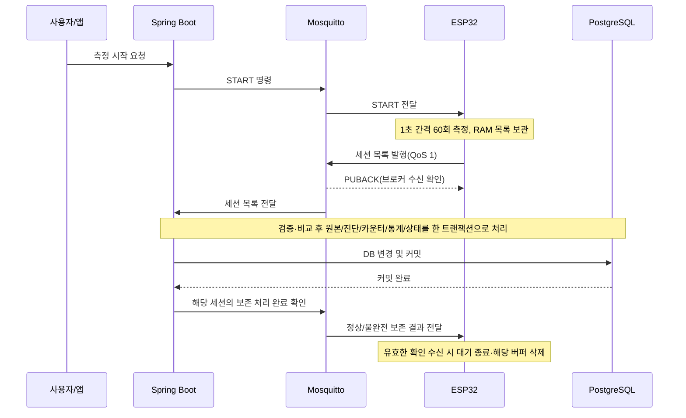

# Home Water Monitor — 백엔드 설계 요약

> 설계 정리 기준: 2026-10-16의 명세와 노트북 후속 대화. **본문은 설계 자료이며 각 항목의 구현 완료를 뜻하지 않는다.** 2026-10-17까지의 실제 구현·확인 범위와 바로 다음 단계는 [최신 인계](HANDOFF.md)를 먼저 읽는다.
>
> 전체 배경: [프로젝트 명세](HOME_WATER_MONITOR_CODEX_SPEC_PAIR_PROGRAMMING.md) · 협업 방식: [AGENTS.md](AGENTS.md)
>
> **합의:** 사용자가 선택한 정책. **정리 초안:** 합의한 동작에 설명용 상태 이름을 붙여 표현한 것. **권고/미정:** 아직 최종 선택하지 않은 부분. 상태 이름·필드 이름을 Java enum·DB 컬럼·최종 MQTT JSON으로 확정한 것은 아니다.

## 1. 지금까지 결정한 시스템 흐름

아침·저녁에 세면대에서 새 물을 용기에 받고 앱으로 측정을 시작한다. 장치는 1초마다 60회 측정해 RAM에 모은 뒤 세션 목록 하나로 전송한다. TDS 추세 관측이 목적이며 수질 안전성·필터 황변 원인을 판정하지 않는다. 실제 채수 수온 절차는 미정이다.

이 그림은 정상 흐름을 설명한다. **PUBACK과 브로커의 서버 전달 사이에 고정 순서를 요구하는 계약이 아니다.** 보존 확인이 예상보다 먼저 도착해도 유효하면 처리해야 한다. MQTT ACK 교환을 모두 그린 그림도 아니다.

## 2. 구분해야 할 말

| 용어 | 의미 |
|---|---|
| 세션 | 새 물을 한 번 채수해 측정하는 단위. 재측정은 새 세션 ID |
| 원본 한 건 | 해당 세션의 특정 seq에 해당하는 측정. 식별은 `sessionId + seq` |
| 전송 시도 | 같은 세션 목록을 전달하고 보존 확인을 기다리는 한 번의 시도 |
| 전송 회차 | 첫 시도 포함 최대 5번의 시도. 이후 수동 요청은 새 회차 |
| PUBACK | 장치→브로커 구간의 QoS 1 확인. DB 커밋 확인이 아님 |
| 보존 처리 완료 확인 | 서버가 DB 커밋 후 보내는 애플리케이션 메시지. 정상/불완전 결과를 구분 |
| 내용 충돌 | 같은 원본 식별자로 비교 대상 내용이 달라진 것. 새로운 측정이 아님 |
| 확인 미수신 | 장치가 서버 보존 여부를 아직 모르는 상태. DB 실패의 확정 증거가 아님 |

## 3. 장치 상태 전이표 — 현재 초안을 정리한 것

범위는 **측정 종료 후 목록 보관부터 보존 확인·버퍼 삭제까지**다. START 명령 전체 검증, 측정 진행, 재연결 구현까지 완성한 표는 아니다.

| 현재 상태 | 입력 사건 | 조건 | 다음 상태 | 버퍼·전송 동작 |
|---|---|---|---|---|
| 전송 준비 | 첫 전송 시작 | 측정 종료, 전송할 목록 있음 | 브로커 확인 대기 | 회차의 시도 1 시작, 목록 유지·발행 |
| 브로커 확인 대기 | 해당 시도의 PUBACK 수신 | 아직 보존 미확인 목록이 남음 | 보존 확인 대기 | **이때부터 최대 30초** 대기. 버퍼 유지 |
| 브로커 확인 대기 | 연결·발행 실패 또는 PUBACK 대기 제한 만료 | 현재 시도 번호가 5 미만 | 백오프 대기 | 이번 시도 소모, 버퍼 유지 |
| 브로커 확인 대기 | 연결·발행 실패 또는 PUBACK 대기 제한 만료 | 현재 시도 번호가 5 | 사용자 재시도 대기 | 이번 시도 소모, 버퍼 유지, 자동 회차 종료 |
| 보존 확인 대기 | 30초 만료 | 시도 번호가 5 미만 | 백오프 대기 | 버퍼 유지, 다음 전송 전 지터 대기 시작 |
| 보존 확인 대기 | 30초 만료 | 시도 번호가 5 | 사용자 재시도 대기 | 버퍼 유지, 자동 전송 회차 종료 |
| 백오프 대기 | 지터 대기시간 만료 | 유효 보존 확인이 없고 다음 시도 가능 | 브로커 확인 대기 | 시도 번호 증가, **동일 세션·동일 목록** 발행 |
| 사용자 재시도 대기 | 유효한 수동 재전송 명령 실행 | 보관 중인 목록이 있음 | 브로커 확인 대기 | 같은 목록으로 새 회차의 시도 1 시작 |
| 브로커 확인/보존 확인/백오프/사용자 재시도 대기 | 유효한 보존 처리 완료 확인 수신 | 보관 중인 세션과 일치하며 정상 또는 불완전 보존 완료 | 측정 시작 가능 대기 | 타이머·대기·재시도 종료, 해당 버퍼 삭제 |
| 미확인 버퍼를 가진 상태 | 새 START 수신 | 기존 미확인 목록이 남음 | 기존 상태 유지 | START 거절, 기존 버퍼 유지 |
| 위 전송 관련 상태 | 장치 재부팅 | RAM 버퍼가 사라짐 | 부팅 후 명령 대기 | 유실 허용. DB 결과를 실패로 단정하지 않음. 자동 재측정하지 않음 |

**버퍼 삭제는 보존 확인을 기다린다는 이유로 실행하지 않는다.** 유효하고 일치하는 보존 완료 확인이 실제 도착해야 한다. 정상/불완전 결과 모두 해당 버퍼 삭제를 허용한다.

이미 확인을 처리해 버퍼가 없어진 뒤 도착한 PUBACK·타임아웃으로 다시 대기하거나 버퍼를 지우면 안 된다. 다른 세션의 확인도 현재 버퍼를 삭제할 근거가 아니다.

### 아직 표의 빈칸으로 남긴 부분

| 사건 | 현재 정리 상태 |
|---|---|
| 연결·발행·PUBACK 대기 제한시간 | 실패 시도를 소모하고 잔여 횟수에 따라 전이하는 정책은 사용자 채택. **대기 제한시간 수치만 미정**, 장치 연동 시 검토하며 첫 백엔드 기능의 착수를 막지 않음 |
| 수동 재전송 명령이 중복되거나 기존 회차 진행 중 도착 | 새 회차를 중복 생성하지 않도록 수락·실행 규칙 검토 필요 |
| 서버가 영구 입력 오류를 알림 | 정상/불완전 보존 완료와 다름. 재전송 중단·버퍼 처리 계약 미정 |

이 빈칸은 이미 정한 5회·30초·Full Jitter·버퍼 유지 정책을 처음부터 다시 설계하라는 뜻이 아니다.

## 4. 타이머와 재시도

| 구분 | 정책 | 상태 |
|---|---|---|
| 연결·발행·PUBACK 대기 | 실패/제한 만료도 1회 시도 소모, 잔여 횟수에 따라 백오프/사용자 대기. 별도 유한 대기 제한의 수치만 미정 | 실패 집계 합의, 시간 미정 |
| 애플리케이션 보존 확인 대기 | **PUBACK 수신 후 최대 30초**. 확인이 도착하면 30초를 채우지 않고 즉시 처리 | 최근 사용자 초안 반영 |
| 회차당 시도 | 첫 전송 포함 최대 5회, 재전송은 최대 4회 | 합의 |
| 두 번째 전송 전 | 0~1초 균등 무작위 대기 | 합의 |
| 세 번째 전송 전 | 0~2초 균등 무작위 대기 | 합의 |
| 네 번째 전송 전 | 0~4초 균등 무작위 대기 | 합의 |
| 다섯 번째 전송 전 | 0~8초 균등 무작위 대기 | 합의 |
| 회차 소진 | 버퍼 유지, 사용자 요청 대기. 무제한 자동 회차 반복 없음 | 합의 |
| 늦은 보존 확인 | 백오프·사용자 대기 중에도 유효한 일치 확인이면 종료·삭제 | 합의 |

PUBACK 이전 구간을 제한하지 않은 채 PUBACK 이후 타이머만 두면 회차 종료를 보장할 수 없다. 전체 회차 시간의 상한은 아직 확정할 수 없다. MQTT 라이브러리 내부 재전달과 애플리케이션의 5회 전송 시도를 어떻게 대응시킬지도 구현 시 검증해야 한다.

## 5. 서버 처리 결과와 원자성

서버 보존 결과와 장치의 현재 상태를 하나의 상태값으로 합치지 않는다. 아래 명칭은 의미 설명이며 최종 enum이 아니다.

| 상황 | 서버 처리 | 장치에 전달할 의미 |
|---|---|---|
| 필요한 유효 고유 원본 60개 보존 | 정상 보존, 전체 보존 원본으로 통계 계산 | 정상 보존 처리 완료 |
| 유효 고유 원본 59개 등 부족 | 유효 원본·불완전 상태·진단 보존. 정상 TDS 대표 통계/추세에서는 제외 | 불완전 보존 처리 완료. 새로 측정하려면 새 세션 |
| 같은 키·같은 내용 | 원본 유지, 동일 내용 재수신 진단 기록 | 기존 정상/불완전 보존 결과 재확인 가능 |
| 같은 키·다른 내용 | 기존 원본 유지, 내용 충돌 진단 기록. 유효 신규 측정은 수락 | 보존 결과와 내용 충돌 정보를 구분. 재수신 값을 모두 저장했다는 의미가 아님 |
| DB 쓰기·커밋 실패 | 이번 목록 처리의 모든 DB 변경 롤백. 이전 커밋 원본은 유지 | 이번 처리의 보존 완료 확인을 보내면 안 됨 |
| 커밋 후 확인 발행 실패·유실 | 이미 보존한 원본·통계 유지 | 장치 재전송에 기존 결과를 재확인할 수 있어야 함 |

이미 60개가 보존된 세션의 충돌 재수신도 진단·대응 카운터를 커밋한 뒤 처리 완료를 알려 버퍼 삭제를 허용한다. 불완전 종료 후 추가/변경 목록의 도착, 잘못된 값·목록 내부 중복 등은 별도 미정이다.

하나의 목록 처리에서 발생하는 **신규 원본 + 재수신/충돌 진단 + 대응 카운터 + 통계 + 세션 상태**를 하나의 DB 트랜잭션으로 처리한다. 진단 저장이 실패해도 이번 변경 전체를 롤백한다. 이 트랜잭션은 측정하는 60초 동안 열어두지 않는다.

확인 발행은 실제 커밋 이후다. `save()` 반환과 커밋 완료를 동일하게 취급하지 않는다. DB 커밋과 MQTT 발행이 자동으로 하나의 원자적 작업이 되는 것도 아니다. 구체적인 커밋 이후 처리 방식은 미정이다.

## 6. 원본 식별·진단·건수

- 원본의 중복 방어는 DB의 **`sessionId + seq` 복합 UNIQUE**다. 측정 시각·PPM은 이 조합에서 제외한다.
- 조회만으로 중복을 검사하고 끝내지 않는다. 동시 수신 시 최종 DB 제약과 통계·카운터·상태 경합 처리까지 검토한다.
- 같은 값이 다른 seq에서 측정되면 다른 원본이다. 같은 키에서 값이 달라지면 내용 충돌이다.
- 동일 내용 재수신은 기록하되 내용 충돌 건수는 올리지 않는다.

| 지표 | 세는 대상 | 주의 |
|---|---|---|
| 고유 측정 건수 | 보존된 서로 다른 원본 | 중복/충돌 수신으로 늘리지 않음 |
| 수신 메시지 건수 | 목록 메시지의 수신 | 원본 측정 수와 다름 |
| 중복 수신 기록 건수 | 진단으로 보관한 재수신 기록 | 메시지별/샘플별 저장 단위는 미정 |
| 내용 충돌 건수 | 같은 식별자의 다른 내용 | 동일 내용 재수신과 구분 |

진단 필드 후보는 세션 ID·seq, 기존/수신 PPM·측정 시각, 서버 탐지 시각, 유형·사유다. 기존 값 참조/스냅샷, 비교 필드·수치 정밀도, 실제 테이블/컬럼은 아직 확정하지 않았다.

## 7. 최소 MQTT 계약 — 흐름은 합의, 상세는 초안

**다음 표는 계약을 정리할 재료다. 새 토픽·이벤트명·필드명·JSON을 확정한 것이 아니다.** 실제 최소 필드와 ID 생성 주체는 이후 좁은 범위에서 검토한다.

| 메시지 역할 | 방향 | 합의된 의미 | 최소 정보 후보/남은 결정 |
|---|---|---|---|
| 측정 시작 명령 | 서버 → 장치 | 새 세션 측정 요청. 미확인 버퍼가 있으면 거절 | 대상 장치, 명령 식별, 세션 식별과 생성 주체, 측정 조건 |
| 보관 데이터 재전송 명령 | 서버 → 장치 | 같은 세션·같은 목록으로 새 전송 회차 요청 | 대상 장치·세션, 명령 식별, 중복/진행 중 명령 처리 |
| 명령 수락·실행 결과 | 장치 → 서버 | 보낸 사실과 실제 수락/실행을 구분하기 위한 결과 | 원래 명령과 연결할 정보, 수락/거절·사유. 별도 이벤트 필요 범위 미정 |
| 세션 결과 목록 | 장치 → 서버 | 측정 종료 후 원본 목록 일괄 전달 | 장치·세션, 스키마, 기대 샘플 수·측정 간격·교정/가정 온도, seq·측정값·전압·시각 등 |
| 보존 처리 완료 확인 | 서버 → 장치 | DB 커밋 후 보존 결과 전달. 일치하는 버퍼 삭제 허용 | 장치·세션, 정상/불완전 결과, 충돌 유무 등 진단 요약 후보. 정확한 유효성·상관관계 검증 미정 |
| 장치 상태 보고 | 장치 → 서버 | 앱이 장치의 전송·확인·버퍼 상태를 관측 | 장치·세션, 상태·회차/시도·버퍼 보유·보고 시각/순서 정보 후보. 저장·보고 방식 미정 |

기존 토픽 후보는 `home/water/v1/esp32-water-01/events`와 `home/water/v1/esp32-water-01/commands`다. 보존 확인·상태 보고를 어디에 배치할지와 MQTT 버전은 미정이다. 기존 QoS 1·retain=false 방향을 유지하되 장치 라이브러리 지원·브로커 설정은 미검증이다.

서버가 확인을 발행했다는 사실만으로 장치가 수신·삭제했다고 표시하지 않는다. 상태 보고가 끊기면 **마지막 관측 상태·시각**과 **현재 미확인**을 구분한다. 원본의 일괄 전송과 별도 상태 보고는 다른 요구다.

## 8. 책임 분리 초안

| 담당 | 현재 정리된 책임 |
|---|---|
| 입력 어댑터 | MQTT 메시지 형식 해석·기본 검증, 유스케이스로 전달 |
| 애플리케이션 서비스 | 기존 원본 조회, 도메인 판단 요청, 저장·진단·트랜잭션 조율 |
| 도메인 | 같은 측정의 동일/충돌 판단과 보존 규칙 표현 |
| DB 연동 | 원본·진단·지표·상태의 저장, 제약·동시성 처리 |
| MQTT 발행 어댑터 | 커밋 이후 호출되는 보존 확인 등의 MQTT 발행 |

클래스·인터페이스·계층형/헥사고날 구조·DDD Aggregate·최종 ERD를 확정한 것은 아니다.

## 9. 리뷰·검증할 대표 사례

아래는 합의된 정책을 확인하기 위해 정리한 **검수 초안**이다. 사용자 작성 테스트 코드나 실제 통과 결과가 아니다.

| 사례 | 확인할 결과 |
|---|---|
| 정상 목록 커밋 후 유효 보존 확인 | 원본 60개, 통계 정확성, 장치 해당 버퍼 삭제 |
| 같은 목록 재전송 | 원본·통계 불변, 진단 기록과 결과 재확인 |
| 같은 키의 다른 PPM | 원본 유지, 내용 충돌 진단. 정상 재수신으로 덮어쓰지 않음 |
| 원본 59개인 불완전 최종 목록 | 불완전 결과 보존, 정상 추세 제외, 커밋 후 확인·삭제 |
| 진단 기록 또는 커밋 실패 | 이번 목록 처리 전체 롤백, 성공 확인 없음 |
| 커밋 후 확인 유실 | 서버 결과 유지, 장치 버퍼 유지·재전송·재확인 |
| 5번째 시도도 확인 미수신 | 사용자 재시도 대기, 버퍼 유지, 새 START 거절 |
| 백오프·사용자 대기 중 늦은 유효 확인 | 회차/대기 종료, 해당 버퍼 삭제 |
| 다른 세션의 확인 또는 완료 뒤 늦은 타임아웃 | 현재 버퍼/완료 처리를 잘못 변경하지 않음 |
| 장치 재부팅 | RAM 유실 허용, 서버 저장 여부를 임의로 단정하지 않음 |

## 10. 여기서 다음으로 할 일

상태표를 사용자에게 같은 형식으로 반복 작성하도록 요구하지 않는다. 현재 초안으로 시작하고 필요한 선택만 확인한다.

1. 연결·발행·PUBACK 대기 실패도 시도를 소모하는 것으로 사용자 합의. 남은 대기 제한시간 수치는 장치 연동 시 정하며 백엔드 학습을 지연시키지 않는다.
2. 사용자는 메시지 필드를 혼자 정하기 어렵다고 설명했다. AI가 업무 목적에 필요한 정보와 진단 후보를 이유와 함께 제시하고 사용자가 검토한다. 모든 모니터링/명령 예외를 먼저 완성하지 않는다.
3. 사용자 요청에 따라 가상 목록 하나를 사용하는 첫 백엔드 기능의 범위·DB 초안·테스트 기대 결과를 구체화한다. 전체 DDD·전체 ERD를 완성하기 위해 첫 구현을 무기한 미루지 않는다.

입력 오류의 세부 처리, 상태 보고 순서 역전, 동시성, 브로커 영속화와 클라이언트 라이브러리 등은 해당 기능의 구현 전 필요한 범위에서 검토한다. 아직 구현·테스트 실행은 승인하거나 수행하지 않았다.

## 11. 첫 백엔드 기능 제안 — 사용자 검토용

**목표:** 가상으로 만든 정상 세션 목록 한 개를 애플리케이션 서비스에 전달하여 검증하고, 원본·세션 통계를 PostgreSQL에 원자적으로 저장한다. 실제 ESP32·브로커·START·화면 없이 서버의 처리부터 연습한다. 2026-10-17 현재 통계 계산·테스트 7개, DB·Flyway V1/V2와 측정 엔티티를 작성했다. 세션 저장 서비스·통합 테스트·MQTT는 아직 구현하지 않았으며 이 범위를 전체 MVP 완료로 표현하지 않는다.

### MQTT 메시지 정보는 누가 만드는가?

MQTT는 메시지를 운반한다. 측정값·전압·기기 상태 같은 업무 정보는 펌웨어가 읽거나 계산해 payload에 넣어야 서버가 받을 수 있다. MQTT 연결만으로 장치의 모든 내부 정보가 자동 제공되는 것은 아니다. 가상 발행자도 같은 계약에 맞춰 데이터를 만든다.

### 첫 세션 결과의 필드 제안

다음은 필요 이유를 설명하기 위한 **계약 초안**이다. 기존 7장의 전체 메시지 후보를 모두 구현하라는 뜻이 아니다.

| 범위 | 필드 후보 | 필요한 이유 |
|---|---|---|
| 메시지 | `schemaVersion`, `eventType` | 형식 버전과 세션 결과 메시지 구분. 실제 타입 이름은 이후 결정 |
| 출처·식별 | `deviceId`, `sessionId` | 장치와 한 번의 측정 세션 식별 |
| 세션 시각 | `startedAt` | 일별 아침/저녁 추세 분류. UTC/오프셋 포함 시각을 사용하고 미동기화 정책은 별도 검토 |
| 측정 계획 | `expectedSamples`, `samplingIntervalMs` | 기대 샘플 수와 누락 판단의 기준 |
| 품질 맥락 | `temperatureAssumedC`, `calibrationVersion` | 실측 수온이 아닌 가정값·미교정 결과임을 보존 |
| 원본 목록 | `measurements` | 세션의 모든 1초 측정값 전달 |
| 원본 식별·상대시간 | 원본별 `seq`, `elapsedMs` | 중복 판정과 세션 내 상대시간 보존 |
| 원본 수치·집계 구분 | 원본별 `tdsPpm`, `isWarmup` | 통계 대상 수치와 초기 안정화 제외 구분 |
| 진단 권장 | 원본별 `rawVoltageMv` | 이상값 원인 분석과 환산 검토 재료. 첫 저장 기능에서 필수로 강제할지는 미정 |

배터리·RSSI·메모리·펌웨어 버전 등은 현재 첫 기능에 필요한 입력이 아니다. 필요가 생기면 장치 상태 보고 쪽에서 검토한다. 실제 수온 센서를 추가하기로 한 것도 아니다. 가상 첫 사례는 유효한 시각과 정상 수치만 사용하되, 이 조건을 모든 실제 입력의 계약으로 확정하지 않는다.

### 보존 확인 정보 제안 — 다음 연결 단계

`deviceId + sessionId`로 대상을 구분하고, 정상/불완전 보존 결과, 보존된 고유 측정 건수, 충돌 관련 결과를 전달하는 방향을 제안한다. 정확한 필드명·토픽·유효성·상관관계 검증은 아직 미정이다. 확인은 실제 커밋 이후 발행해야 한다. 첫 저장 기능에서는 반환 결과를 검증하고, 실제 MQTT 발행은 다음 연결 단계에서 다룬다.

### 첫 DB 초안 — DDL 아님

| 대상 | 첫 기능에서 필요한 정보·규칙 |
|---|---|
| 세션 | 세션 ID, 장치 ID, 측정 시작/수신 시각, 기대·보존·통계 대상 건수, 보존 결과, 가정 온도·교정 버전, 최소/최대/평균/중앙값 |
| 원본 | 소속 세션, seq, 경과시간, TDS, 안정화 여부, 원본 전압 후보. 세션 참조와 `sessionId + seq` UNIQUE |

중복 수신 진단 테이블 요구는 유지한다. 첫 정상 경로에는 진단 기록이 생기지 않으므로 다음 중복/충돌 기능에서 저장 단위·DDL을 구체화한다. 임시 정상 경로의 제약 위반 오류 처리를 최종 멱등성 정책이라고 간주하지 않는다. 두 기본 테이블의 현재 컬럼·제약은 실제 V1/V2 마이그레이션을 기준으로 한다. 동시성·추가 인덱스·전체 상태 모델·입력 검증의 세부 정책은 이어서 검토한다.

### 첫 가상 데이터와 테스트 기대 결과 제안

첫 목록은 서로 다른 `seq=1..60`으로 만든다. 첫 10개는 `isWarmup=true`, TDS `300.0ppm`이고 나머지 50개는 `isWarmup=false`, TDS `151.3ppm`이다. 안정화 구간을 잘못 포함하면 통계가 달라지도록 구성한 **가상 고정 사례**이며 실제 수돗물 측정 결과가 아니다. 필수 메타데이터와 시각은 정상값으로 제공한다. 원본 전압은 첫 사례에서 생략하는 제안이며, 실제 센서 환산식이나 정확성 검증을 대신하지 않는다.

| 첫 기능의 검토 사례 | 제안하는 기대 결과 |
|---|---|
| 정상 목록 한 번 저장 | 세션 1건, 원본 60건, 고유 보존 60개, 통계 대상 50개, 정상 보존 결과 |
| 통계 확인 | 최소·최대·평균·중앙값 모두 151.3ppm. 안정화 10개 제외 |
| 저장 도중 DB 오류 | 이번 세션·원본·통계 변경 전부 롤백, 보존 성공 결과 없음 |
| 커밋 전후 결과 확인 | 저장 함수 호출만으로 커밋을 단정하지 않음. 실제 커밋 후 DB 조회로 확인 |

이 표는 사용자 검토용 기대 결과이며 테스트 코드·실행 결과가 아니다. 정상 60개 수락은 이미 합의한 정책을 구체적인 가상 입력으로 표현한 것이다. 다음 기능에서 동일 재전송·내용 충돌 진단, 59개 불완전 보존, 커밋 후 MQTT 확인을 순차적으로 연결한다. 첫 기능이 끝났다고 전체 MQTT 수집이 완성됐다고 표현하지 않는다.
