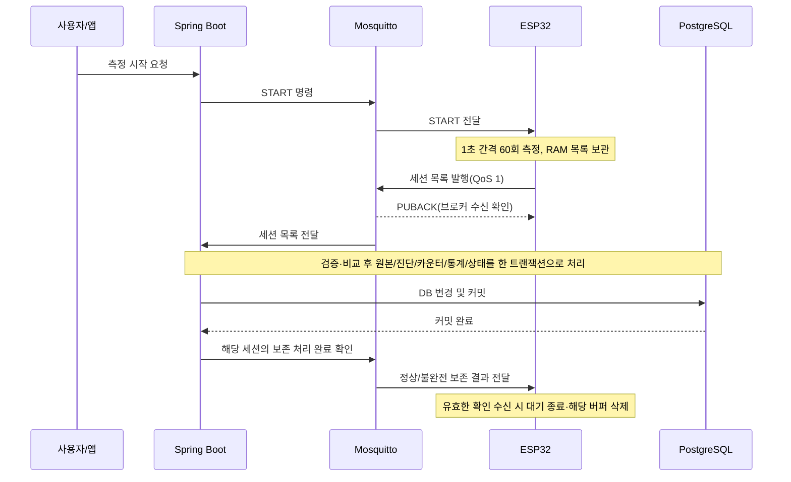

> **운영 전환(2026-10-21):** [루트 AGENTS.md](../AGENTS.md)·[Harness.md](Harness.md)를 따른다. 과거 학습·직접 작성 문구는 이력이며 현재 실행 지시가 아니다. 업무 정책과 미정 계약은 유지한다.

# Home Water Monitor — 백엔드 설계 요약

> 설계 정리 기준: 2026-10-16 이후 합의와 2026-10-20의 원본 비교 정책. **설계와 구현 상태를 구분한다.** 정상 신규 저장과 통합 테스트 3개는 작성·사용자 통과 보고, 비교 도메인은 PR #2로 구현·병합됐다. 2026-10-21 정상 세션 재수신 범위의 최신 합의는 이 문서 13장과 작업 명세를 따른다. 실제 소스·검증 근거·다음 단계는 [최신 인계](HANDOFF.md)를 먼저 읽는다.
>
> 전체 배경: [프로젝트 명세](HOME_WATER_MONITOR_CODEX_SPEC_PAIR_PROGRAMMING.md) · 협업 방식: [AGENTS.md](AGENTS.md)
>
> **합의:** 사용자가 선택한 정책. **정리 초안:** 합의한 동작에 설명용 상태 이름을 붙여 표현한 것. **권고/미정:** 아직 최종 선택하지 않은 부분. 상태 이름·필드 이름을 Java enum·DB 컬럼·최종 MQTT JSON으로 확정한 것은 아니다.

## 1. 지금까지 결정한 시스템 흐름

아침·저녁에 세면대에서 새 물을 용기에 받고 앱으로 측정을 시작한다. 장치는 1초마다 60회 측정해 RAM에 모은 뒤 세션 목록 하나로 전송한다. TDS 추세 관측이 목적이며 수질 안전성·필터 황변 원인을 판정하지 않는다. 실제 채수 수온 절차는 미정이다.

이 그림은 정상 흐름을 설명한다. **PUBACK과 브로커의 서버 전달 사이에 고정 순서를 요구하는 계약이 아니다.** 보존 확인이 예상보다 먼저 도착해도 유효하면 처리해야 한다. MQTT ACK 교환을 모두 그린 그림도 아니다.

## 2. 구분해야 할 말

| 용어 | 의미 |
|---|---|
| 세션 | 새 물을 한 번 채수해 측정하는 단위. 재측정은 새 세션 ID |
| 원본 한 건 | 해당 세션의 특정 seq에 해당하는 측정. 식별은 `sessionId + seq` |
| 전송 시도 | 같은 세션 목록을 전달하고 보존 확인을 기다리는 한 번의 시도 |
| 전송 회차 | 첫 시도 포함 최대 5번의 시도. 이후 수동 요청은 새 회차 |
| PUBACK | 장치→브로커 구간의 QoS 1 확인. DB 커밋 확인이 아님 |
| 보존 처리 완료 확인 | 서버가 DB 커밋 후 보내는 애플리케이션 메시지. 정상/불완전 결과를 구분 |
| 내용 충돌 | 같은 원본 식별자로 비교 대상 내용이 달라진 것. 새로운 측정이 아님 |
| 확인 미수신 | 장치가 서버 보존 여부를 아직 모르는 상태. DB 실패의 확정 증거가 아님 |

## 3. 장치 상태 전이표 — 현재 초안을 정리한 것

범위는 **측정 종료 후 목록 보관부터 보존 확인·버퍼 삭제까지**다. START 명령 전체 검증, 측정 진행, 재연결 구현까지 완성한 표는 아니다.

| 현재 상태 | 입력 사건 | 조건 | 다음 상태 | 버퍼·전송 동작 |
|---|---|---|---|---|
| 전송 준비 | 첫 전송 시작 | 측정 종료, 전송할 목록 있음 | 브로커 확인 대기 | 회차의 시도 1 시작, 목록 유지·발행 |
| 브로커 확인 대기 | 해당 시도의 PUBACK 수신 | 아직 보존 미확인 목록이 남음 | 보존 확인 대기 | **이때부터 최대 30초** 대기. 버퍼 유지 |
| 브로커 확인 대기 | 연결·발행 실패 또는 PUBACK 대기 제한 만료 | 현재 시도 번호가 5 미만 | 백오프 대기 | 이번 시도 소모, 버퍼 유지 |
| 브로커 확인 대기 | 연결·발행 실패 또는 PUBACK 대기 제한 만료 | 현재 시도 번호가 5 | 사용자 재시도 대기 | 이번 시도 소모, 버퍼 유지, 자동 회차 종료 |
| 보존 확인 대기 | 30초 만료 | 시도 번호가 5 미만 | 백오프 대기 | 버퍼 유지, 다음 전송 전 지터 대기 시작 |
| 보존 확인 대기 | 30초 만료 | 시도 번호가 5 | 사용자 재시도 대기 | 버퍼 유지, 자동 전송 회차 종료 |
| 백오프 대기 | 지터 대기시간 만료 | 유효 보존 확인이 없고 다음 시도 가능 | 브로커 확인 대기 | 시도 번호 증가, **동일 세션·동일 목록** 발행 |
| 사용자 재시도 대기 | 유효한 수동 재전송 명령 실행 | 보관 중인 목록이 있음 | 브로커 확인 대기 | 같은 목록으로 새 회차의 시도 1 시작 |
| 브로커 확인/보존 확인/백오프/사용자 재시도 대기 | 유효한 보존 처리 완료 확인 수신 | 보관 중인 세션과 일치하며 정상 또는 불완전 보존 완료 | 측정 시작 가능 대기 | 타이머·대기·재시도 종료, 해당 버퍼 삭제 |
| 미확인 버퍼를 가진 상태 | 새 START 수신 | 기존 미확인 목록이 남음 | 기존 상태 유지 | START 거절, 기존 버퍼 유지 |
| 위 전송 관련 상태 | 장치 재부팅 | RAM 버퍼가 사라짐 | 부팅 후 명령 대기 | 유실 허용. DB 결과를 실패로 단정하지 않음. 자동 재측정하지 않음 |

**버퍼 삭제는 보존 확인을 기다린다는 이유로 실행하지 않는다.** 유효하고 일치하는 보존 완료 확인이 실제 도착해야 한다. 정상/불완전 결과 모두 해당 버퍼 삭제를 허용한다.

이미 확인을 처리해 버퍼가 없어진 뒤 도착한 PUBACK·타임아웃으로 다시 대기하거나 버퍼를 지우면 안 된다. 다른 세션의 확인도 현재 버퍼를 삭제할 근거가 아니다.

### 아직 표의 빈칸으로 남긴 부분

| 사건 | 현재 정리 상태 |
|---|---|
| 연결·발행·PUBACK 대기 제한시간 | 실패 시도를 소모하고 잔여 횟수에 따라 전이하는 정책은 사용자 채택. **대기 제한시간 수치만 미정**, 장치 연동 시 검토하며 첫 백엔드 기능의 착수를 막지 않음 |
| 수동 재전송 명령이 중복되거나 기존 회차 진행 중 도착 | 새 회차를 중복 생성하지 않도록 수락·실행 규칙 검토 필요 |
| 서버가 영구 입력 오류를 알림 | 정상/불완전 보존 완료와 다름. 재전송 중단·버퍼 처리 계약 미정 |

이 빈칸은 이미 정한 5회·30초·Full Jitter·버퍼 유지 정책을 처음부터 다시 설계하라는 뜻이 아니다.

## 4. 타이머와 재시도

| 구분 | 정책 | 상태 |
|---|---|---|
| 연결·발행·PUBACK 대기 | 실패/제한 만료도 1회 시도 소모, 잔여 횟수에 따라 백오프/사용자 대기. 별도 유한 대기 제한의 수치만 미정 | 실패 집계 합의, 시간 미정 |
| 애플리케이션 보존 확인 대기 | **PUBACK 수신 후 최대 30초**. 확인이 도착하면 30초를 채우지 않고 즉시 처리 | 최근 사용자 초안 반영 |
| 회차당 시도 | 첫 전송 포함 최대 5회, 재전송은 최대 4회 | 합의 |
| 두 번째 전송 전 | 0~1초 균등 무작위 대기 | 합의 |
| 세 번째 전송 전 | 0~2초 균등 무작위 대기 | 합의 |
| 네 번째 전송 전 | 0~4초 균등 무작위 대기 | 합의 |
| 다섯 번째 전송 전 | 0~8초 균등 무작위 대기 | 합의 |
| 회차 소진 | 버퍼 유지, 사용자 요청 대기. 무제한 자동 회차 반복 없음 | 합의 |
| 늦은 보존 확인 | 백오프·사용자 대기 중에도 유효한 일치 확인이면 종료·삭제 | 합의 |

PUBACK 이전 구간을 제한하지 않은 채 PUBACK 이후 타이머만 두면 회차 종료를 보장할 수 없다. 전체 회차 시간의 상한은 아직 확정할 수 없다. MQTT 라이브러리 내부 재전달과 애플리케이션의 5회 전송 시도를 어떻게 대응시킬지도 구현 시 검증해야 한다.

## 5. 서버 처리 결과와 원자성

서버 보존 결과와 장치의 현재 상태를 하나의 상태값으로 합치지 않는다. 아래 명칭은 의미 설명이며 최종 enum이 아니다.

| 상황 | 서버 처리 | 장치에 전달할 의미 |
|---|---|---|
| 필요한 유효 고유 원본 60개 보존 | 정상 보존, 전체 보존 원본으로 통계 계산 | 정상 보존 처리 완료 |
| 유효 고유 원본 59개 등 부족 | 유효 원본·불완전 상태·진단 보존. 정상 TDS 대표 통계/추세에서는 제외 | 불완전 보존 처리 완료. 새로 측정하려면 새 세션 |
| 같은 키·같은 내용 | 원본 유지, 동일 내용 재수신 진단 기록 | 기존 정상/불완전 보존 결과 재확인 가능 |
| 같은 키·다른 내용 | 확정 원본 유지, 같은 seq 집합의 내용 충돌 진단 기록 | 보존 결과와 내용 충돌 정보를 구분. 재수신 값을 모두 저장했다는 의미가 아님 |
| DB 쓰기·커밋 실패 | 이번 목록 처리의 모든 DB 변경 롤백. 이전 커밋 원본은 유지 | 이번 처리의 보존 완료 확인을 보내면 안 됨 |
| 커밋 후 확인 발행 실패·유실 | 이미 보존한 원본·통계 유지 | 장치 재전송에 기존 결과를 재확인할 수 있어야 함 |

이미 60개가 보존된 세션의 충돌 재수신도 진단·대응 카운터를 커밋한 뒤 처리 완료를 알려 버퍼 삭제를 허용한다.
불완전 최종 목록의 추가/변경과 잘못된 입력의 보존 규칙은 15장의 승인 범위를 따른다. 실제 MQTT 응답은 후속 계약이다.

하나의 목록 처리에서 발생하는 **신규 원본 + 재수신/충돌 진단 + 대응 카운터 + 통계 + 세션 상태**를 하나의 DB 트랜잭션으로 처리한다. 진단 저장이 실패해도 이번 변경 전체를 롤백한다. 이 트랜잭션은 측정하는 60초 동안 열어두지 않는다.

확인 발행은 실제 커밋 이후다. `save()` 반환과 커밋 완료를 동일하게 취급하지 않는다. DB 커밋과 MQTT 발행이 자동으로 하나의 원자적 작업이 되는 것도 아니다. 구체적인 커밋 이후 처리 방식은 미정이다.

## 6. 원본 식별·진단·건수

- 원본의 중복 방어는 DB의 **`sessionId + seq` 복합 UNIQUE**다. 측정 시각·PPM은 이 조합에서 제외한다.
- 조회만으로 중복을 검사하고 끝내지 않는다. 동시 수신 시 최종 DB 제약과 통계·카운터·상태 경합 처리까지 검토한다.
- 같은 값이 다른 seq에서 측정되면 다른 원본이다. 같은 키에서 값이 달라지면 내용 충돌이다.
- 동일 내용 재수신은 기록하되 내용 충돌 건수는 올리지 않는다.

| 지표 | 세는 대상 | 주의 |
|---|---|---|
| 고유 측정 건수 | 보존된 서로 다른 원본 | 중복/충돌 수신으로 늘리지 않음 |
| 수신 메시지 건수 | 목록 메시지의 수신 | 원본 측정 수와 다름 |
| 중복 수신 기록 건수 | 진단으로 보관한 재수신 기록 | 메시지별/샘플별 저장 단위는 미정 |
| 내용 충돌 건수 | 같은 식별자의 다른 내용 | 동일 내용 재수신과 구분 |

**2026-10-20 사용자 선택:** 같은 `sessionId + seq`의 `tdsPpm`·`elapsedMs`·`isWarmup`·`rawVoltageMv` 네 필드를 모두 비교한다. 수치는 `BigDecimal.compareTo()`로 표현 자릿수를 무시하되 반올림·허용 오차는 추가하지 않는다. 전압은 양쪽 null이면 동일, 한쪽만 null이면 충돌이다.

진단 필드 후보는 세션 ID·seq, 기존/수신 네 필드의 값, 서버 탐지 시각, 유형·사유다. 기존 값 참조/스냅샷, 메시지/샘플 저장 단위, 실제 진단 테이블/컬럼·카운터, 세션 메타데이터 변경 판정은 아직 확정하지 않았다. 현재 저장 서비스는 DB의 소수 둘째 자리·정수부 범위를 검증하지만 물리적 센서 유효 범위까지 확정한 것은 아니다.

## 7. 최소 MQTT 계약 — 결과 목록·보존 확인 v1

2026-10-22 MQTT **5.0** 기준으로 결과 목록과 보존 확인부터 계약을 작성·오프라인 검증했다.
두 메시지의 최신 필드·토픽·검증 규칙은 [MQTT_MESSAGE_CONTRACT.md](MQTT_MESSAGE_CONTRACT.md)를 따른다.
상태는 VERIFIED이며 사용자 최종 리뷰 대기다. 다음 표의 나머지 메시지와 ID 발급/전달 주체는 후속 계약 후보다.

| 메시지 역할 | 방향 | 합의된 의미 | 최소 정보 후보/남은 결정 |
|---|---|---|---|
| 측정 시작 명령 | 서버 → 장치 | 새 세션 측정 요청. 미확인 버퍼가 있으면 거절 | 대상 장치, 명령 식별, 세션 식별과 생성 주체, 측정 조건 |
| 보관 데이터 재전송 명령 | 서버 → 장치 | 같은 세션·같은 목록으로 새 전송 회차 요청 | 대상 장치·세션, 명령 식별, 중복/진행 중 명령 처리 |
| 명령 수락·실행 결과 | 장치 → 서버 | 보낸 사실과 실제 수락/실행을 구분하기 위한 결과 | 원래 명령과 연결할 정보, 수락/거절·사유. 별도 이벤트 필요 범위 미정 |
| 세션 결과 목록 | 장치 → 서버 | 측정 종료 후 원본 목록 일괄 전달 | SESSION_RESULT v1. 필드·검증은 최신 계약 참조 |
| 보존 처리 완료 확인 | 서버 → 장치 | DB 커밋 후 보존 결과 전달. 일치하는 버퍼 삭제 허용 | SESSION_PRESERVED v1. 정상/불완전·비교 건수·버퍼 상관관계는 최신 계약 참조 |
| 장치 상태 보고 | 장치 → 서버 | 앱이 장치의 전송·확인·버퍼 상태를 관측 | 장치·세션, 상태·회차/시도·버퍼 보유·보고 시각/순서 정보 후보. 저장·보고 방식 미정 |

결과는 `home/water/v1/{deviceId}/events`, 보존 확인은 `home/water/v1/{deviceId}/preservation`을 사용한다.
MQTT 5.0·QoS 1·retain=false·UTF-8 JSON·payload 16 KiB 이하이며 Content Type과 Payload Format Indicator도 계약에 포함한다.
`commands`와 상태 보고 토픽은 후보이며 장치 라이브러리 지원·브로커 설정·실제 송수신은 미검증이다.

서버가 확인을 발행했다는 사실만으로 장치가 수신·삭제했다고 표시하지 않는다. 상태 보고가 끊기면 **마지막 관측 상태·시각**과 **현재 미확인**을 구분한다. 원본의 일괄 전송과 별도 상태 보고는 다른 요구다.

## 8. 책임 분리 초안

| 담당 | 현재 정리된 책임 |
|---|---|
| 입력 어댑터 | MQTT 메시지 형식 해석·기본 검증, 유스케이스로 전달 |
| 애플리케이션 서비스 | 기존 원본 조회, 도메인 판단 요청, 저장·진단·트랜잭션 조율 |
| 도메인 | 같은 측정의 동일/충돌 판단과 보존 규칙 표현 |
| DB 연동 | 원본·진단·지표·상태의 저장, 제약·동시성 처리 |
| MQTT 발행 어댑터 | 커밋 이후 호출되는 보존 확인 등의 MQTT 발행 |

클래스·인터페이스·계층형/헥사고날 구조·DDD Aggregate·최종 ERD를 확정한 것은 아니다.

## 9. 리뷰·검증할 대표 사례

아래는 전체 기능을 위한 **검수 목록**이다. 현재 구현 상태는 최신 13~16장 및 HANDOFF를 따른다.
초기 정상 저장 당시의 범위와 이후 구현된 재수신·불완전 보존·MQTT 서버 연동을 구분한다.

| 사례 | 확인할 결과 |
|---|---|
| 정상 목록 커밋 후 유효 보존 확인 | 원본 60개, 통계 정확성, 장치 해당 버퍼 삭제 |
| 같은 목록 재전송 | 원본·통계 불변, 진단 기록과 결과 재확인 |
| 같은 키의 다른 PPM | 원본 유지, 내용 충돌 진단. 정상 재수신으로 덮어쓰지 않음 |
| 원본 59개인 불완전 최종 목록 | 불완전 결과 보존, 정상 추세 제외, 커밋 후 확인·삭제 |
| 진단 기록 또는 커밋 실패 | 이번 목록 처리 전체 롤백, 성공 확인 없음 |
| 커밋 후 확인 유실 | 서버 결과 유지, 장치 버퍼 유지·재전송·재확인 |
| 5번째 시도도 확인 미수신 | 사용자 재시도 대기, 버퍼 유지, 새 START 거절 |
| 백오프·사용자 대기 중 늦은 유효 확인 | 회차/대기 종료, 해당 버퍼 삭제 |
| 다른 세션의 확인 또는 완료 뒤 늦은 타임아웃 | 현재 버퍼/완료 처리를 잘못 변경하지 않음 |
| 장치 재부팅 | RAM 유실 허용, 서버 저장 여부를 임의로 단정하지 않음 |

## 10. 여기서 다음으로 할 일

상태표를 사용자에게 같은 형식으로 반복 작성하도록 요구하지 않는다. 현재 초안으로 시작하고 필요한 선택만 확인한다.

1. 연결·발행·PUBACK 대기 실패도 시도를 소모하는 것으로 사용자 합의. 남은 대기 제한시간 수치는 장치 연동 시 정하며 백엔드 학습을 지연시키지 않는다.
2. 사용자는 메시지 필드를 혼자 정하기 어렵다고 설명했다. AI가 업무 목적에 필요한 정보와 진단 후보를 이유와 함께 제시하고 사용자가 검토한다. 모든 모니터링/명령 예외를 먼저 완성하지 않는다.
3. 첫 정상 저장과 롤백 검증은 완료 보고했다. 다음은 [미작성 비교 도메인과 테스트 코드](NEXT_MEASUREMENT_COMPARISON.md)를 별도 기능 계획 승인 후 AI가 구현·검증하는 것이다. 전체 DDD·전체 ERD 재설계로 다음 구현을 미루지 않는다.

입력 오류의 최종 처리, 상태 보고 순서 역전, 동시성, 브로커 영속화와 클라이언트 라이브러리 등은 해당 기능의 구현 전 필요한 범위에서 검토한다. 이번 인계 요청은 문서·Git 공유이며 추가 소스 구현·테스트 실행을 포함하지 않는다.

## 11. 첫 백엔드 기능 제안 — 사용자 검토용

**목표:** 가상으로 만든 정상 세션 목록 한 개를 애플리케이션 서비스에 전달하여 검증하고, 원본·세션 통계를 PostgreSQL에 원자적으로 저장한다. 실제 ESP32·브로커·START·화면 없이 서버의 처리부터 연습한다. **2026-10-20 상태:** `SaveNormalTdsSessionService`·관련 엔티티와 Repository·저장 어댑터를 작성했고 정상 커밋·저장 중 오류·커밋 오류의 통합 테스트 3개를 사용자가 각각 통과 보고했다. 실제 MQTT·재수신 진단·불완전 보존은 미구현이며 전체 MVP 완료로 표현하지 않는다.

### MQTT 메시지 정보는 누가 만드는가?

MQTT는 메시지를 운반한다. 측정값·전압·기기 상태 같은 업무 정보는 펌웨어가 읽거나 계산해 payload에 넣어야 서버가 받을 수 있다. MQTT 연결만으로 장치의 모든 내부 정보가 자동 제공되는 것은 아니다. 가상 발행자도 같은 계약에 맞춰 데이터를 만든다.

### 첫 세션 결과의 필드 제안

다음은 필요 이유를 설명하기 위한 **계약 초안**이다. 기존 7장의 전체 메시지 후보를 모두 구현하라는 뜻이 아니다.

| 범위 | 필드 후보 | 필요한 이유 |
|---|---|---|
| 메시지 | `schemaVersion`, `eventType` | 형식 버전과 세션 결과 메시지 구분. 실제 타입 이름은 이후 결정 |
| 출처·식별 | `deviceId`, `sessionId` | 장치와 한 번의 측정 세션 식별 |
| 세션 시각 | `startedAt` | 일별 아침/저녁 추세 분류. UTC/오프셋 포함 시각을 사용하고 미동기화 정책은 별도 검토 |
| 측정 계획 | `expectedSamples`, `samplingIntervalMs` | 기대 샘플 수와 누락 판단의 기준 |
| 품질 맥락 | `temperatureAssumedC`, `calibrationVersion` | 실측 수온이 아닌 가정값·미교정 결과임을 보존 |
| 원본 목록 | `measurements` | 세션의 모든 1초 측정값 전달 |
| 원본 식별·상대시간 | 원본별 `seq`, `elapsedMs` | 중복 판정과 세션 내 상대시간 보존 |
| 원본 수치·집계 구분 | 원본별 `tdsPpm`, `isWarmup` | 통계 대상 수치와 초기 안정화 제외 구분 |
| 진단 권장 | 원본별 `rawVoltageMv` | 이상값 원인 분석과 환산 검토 재료. 첫 저장 기능에서 필수로 강제할지는 미정 |

배터리·RSSI·메모리·펌웨어 버전 등은 현재 첫 기능에 필요한 입력이 아니다. 필요가 생기면 장치 상태 보고 쪽에서 검토한다. 실제 수온 센서를 추가하기로 한 것도 아니다. 가상 첫 사례는 유효한 시각과 정상 수치만 사용하되, 이 조건을 모든 실제 입력의 계약으로 확정하지 않는다.

### 보존 확인 정보 제안 — 다음 연결 단계

`deviceId + sessionId`로 대상을 구분하고, 정상/불완전 보존 결과, 보존된 고유 측정 건수, 충돌 관련 결과를 전달하는 방향을 제안한다. 정확한 필드명·토픽·유효성·상관관계 검증은 아직 미정이다. 확인은 실제 커밋 이후 발행해야 한다. 첫 저장 기능에서는 반환 결과를 검증하고, 실제 MQTT 발행은 다음 연결 단계에서 다룬다.

### 첫 DB 초안 — DDL 아님

| 대상 | 첫 기능에서 필요한 정보·규칙 |
|---|---|
| 세션 | 세션 ID, 장치 ID, 측정 시작/수신 시각, 기대·보존·통계 대상 건수, 보존 결과, 가정 온도·교정 버전, 최소/최대/평균/중앙값 |
| 원본 | 소속 세션, seq, 경과시간, TDS, 안정화 여부, 원본 전압 후보. 세션 참조와 `sessionId + seq` UNIQUE |

중복 수신 진단 테이블 요구는 유지한다. 첫 정상 경로에는 진단 기록이 생기지 않으므로 다음 중복/충돌 기능에서 저장 단위·DDL을 구체화한다. 임시 정상 경로의 제약 위반 오류 처리를 최종 멱등성 정책이라고 간주하지 않는다. 두 기본 테이블의 현재 컬럼·제약은 실제 V1/V2 마이그레이션을 기준으로 한다. 동시성·추가 인덱스·전체 상태 모델·입력 검증의 세부 정책은 이어서 검토한다.

### 첫 가상 데이터와 테스트 기대 결과 제안

첫 목록은 서로 다른 `seq=1..60`으로 만든다. 첫 10개는 `isWarmup=true`, TDS `300.0ppm`이고 나머지 50개는 `isWarmup=false`, TDS `151.3ppm`이다. 안정화 구간을 잘못 포함하면 통계가 달라지도록 구성한 **가상 고정 사례**이며 실제 수돗물 측정 결과가 아니다. 필수 메타데이터와 시각은 정상값으로 제공한다. 원본 전압은 첫 사례에서 생략하는 제안이며, 실제 센서 환산식이나 정확성 검증을 대신하지 않는다.

| 첫 기능의 검토 사례 | 제안하는 기대 결과 |
|---|---|
| 정상 목록 한 번 저장 | 세션 1건, 원본 60건, 고유 보존 60개, 통계 대상 50개, 정상 보존 결과 |
| 통계 확인 | 최소·최대·평균·중앙값 모두 151.3ppm. 안정화 10개 제외 |
| 저장 도중 DB 오류 | 이번 세션·원본·통계 변경 전부 롤백, 보존 성공 결과 없음 |
| 커밋 전후 결과 확인 | 저장 함수 호출만으로 커밋을 단정하지 않음. 실제 커밋 후 DB 조회로 확인 |

이 표는 최초 검토용으로 작성한 기준이며, 현재 첫 정상 경로와 쓰기/커밋 실패 롤백은 소스·사용자 통과 보고로 확인했다. 커밋 실패 테스트는 지연 제약 트리거로 원본 60개가 저장된 뒤 커밋에서 오류가 발생하도록 구성한다. 이후 동일 재전송·내용 충돌 진단, 59개 불완전 보존, 커밋 후 MQTT 확인을 순차적으로 연결한다. 첫 기능이 끝났다고 전체 MQTT 수집이 완성됐다고 표현하지 않는다.

## 12. 다음 구현 — 측정 도메인 비교

현재는 정책 선택과 코드 안내까지만 했고 실제 파일은 아직 없다. 주석 포함 전체 코드는 [다음 작업 문서](NEXT_MEASUREMENT_COMPARISON.md)에 보존했다.

1. `TdsMeasurementComparisonResult`: `IDENTICAL`/`CONFLICT`.
2. `TdsMeasurement`: UUID·seq로 비교 대상을 확인하고 네 원본 필드를 비교하는 순수 Java record.
3. `TdsMeasurementTest`: 수치 표현 자릿수 무시, 전압 null, 네 필드 각각의 변경, 다른 식별자 거절을 확인하는 단위 테스트 6개.

다른 키의 원본은 내용 충돌이 아니라 비교 대상 오류로 다룬다. 신규 여부는 서비스가 기존 원본 조회 결과로 판단한다. 이 비교 구현 뒤 진단 저장 단위·필드·카운터·동시성을 함께 정하고 서비스에 연결한다. 진단 테이블 없이 현재 신규 저장 서비스를 최종 재수신 처리라고 간주하지 않는다.

## 13. 정상 보존 세션 재수신 — 2026-10-21 승인 범위

[작업 명세](tasks/NORMAL_SESSION_REDELIVERY.md)를 사용자 승인받아 구현했다. 검증 상태는 HANDOFF를 따른다.
이 절은 앞선 진단 단위·스냅샷·건수·잠금 미정 항목 중 기존 NORMAL 60개 세션 범위만 구체화한다.

- V3의 tds_session_redelivery는 성공 처리한 재수신 목록 1건을 기록한다.
- tds_measurement_redelivery는 해당 목록의 모든 seq 60개와 기존/수신 네 필드·판정을 기록한다.
- 헤더는 session FK, 상세는 header FK 및 (redelivery_id, seq) PK를 가진다.
- 헤더 CHECK는 동일+충돌=60, 상세 CHECK는 seq 1..60·판정·경과시간을 검사한다.
- 상세/헤더 집계 일치는 서비스와 통합 테스트로 보장하며 DB 간 합계 트리거는 추가하지 않는다.
- 재수신의 누적 목록/동일/충돌 건수는 헤더 COUNT/SUM이다. 원본 수·기기 전송 수와 구분한다.
- ProcessNormalTdsSessionRedeliveryService는 READ_COMMITTED 트랜잭션에서 기존 세션 잠금 후
  메타데이터·원본 집합 검증, 도메인 비교, 헤더·상세 원자 저장을 조율한다.
- 시각은 PostgreSQL/JDBC의 같은 저장 표현으로 비교하고, 다른 메타데이터는 거절한다.
- 같은 세션은 PESSIMISTIC_WRITE로 직렬화하며 트랜잭션 한정 lock_timeout 기본 5000ms다.
- 속성 water-monitor.redelivery.lock-timeout-ms로 대기를 설정하며 timeout은 예외·전체 롤백이다.
- 거절·실패를 성공 진단으로 남기거나 자동 재시도하지 않는다. 기존 원본·통계·과거 진단은 유지한다.
- 새 입력 검증기는 기존 신규 저장과 기본 검증만 공유한다. 신규의 통계 대상 필수 조건은 유지한다.
- 입력 record는 기존 SaveNormalTdsSessionCommand를 재사용하며 공개 MQTT/API 계약을 추가하지 않는다.
- 신규 UUID 헤더·복합키 상세는 persist 경로로 등록하고 진단 저장 어댑터는 MANDATORY를 요구한다.
- 신규 세션의 최초 저장 경합·자동 라우팅·불완전 보존·MQTT 확인 발행은 아직 별도 구현 대상이다.

## 14. 정상 신규/기존 통합 라우팅 — 2026-10-21 승인 범위

[작업 명세](tasks/NORMAL_SESSION_ROUTING.md)의 계획을 승인받아 구현·검증했고 사용자 최종 리뷰를 통과했다 (DONE).
13장과 과거 미구현 기록 중 정상 세션의 자동 라우팅·최초 저장 경합은 이 절로 갱신한다.

- 내부 진입점 ProcessNormalTdsSessionService.process()는 NEVER로 외부 트랜잭션 호출을 거절한다.
- 공통 입력 검증 후 별도 READ_COMMITTED Bean에서 기존 세션을 잠금 조회한다.
- 기존이면 재수신 서비스를 호출하고, 없으면 기존 신규 서비스를 호출한다. 두 경로 모두 기존 검증을 유지한다.
- 미존재 행은 조회 잠금으로 동시 생성이 방지되지 않는다. 기존 세션 PK로 최초 저장 승자를 결정한다.
- SQLSTATE 23505 및 tds_session_pkey가 함께 확인된 경우에만 첫 트랜잭션 종료 후
  새 트랜잭션에서 기존 세션 처리로 1회 전환한다. 복구 실패는 다시 시도하지 않는다.
- 다른 제약·timeout·연결/불명 커밋 실패는 호출자에게 전달한다. 같은 실패 트랜잭션을 재사용하지 않는다.
- 기존 세션의 원본·통계는 유지하며 메타데이터 불일치·INCOMPLETE·기존 원본 불일치는 거절한다.
- 신규 목록은 통계 대상이 필요하다. 모두 안정화인 목록은 기존 세션에서만 비교한다.
  미존재 조회 후 신규 검증 실패를 동시 저장의 증거로 간주하거나 복구하지 않는다.
- 기존 lock_timeout (기본 5000ms)을 라우팅 트랜잭션의 INSERT 대기에도 적용한다.
  잠금별 대기 제한이며 전체 호출 상한은 아니다. DB 전역 설정은 바꾸지 않는다.
- 실제 커밋까지 성공한 통합 호출만 정상 반환한다. 새 내부 결과는 SAVED_NEW/PROCESSED_REDELIVERY와
  재수신 시 기존 비교 결과를 구분한다. 새 API/MQTT 응답 계약을 확정한 것은 아니다.
- 기존 직접 저장/재수신 서비스와 MANDATORY persist 경로·V1/V2/V3·의존성을 유지했다.
- 최종 로컬 Full 66개 (실패/오류/건너뜀 0). 이번 변경의 원격 CI는 NOT RUN이다.
- 불완전 보존·실패 사건 영속화·실제 MQTT 수신/커밋 후 확인 발행은 후속 작업이다.

## 15. 불완전 세션 보존 — 승인된 구현 범위

[작업 명세](tasks/INCOMPLETE_SESSION_PRESERVATION.md)의 전체 계획을 승인받아 구현했고,
2026-10-22 사용자 최종 리뷰를 통과했다 (DONE).
검증 상태와 실행 증거는 HANDOFF 및 작업 명세를 따른다. 이전 절의 불완전 보존 미정/미구현 기록 중
아래 범위를 갱신하며 실제 MQTT 수신/확인 발행은 포함하지 않는다.

- 신규 최종 목록의 유효 고유 원본 0~59개를 INCOMPLETE로 확정한다. 빈 최종 목록도 입력된 세션만 보존한다.
- 원본·보존 건수·누락 seq 진단을 한 트랜잭션으로 저장한다. 누락값 생성·보간·다른 세션으로 채우기 없음.
- stats_sample_count=0, 최소/최대/평균/중앙값 NULL. 상세 참고 통계와 추세 조회 API는 추가하지 않는다.
- 최초 원본/상태/누락 진단은 고정한다. 재측정은 새 세션 ID를 사용하며 NORMAL로 승격하지 않는다.
- 재수신은 같은 seq 집합만 허용한다. 네 필드 비교·BigDecimal.compareTo·전압 null 정책을 유지한다.
- seq 추가/삭제/같은 개수의 순번 교체·메타데이터 변경은 전체 거절한다. 내용만 바뀌면 충돌 진단을 저장한다.
- 잘못된 값·중복/범위 밖 seq·61개 이상은 전체 거절하며 일부 값을 버려 불완전으로 저장하지 않는다.
- 60개는 기존 NORMAL 경로와 통계 대상 필수 조건을 유지한다. 안정화 원본도 모두 보존한다.
- 새 ProcessTdsSessionService는 NEVER로 외부 트랜잭션을 거절한다. 별도 READ_COMMITTED Bean에서
  세션 잠금 후 NORMAL/INCOMPLETE에 맞는 기존/신규 서비스를 호출한다. 기존 정상 전용 진입점도 유지한다.
- 최초 저장 경합은 세션 PK만 첫 트랜잭션 종료 후 1회 복구한다. 정상/불완전 경합의 최초 커밋 결과를 유지한다.
- 잠금 timeout·다른 제약·쓰기/실제 커밋 실패는 예외/롤백이며 이전 원본·누락/재수신 진단은 유지한다.
- V4는 tds_session_missing_sample (session_id, seq) PK/FK/1..60 CHECK와 재수신 헤더 0~60 제약을 추가한다.
  기존 V1/V2/V3는 수정하지 않는다. 빈 재수신도 헤더 한 건이며 상세/동일/충돌은 0개다.
- DB 원본 집합·보존 건수·통계 제외·누락 집합이 불일치하면 거절한다. 자동 데이터 복구는 수행하지 않는다.
- 진단 헤더 COUNT/SUM의 의미는 성공한 재수신 사건이며 최초 저장/실패/거절/전체 전송 시도와 구분한다.
- 기존 application→영속성 직접 사용·MANDATORY/persist·domain·의존성을 유지한다.
- 후속 순서는 MQTT 메시지 계약 → 연동 실패 처리다. 이번 범위에는 MQTT/운영 DB 변경/실패 사건 별도 영속화가 없다.

## 16. MQTT 5.0 서버 연동 — 2026-10-22 승인 범위

이 절은 이전 절의 실제 MQTT 미구현/실패 처리 미정 기록을 아래 범위에서 갱신한다.
상세 정책/설정은 [MQTT_INTEGRATION.md](MQTT_INTEGRATION.md), 인수 조건/실행 결과는
[tasks/MQTT_INTEGRATION.md](tasks/MQTT_INTEGRATION.md)를 따른다.

- Spring Integration 7.1.1/Paho v5 1.2.5로 실제 결과 수신·기존 application 호출·커밋 후 확인 발행을 구현한다.
- session.infrastructure.mqtt의 어댑터는 원본 byte/JSON/토픽/장치/MQTT 속성을 검사하며 DB에 직접 접근하지 않는다.
- 수신/발행 연결을 분리하고 수신은 직렬 처리한다. 기본 비활성, 활성화 시 명시적 URI/고유 ID/허용 장치를 요구한다.
- 실제 커밋 성공 후만 보존 확인을 보낸다. 실패한 수신도 MQTT ACK하되 보존 확인은 보내지 않는다.
  커밋 후 확인 유실은 장치의 같은 목록 재전송과 기존 진단 저장으로 복구한다. DB/MQTT 원자성은 주장하지 않는다.
- 수신 세션 만료 86400초, 연결 10초, 발행 PUBACK 대기 10초와 제한된 자동 재연결을 적용한다.
- 테스트 전용 Mosquitto/PostgreSQL/모의 장치를 사용한다. 운영 브로커/DB·펌웨어·START/명령/상태 보고는 포함하지 않는다.

## 17. MQTT START·상태 보고 — 승인된 구현/인수 진행 중

- 계약·전체 실행 계획과 고정 SDK의 수신 Expiry 직접 검사 예외를 사용자 승인받았다.
  최종 검증 상태는 [실행 명세](tasks/MQTT_CONTROL_IMPLEMENTATION.md)와 HANDOFF를 따른다.
- application.control은 짧은 제어 트랜잭션과 트랜잭션 밖 MQTT 발행/대기를 조율한다. 기존 결과 저장 경로는 유지한다.
- V5의 장치 제어·명령·관측·부팅 이력은 기존 세션/원본과 분리한다. START 예약으로 빈 INCOMPLETE를 만들지 않는다.
- 전역 멱등 키, 장치별 잠금, fresh probe/bootId/일회성10초 창, 자동 업무 명령 재발행0회와 UNKNOWN 조정을 사용한다.
- 새 상태/제어 MQTT 연결과 유한 실행기/큐를 사용한다. 기존 결과 저장·커밋 후 보존 확인과 장애 자원을 분리한다.
- 명령 수락·서버 보존·장치 버퍼 해제·신선도를 각각 표시하고 실제 DB 대조 후만 장치 슬롯을 해제한다.
- 펌웨어는 단일 task에서 실행/상태를 소유한다. MQTT/UART 실행 모드는 상호 배제하고 재부팅 RAM 유실 합의를 유지한다.
- 고정 ESP-MQTT는 수신 Expiry를 공개하지 않는다. SDK를 수정하지 않고 서버10초/브로커 만료와 장치 boot/window를 유지한다.
