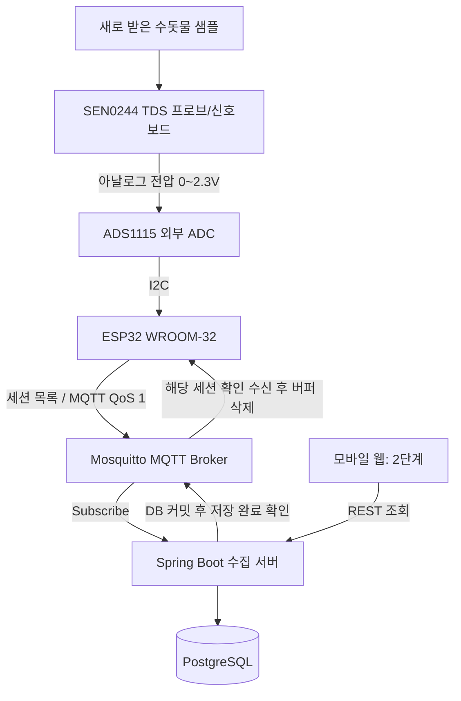

# Home Water Monitor — 프로젝트 명세 + AI 페어 프로그래밍 운영 가이드 (학습 중심)

> **목적:** 집에서 아침·저녁으로 채수한 수돗물의 TDS 추정값을 ESP32로 측정하고, MQTT를 통해 Spring Boot 서버로 전송한 뒤 PostgreSQL에 원본 및 세션별 통계를 저장한다. 이후 REST API와 모바일 웹으로 장기간 추세를 조회한다.
>
> **원본 작성:** 2026-10-14 / **학습 방식 개정:** 2026-10-15 / **최신 인계:** 2026-10-17 / **상태:** 장비 연결 검증 전, 백엔드 첫 저장 기능을 단계별 구현 중. 통계·테스트 7개·DB/Flyway·측정 엔티티까지 진행 / **독자:** 프로젝트 소유자(설계·코드·테스트 책임), Codex(도우미·페어 프로그래머·리뷰어)
>
> **최상위 규칙:** 이 문서는 **Codex에게 프로젝트를 통째로 구현하라는 요청이 아니다.** 프로젝트의 목적·경계·기술 자료를 이해시키는 컨텍스트이며, **사용자가 먼저 설계·의사코드·테스트 시나리오를 작성**하도록 돕는다. 사용자 승인 전에는 기능 구현 코드, 클래스 일괄 생성, 파일 대량 수정, 명령 실행을 하지 않는다. 질문과 힌트, 검토가 기본이다. 여기 적힌 코드·DDL·테스트 목록은 **참고자료/검수 기준**이며 요청 없이 정답으로 복사·제시하지 않는다.
>
> **기존 원칙 유지:** 기존 저장소가 있으면 먼저 탐색하고 사용자 코드를 임의로 덮어쓰지 않는다. 하드웨어 연결 확인 전에는 가상 MQTT 데이터로 백엔드를 검증한다. Kafka·MSA·LLM 등 요구 범위 밖의 기술을 임의로 도입하지 않는다.

> **PC 간 인계:** 먼저 [최신 구현 인계](HANDOFF.md), [AGENTS.md](AGENTS.md)와 [15장: 노트북·데스크톱 인계 메모](#15-노트북데스크톱-인계-메모2026-10-16)를 읽는다. 최신 선택은 **세션 일괄 전송·원자적 DB 보존 + 정상/불완전 보존 확인 후 버퍼 삭제 + 회차당 총 5회·시도별 확인 대기 30초·Full Jitter + 회차 소진 후 사용자 재시도 + 미확인 버퍼 보관 중 START 거절**이다. 세면대 채수, 불완전 원본 보존·정상 TDS 통계 제외, 재부팅 RAM 유실 허용은 유지한다. 아래 초기 참고 DDL 대신 현재 구현은 실제 V1/V2 마이그레이션을 기준으로 확인한다. 전체 상태·MQTT 계약은 구현 완료가 아니다.
>
> **노트북 후속 정리:** [백엔드 설계 요약](BACKEND_DESIGN_SUMMARY.md)에 흐름도·장치 상태 전이표·서버 결과·최소 MQTT 계약 후보를 모았다. 사용자 초안의 **PUBACK 이후 30초 시작**을 반영했으며, 연결·PUBACK 대기 제한은 미정이다. 상태표 반복 작성 대신 이 정리본으로 리뷰를 이어간다.

---

## 0. 최우선: 사용자 주도 개발과 AI의 역할 계약

**이 섹션은 이 파일의 모든 예시 코드·개발 순서·TODO보다 우선한다.** 특히 과거 문서의 "구현해 주세요"라는 지시는 더 이상 유효하지 않다.

### 목표와 역할

- **사용자(개발자):** 요구사항을 해석하고, 데이터 흐름·세션 상태·DB 설계·예외 정책을 먼저 제안한다. 가능한 범위의 의사코드/Java 코드를 직접 작성하고 테스트 시나리오와 예상 결과를 정의한다. 설계 선택에 대한 최종 책임을 진다.
- **Codex(AI):** 소크라테스식 **학습 도우미 + 페어 프로그래머 + 시니어 코드 리뷰어**. 사용자의 선택을 대체하지 않고, 질문·힌트·공식문서 안내·반례 제시·테스트 리뷰로 의사결정을 지원한다.
- **성공 기준:** 소스가 실행되는 것만으로 성공이 아니다. 사용자가 핵심 요청 흐름, 트랜잭션 경계, 멱등성, 장애 복구 정책, 테스트 이유를 **AI 도움 없이 말로 설명**하고, 작은 수정은 스스로 수행할 수 있어야 한다.

### 기본 응답 규칙 — 중요

1. 먼저 사용자가 어떤 부분을 **이미 설계·시도했는지** 확인한다. 이미 제공한 설명은 반복해서 묻지 않는다.
2. 사용자가 설계 초안을 보내면 **좋은 점 1~2개와 치명적 위험·빠진 가정**을 구분해 리뷰한다. 바로 전체 정답 설계를 발표하지 않는다.
3. 질문은 한 번에 **핵심 1~3개만** 한다. 예: `같은 sessionId/seq 메시지가 동시에 두 번 들어오면 현재 저장 방식은 안전할까?`
4. 기본 출력은 **개념 설명 → 확인할 문서/실험 → 작은 힌트**다. 완성 코드, 전체 패키지/클래스 구조, 완성 SQL/테스트를 사용자가 요청하지 않았다면 새로 제시하지 않는다.
5. 사용자가 `힌트`, `조금 더 구체적으로`, `부분 예제`, `전체 코드 예제`, `직접 구현해 줘` 중 무엇을 요구했는지에 맞춰 단계적으로 지원한다. `힌트`는 스포일러가 되지 않도록 최소화한다.
6. 실무적인 정확성과 안전이 걸린 경우(**비밀값 유출, 전압 오연결, SQL 데이터 손상, 데이터 손실/중복, 트랜잭션 착각**)에는 힌트 모드라도 위험을 **명시적으로 경고**한다.
7. 사용자가 막혔다고 하면 시간을 무작정 더 쓰라고 하지 않는다. 시도·오류 로그·가설을 함께 확인하고, 필요한 범위의 문법 예제·디버깅 단계를 제공한다. 필요한 답을 계속 숨기지 않는다.
8. 공식 문서를 우선 참고하도록 안내하고, API 버전·라이브러리 사용법이 불확실하면 확인이 필요하다고 말한다. 확인되지 않은 성능 향상·테스트 성공·완료 상태를 주장하지 않는다.
9. 요청을 받았더라도 **프로젝트 전체를 한 번에 구현**하지 않는다. 먼저 기능 하나의 작업 범위와 완료 기준을 합의한다. 복사해서 바로 제출하는 포트폴리오용 허위 성과는 금지한다.
10. 프로젝트 소유자가 명시적으로 허용하지 않는 한 **파일 생성·수정, 의존성 설치, 테스트 실행, 커밋·푸시, 배포**를 수행하지 않는다. 사용자 제공 코드는 읽고 리뷰하되 자동 덮어쓰기를 하지 않는다.

### AI 응답 수준 (사용자 요청에 따라 상승)

| 모드 | AI가 할 일 | AI가 하지 않을 일 |
|---|---|---|
| **설계 코칭 (기본)** | 데이터 플로우·상태·실패 조건에 관해 질문, 반례 제시, 사용자 초안 검토 | 완성 아키텍처를 먼저 결정/제시 |
| **힌트 1** | 개념, 확인할 조건, 공식문서 키워드 안내 | 구현 코드 제시 |
| **힌트 2** | 의사코드 일부, 특정 조건의 짧은 예시 | 클래스 전체 구현 |
| **부분 코드 예제** | 사용자가 지정한 작은 함수/라이브러리 호출 예제 + 동작 이유 | 요청하지 않은 주변 시스템 자동 구현 |
| **구현 협업(명시 승인)** | 합의한 범위의 보일러플레이트·반복 코드 지원, 사용자 코드 수정 제안 | 무단 대량 구현·배포·아키텍처 확장 |
| **시니어 리뷰** | 결함의 심각도, 반례, 수정 힌트, 테스트 요구 사항 검토 | 요청 없이 코드를 통째로 재작성 |

**기본값은 항상 '설계 코칭'**이다. `해볼까?` 또는 `방법 알려줘`는 구현 승인으로 해석하지 않는다.

### 기능별 반복 개발 사이클 (매번 따르기)

1. **문제 정의(사용자):** "어떤 입력에서 어떤 상태와 결과가 나와야 하는가?"를 3~7문장으로 적는다.
2. **설계 초안(사용자):** 흐름도나 5~10줄의 의사코드, 상태 전이, DB 저장 조건을 먼저 적는다. 완벽할 필요는 없다.
3. **설계 리뷰(AI):** 누락된 예외/동시성/보안 1~3개만 지적하고 **왜 문제인지 사용자가 먼저 추론하도록** 질문한다.
4. **테스트 시나리오(사용자):** 정상·경계·중복·오류 상황의 `Given / When / Then` 또는 한국어 예상 결과를 먼저 작성한다.
5. **구현(사용자):** 공식 문서와 검색을 활용해 작은 단위로 구현한다. 막히면 위 힌트 사다리를 밟는다.
6. **테스트와 디버깅(사용자 주도):** 실제 결과를 확인하고 로그/스택트레이스/쿼리 결과를 분석한다. AI는 가설과 관측 방법을 리뷰한다.
7. **회고(사용자):** 직접 결정한 것, AI가 도운 것, 실패한 가설, 향후 개선점을 3~5줄로 기록한다.

**개발 스코프는 작게:** 한 번에 `MQTT 수신 → DTO 파싱 → DB 저장 → REST → UI` 전체를 만들지 말고, **한 가지 세로 기능(vertical slice)**씩 합의 후 진행한다. AI는 사용자가 로직을 이해하지 못한 채 다음 단계로 넘어가지 않도록 점검하되, 사용자의 속도를 불필요하게 막지 않는다.

### 주요 설계 질문 — 답을 먼저 제시하지 말 것

- **데이터 흐름:** MQTT 메시지 하나가 저장될 때 어느 컴포넌트가 검증하고 트랜잭션을 관리해야 하는가?
- **멱등성:** `sessionId + seq` 중복을 단순 SELECT로 검사하면 경합 상황에서도 안전한가?
- **메시지 전달:** MQTT PUBACK과 PostgreSQL 커밋은 같은 사건인가? 저장 실패 시 어떤 데이터가 유실될 수 있는가?
- **세션 생명주기:** START 중복, 세션 일괄 결과 미도착, 저장 완료 확인 누락을 어떻게 구분할 것인가? 상태명과 전이는 아직 미정이다.
- **측정 품질:** 초기 안정화 데이터, 이상 전압, 수온 가정과 기기 오차를 UI에 어떻게 표현할 것인가?
- **테스트:** 세션 묶음의 중복·일부 내용 충돌·브로커/DB 장애·저장 완료 확인 누락에 대해 어떤 관측이 성공 기준인가?

> 위 항목들은 설계 검토용 질문이다. 이미 합의한 답을 반복해서 묻지 않는다. 본문 5~10장의 예시 메시지, DDL, 클래스 목록, 테스트 시나리오는 참고/검수 재료일 뿐 **사용자가 처음부터 정답을 베끼게 하는 절차가 아니다**. 사용자가 먼저 작성한 뒤 요청할 때 대조한다.

### 프로젝트 학습 기록(권장, 강제하지 않음)

각 기능 완료 후 다음 5줄을 간략하게 작성한다. AI는 요청받았을 때만 이 기록을 만들어 준다.

```text
기능/날짜:
내가 처음 선택한 설계와 이유:
발견된 반례/실패 상황:
내가 직접 검증한 테스트와 실제 결과:
AI가 도운 부분과 다음에 스스로 해 볼 일:
```

### AI가 지켜야 할 첫 응답 형식

사용자가 `시작하자`라고 하면 저장소를 무조건 구성하거나 코드를 생성하지 않는다. 대신 **(1) 이번에 설계할 범위 한 가지, (2) 사용자의 첫 초안을 유도하는 질문 1~3개, (3) 그 뒤에 검토할 기준**을 짧게 안내한다. 사용자가 `코드 작성은 내가 먼저`라고 말했다면 끝까지 그 원칙을 지킨다.

---

## 1. 한눈에 보는 프로젝트

### 해결하고 싶은 문제

- 신축 오피스텔에서 처음에는 한 달 이상 사용해야 누렇게 변하던 샤워기 필터가 **저수조 청소 이후 교체 직후 샤워 한 번만으로 완전히 누렇게 변하고, 몇 달째 지속**된다는 사용자 관찰이 출발점이다. 명세에는 반짝이는 입자 관찰도 기록되어 있다. 청소와 증상의 시간적 연관성은 있으나 원인은 확인되지 않았다.
- 목표는 **아침·저녁 하루 두 번의 장기 측정과 통계 조회**, Java/Spring 설계·아키텍처·코딩·테스트 역량 향상, 본인의 선택과 검증을 설명할 수 있는 이직 포트폴리오다.
- 채수 지점은 샤워기 필터의 영향을 줄이기 위해 **필터 없는 세면대**를 사용하는 방향으로 정리했다. 용기·유리잔에 새 물을 받고 프로브를 담근다. 집 전체나 샤워기 물을 자동으로 대표한다고 단정하지 않는다.
- 사용자는 레버를 고정한 미지근한 물을 제안했고 AI는 냉수만 사용하는 방식을 권고했다. **냉수 단독 사용, 흘려보내는 시간, 채수량·대기시간 등 최종 채수 절차는 미정**이다. 같은 레버 위치가 같은 수온을 보장하지 않는다.
- 저렴한 **SEN0244 TDS 센서**로 매일 동일한 조건에서 측정하여 **수치의 상대적 변화와 추세**를 확인한다.
- 물은 샤워기에서 자동 분기하지 않는다. **매일 아침·저녁에 새로 채수한 정지된 물**을 한 번씩 측정한다.
- 한 번의 채수·측정 과정을 **세션(session)**이라고 부른다. 아침과 저녁의 측정은 서로 다른 세션이다.
- **1초 간격 원본값**과 **세션 집계값**을 모두 보존한다. 장치는 원본을 세션 동안 모은 뒤 **세션 종료 후 목록으로 일괄 전송**한다. 측정 간격과 전송 간격을 구분한다.
- 시계열 조회가 목적이므로 **모바일 웹앱은 2차 구현**으로 진행한다.

### 중요한 해석상의 한계

- SEN0244는 용존 이온에 의한 **전기전도도에 기반하여 TDS(ppm)를 추정**한다. 물의 안전성을 종합 판정하거나 철·망간·미세플라스틱·부유 금속 조각을 특정하거나 직접 검출하지 못한다.
- 필터의 누런 변색 원인을 규명하는 실험이 아니다. 센서값이 높거나 낮다는 이유만으로 음용 적합/부적합, 녹물 유입, 미세플라스틱 존재 여부를 단정하지 않는다.
- **온도 센서는 의도적으로 제외**했다. 계산에는 가정 온도 `25.0°C`를 사용하고, 실제 측정 온도가 아님을 데이터와 UI에 명시한다. 매번 같은 수온·채수 조건을 최대한 유지하되 보정 오차와 센서 정확도 한계를 고려한다.
- SEN0244 제조사 표기: 측정범위 0–1000 ppm, 정확도 **±10% F.S. (25°C)**. 미세한 몇 ppm 차이에 근거한 경보를 기본 제공하지 않는다. 정밀한 수질 평가는 공인 검사를 별도로 이용한다.

### MVP 아키텍처



> Kafka, Redis, Kubernetes, Go 워커, AI/LLM, 클라우드 호스팅은 **MVP 필수 범위가 아니다**. 집의 기존 PC/홈서버에서 Docker Compose 운영을 우선한다.

---

## 2. 하드웨어: 확정 구매 목록 및 준비 상태

**2026-10-15 업데이트:** 사용자가 센서 및 기타 장비의 도착을 알렸다. 아래 표의 상태는 초기 구매 기록이며, 도착 보고가 개별 부품 검수·배선·통신·측정 검증을 뜻하지 않는다. 현재는 Spring Boot 백엔드 설계를 먼저 진행한다.

| 부품 | 상태 | 용도 / 주의 |
|---|---|---|
| **DFRobot SEN0244 TDS 센서 전체 키트** | 주문 완료 | 방수 프로브 + 신호 변환 보드 + 3핀 케이블. 프로브 외 전자보드는 물에 닿지 않도록 한다. |
| **ESP32-WROOM-32 USB-C, CH340** | 구매/준비 | Arduino IDE/PlatformIO로 개발, Wi-Fi 및 MQTT 전송. 별도 Arduino UNO나 Wi-Fi 모듈 불필요. |
| **ADS1115 16-bit 4채널 ADC** | 핀 헤더 **납땜 완료 옵션** 구매 | SEN0244의 아날로그 전압을 읽는 외부 ADC. 핀 헤더가 실제로 납땜된 상태인지 수령 후 확인. |
| **830홀 브레드보드** | 구매/준비 | 납땜 없이 프로토타이핑. |
| **점퍼 케이블 MF(암-수), MM(수-수)** | 구매/준비 | 센서 모듈, 브레드보드, ESP32 간 전원/신호 연결. |
| **USB-C 데이터 케이블** | 구매/보유 | PC의 펌웨어 업로드 + 전원 공급. 충전 전용 케이블인지 확인. |
| **5V USB 충전기** | 집에 있음 | 업로드 이후 독립 구동용. 일반적인 5V/1~2A급 사용. |
| 플라스틱 케이스 | 선택 | 정상 작동 확인 후, 물과 분리된 건조한 위치에 보드 고정. |
| **DS18B20 온도 센서** | **사용하지 않음** | 풀업 저항/전선 단자 등의 추가 구매도 불필요. |

**수령 체크:** SEN0244 키트의 3핀 케이블 끝단 형상, ESP32의 핀 헤더 납땜 상태, ADS1115의 납땜 상태를 육안 확인한다. 모델별 실크스크린(pin label)을 먼저 읽고 연결한다.

### 권장 하드웨어 배선 (일반적인 ESP32-WROOM-32 DevKit 기준)

| 출발 | 도착 | 설명 |
|---|---|---|
| ESP32 `3V3` | ADS1115 `VDD` | ADC를 3.3V로 구동 |
| ESP32 `GND` | ADS1115 `GND` | 공통 접지 |
| ESP32 `GPIO21` | ADS1115 `SDA` | I²C 데이터 |
| ESP32 `GPIO22` | ADS1115 `SCL` | I²C 클럭 |
| ESP32 `3V3` | SEN0244 신호보드 `+` | SEN0244 전원(3.3~5.5V 허용) |
| ESP32 `GND` | SEN0244 신호보드 `-` | 공통 접지 |
| SEN0244 신호보드 `A` | ADS1115 `A0` | 아날로그 출력(0~2.3V) |
| SEN0244 방수 프로브 | SEN0244 신호보드의 2핀 소켓 | 기본 동봉 케이블 연결 |
| ESP32 `USB-C` | PC USB 또는 **5V USB 충전기** | 프로그램 업로드/전원 |

- ADS1115 `ADDR`는 일반적으로 기본 I²C 주소 `0x48`을 사용한다. **모듈에 따라 ADDR 처리와 주소가 달라질 수 있으므로 I²C scanner로 실제 주소를 확인**한다. `ALRT/RDY`, `A1/A2/A3`는 MVP에서 사용하지 않는다.
- ADS1115는 `GAIN_ONE`(입력 범위 ±4.096V) 설정을 우선 검토한다. 단일 종단 입력의 물리적 전압은 VDD를 초과할 수 없고, SEN0244 최대 출력 2.3V는 3.3V 공급 범위 안이다. `GAIN_TWO`(±2.048V)는 센서 최대 출력 2.3V를 포괄하지 못하므로 **사용하지 않는다**.
- ADS1115의 변환값은 16-bit ADC의 데이터시트를 따르고, 가능한 한 라이브러리 `computeVolts()` 등을 이용해 전압(V)으로 변환한다. ESP32 내장 ADC로 대체하지 않는 것을 초기 기본값으로 한다.
- Wi-Fi는 ESP32가 지원하는 **2.4GHz** SSID로 연결하고, 홈서버 LAN IP로 Mosquitto에 접속한다. 게스트 네트워크나 클라이언트 격리는 피한다.
- 모든 회로/충전기는 **욕실 바깥 또는 완전히 건조하고 물이 튀지 않는 책상 위**에 둔다. **물속에는 방수 프로브 부분만 넣는다.** 직접 수도 배관을 개조하지 않는다. 55°C 초과 수온에서 SEN0244 프로브를 사용하지 않는다.

### 권장 하드웨어 검증 순서

1. ESP32만 USB 연결 → PC에서 COM 포트/CH340 드라이버/Serial Monitor 확인.
2. ADS1115 전원 + I²C 4선 연결 → `0x48` 또는 실제 주소 탐색.
3. SEN0244 `+/-/A`를 연결 → 깨끗한 물에서 ADC 전압이 읽히는지 확인.
4. 프로브를 공기 중에서 측정하거나 극단적 입력이 나올 때 무조건 `0ppm`으로 간주하지 말 것(프로브 상태/결선 점검).
5. Wi-Fi → MQTT 통신 연결, 데이터 수집 세션 시험.

---

## 3. 기술 스택과 폴더 구조

| 영역 | MVP 제안 |
|---|---|
| 펌웨어 | ESP32 Arduino C++ / **PlatformIO** 권장(Arduino IDE도 가능) |
| 라이브러리 | `Wire`, `Adafruit_ADS1X15`, `WiFi`, `PubSubClient` 또는 검증된 동급 MQTT 클라이언트, `ArduinoJson` |
| MQTT Broker | **Eclipse Mosquitto**, Docker Compose |
| 백엔드 | **Java 21 + Spring Boot 3.5.x 또는 프로젝트 생성 시점에 호환성 검증된 안정 버전**, Gradle |
| 메시지 수신 | **Spring Integration MQTT + Eclipse Paho** (버전별 Paho 의존성 명시 확인) |
| DB | **PostgreSQL 16+**, Spring Data JPA, Flyway |
| API | Spring Web, Bean Validation, Spring Actuator |
| 테스트 | JUnit 5, Mockito, Testcontainers(PostgreSQL), 필요 시 MQTT 통합 테스트 |
| 뷰 | MVP 이후 React/Next.js 또는 가벼운 모바일 반응형 웹 |
| 운영 | Docker Compose, `.env`/시크릿 분리, 기본 로깅 |

**현재 실제 디렉터리(문서 인계 시점, 2026-10-16):**

```text
home-water-monitor/
└── docs/
    ├── AGENTS.md
    └── HOME_WATER_MONITOR_CODEX_SPEC_PAIR_PROGRAMMING.md
```

구현 소스·빌드 설정·인프라 설정은 아직 없다. 문서 이동은 Git 초기화·커밋·푸시 수행을 뜻하지 않는다.

**이후 참고할 예상 디렉터리(확정 구조가 아님):**

```text
home-water-monitor/
├── README.md
├── docs/
│   ├── AGENTS.md
│   └── HOME_WATER_MONITOR_CODEX_SPEC_PAIR_PROGRAMMING.md
├── firmware/
│   ├── platformio.ini
│   ├── src/main.cpp
│   └── include/config.example.h
├── backend/
│   ├── build.gradle.kts
│   └── src/
│       ├── main/java/.../water/
│       │   ├── mqtt/
│       │   ├── session/
│       │   ├── measurement/
│       │   ├── api/
│       │   └── config/
│       ├── main/resources/application.yml
│       ├── main/resources/db/migration/
│       └── test/
├── infra/
│   ├── compose.yaml
│   └── mosquitto/
│       └── mosquitto.conf
└── .gitignore
```

> 사용자에게 아직 실제 소스 저장소가 정해지지 않았다면 **기존 디렉터리를 먼저 확인하고 확인된 구조에 맞춰 조정**할 것.

---

## 4. 측정 세션에 대한 합의

### 무엇이 세션인가?

- **아침에 새 물을 채수하여 한 번 측정 = 세션 A**, **저녁에 새로운 물을 받아 다시 측정 = 세션 B**.
- **최신 사용자 결정(10월 15일 반영):** ESP32는 USB로 상시 전원을 공급하고 Wi-Fi/MQTT에 연결된 **대기 상태**를 유지한다. 물을 새로 채수하고 프로브를 넣은 뒤 **앱의 측정 시작 버튼 → Spring Boot REST → MQTT 명령 → ESP32 측정 시작** 흐름으로 제어한다. 하드웨어 전원 스위치나 별도 시작 버튼은 필요 없다.
- 웹 UI 구현 전 Phase 1에서는 `curl`/HTTP 클라이언트로 같은 START API를 호출해 흐름을 시험할 수 있다. 명령 수신/시작 확인, 중복 명령, 명령 타임아웃 등 세부 설계는 사용자가 먼저 제안하고 AI가 리뷰한다.
- 이전 문서의 **전원 연결 시 자동 세션 시작** 방식은 당시의 임시 가정으로, **현재 기본 동작이 아니다.** 펌웨어 리셋으로 예기치 않게 측정되는 것을 피한다.

### 기본 측정 파라미터

| 항목 | 초기값 | 조정 가능 |
|---|---|---|
| 세션당 측정 시간 | **60초** | YES |
| 측정 간격 | **1초** | YES |
| 원본 샘플 수 | **60개** | YES |
| 안정화 제외(warm-up) | **초기 10개(10초)** | YES, 실측 후 보정 |
| 집계 대상 | 유효 샘플 약 **50개** | YES |
| 세션 대표값 | **중앙값(median)** | 평균도 보존 |
| 센서 온도 가정 | **25.0°C** | 온도 센서 추가 전까지 고정 |
| 통신 | 세션 종료 후 목록 일괄 전송, MQTT QoS **1**, retain=false | 인증·크기 검증 필요 |

센서가 안정되는데 실제로 10초 이상 걸릴 수도 있으므로 임의로 충분하다고 가정하지 말고 첫 테스트의 그래프를 보고 조정한다. 센서 원시 측정값은 60개 모두 저장하되 `isWarmup`으로 통계 제외 여부를 표시한다.

### 한 번의 세션 시퀀스 — 최신 일괄 전송 방향

1. ESP32는 USB 전원과 Wi-Fi/MQTT 연결을 유지하며 대기한다. 사용자는 세면대에서 새 물을 받아 프로브를 넣는다.
2. 앱 또는 HTTP 클라이언트의 START 요청을 Spring Boot가 MQTT 명령으로 전달한다.
3. 장치는 명령을 검증하고 측정을 시작한다. 세션마다 새 고유 ID를 사용한다. ID 생성 주체, STARTED 알림의 유지 여부와 세부 계약은 미정이다.
4. **1초 간격 60회 측정**하고 각 원본에 `seq=1..60`을 부여해 RAM에 모은다. 초기 10개 안정화 제외는 문서의 초기값이며 실측 후 조정한다.
5. 종료 후 해당 세션의 측정 목록을 **한 묶음으로 MQTT 발행**한다. 재시도 시 세션 ID·seq·측정 내용·측정 시각을 유지한다.
6. Spring Boot가 묶음을 검증하고 원본·상태·통계와 필요한 진단 기록·대응 카운터를 **하나의 DB 트랜잭션**으로 처리한다. 혼합 목록의 유효 신규 측정은 수락하고 동일/충돌은 구분해 기록한다. 진단 저장을 포함한 DB 쓰기/커밋 실패 시 이번 변경 전체를 롤백한다. 60초 측정 동안 DB 트랜잭션을 열어두지 않는다.
7. **DB 커밋 완료 후** 서버가 정상 또는 불완전 세션의 보존 처리 완료 확인을 MQTT로 보낸다. 장치는 자신이 보관하는 세션과 일치하는 결과를 확인한 뒤 버퍼를 지운다. 원본 60개 보존 후 충돌 재수신을 기록한 경우에도 처리 완료를 알려 삭제를 허용한다. 측정 성공과 보존 처리 완료는 구분하며, 정확한 토픽·JSON·상태명은 미정이다.
8. 완료 확인을 못 받으면 장치 관점의 저장 여부는 미확인이다. 한 회차에서 첫 전송 포함 최대 5회, 시도별 확인 대기 30초와 Full Jitter를 적용한다. 회차 소진 후 버퍼를 유지하고 사용자 재전송 요청을 기다린다. 미확인 버퍼 보관 중 새 START는 거절한다. 같은 세션의 동일 묶음 재전송에도 원본과 통계가 증가해서는 안 된다. 세부 규칙은 아래 합의를 따른다.
9. 모바일 웹은 세션 중앙값의 장기 추세와 세션 내 1초 원본 그래프를 조회한다. 데이터가 종료 후 도착하므로 매초 실시간 조회는 현재 범위가 아니다.

### 불완전 세션 보존과 재측정 — 2026-10-15 추가 합의

- 완료 기준은 매번 신규 60개 삽입이 아니라 해당 세션의 필요한 고유 원본 60개 보존이다. `seq=1..60`의 누락·중복·유효성을 검토한다. 재전송 시 신규 삽입 0개여도 이미 보존된 세션을 재확인할 수 있다. 세부 입력 검증 규칙은 미정이다.
- 최초 최종 목록에 유효한 고유 원본이 59개인 경우처럼 불완전한 측정도 원본·불완전 상태·관련 진단을 함께 보존한다. 정상 세션의 TDS 대표 통계·추세 비교에서는 제외하고, 상세 조회와 향후 누락/장치 상태 분석에는 활용할 수 있다. 누락값을 만들거나 다음 측정으로 채우지 않는다.
- 서버가 불완전 보존을 커밋한 뒤 해당 결과를 장치에 알리면 장치는 해당 버퍼를 삭제한다. 재측정은 새 세션 ID로 진행한다. 자동 재측정 실행은 합의하지 않았다.
- DB 장애로 보존에 실패한 경우와 확인 유실은 불완전 측정 자체와 다르다. 장치에 목록이 남아 있으면 같은 세션·같은 내용을 재전송한다. 이미 커밋된 정상/불완전 결과는 이중 저장 없이 재확인할 수 있어야 한다.
- 불완전 세션만으로 장치 고장을 확정하거나, 미도착 세션까지 포함한 전체 신뢰성을 계산할 수 있다고 가정하지 않는다. 원인·지표 정의는 추후 검토한다. 불완전 종료 후 내용이 달라지거나 샘플이 추가된 목록의 도착 정책도 아직 미정이다.

### 서버·장치 상태 구분 — 2026-10-16 합의

서버는 DB 커밋 결과를 알고 장치는 보존 확인 수신으로 결과를 안다. 둘의 상태는 일시적으로 다를 수 있다. 아래 이름은 설명용이며 최종 enum·테이블 컬럼으로 확정한 것은 아니다.

| 상황 | 서버의 처리 결과 | 장치가 아는 상태 | 장치 버퍼 |
|---|---|---|---|
| 정상 60개 커밋·확인 수신 | 정상 보존 완료 | 정상 보존 확인 완료 | 삭제 |
| 불완전 59개 커밋·확인 수신 | 불완전 보존 완료 | 불완전 보존 확인 완료 | 삭제 |
| 최초 DB 저장 실패 | 이번 저장 시도 실패 | 확인 대기, 실패 통지를 받았다면 재시도 대기 | 유지 |
| 정상 커밋·확인 미수신 | 정상 보존 완료 | 저장 확인 대기 | 유지 |

- DB 저장 실패를 장치가 자동으로 아는 것은 아니다. 서버의 오류 통지 계약도 아직 미정이다. 같은 트랜잭션에서 쓴 실패 상태는 롤백되므로 별도 실패 기록이 자동으로 남는다고 가정하지 않는다.
- 확인 대기·회차 소진은 서버 저장 실패나 세션 최종 실패의 증거가 아니다. 같은 목록 재수신 시 기존 정상/불완전 보존 결과를 재확인한다. 기존 원본·통계는 유지하고 재수신 기록·대응 카운터를 커밋한 뒤 결과를 보낸다.

### 전송 회차·수동 재시도·START 제한 — 2026-10-16 합의

- 원본 목록 재전송 주체는 ESP32다. **한 회차는 첫 전송 포함 최대 5회**이며 재전송은 최대 4회다. 노트북 후속 사용자 초안에서는 **PUBACK을 받은 뒤 해당 세션의 애플리케이션 보존 확인을 최대 30초** 기다리도록 정리했다. 유효 보존 확인이 먼저 오면 즉시 처리하며 30초를 채우지 않는다. 이 30초는 회차 전체 제한이나 측정 시간, MQTT PUBACK 대기시간이 아니다.
- 타임아웃 이후 다음 전송 전에 **Full Jitter**를 적용한다. 재전송 1~4번째의 대기 상한은 각각 **1·2·4·8초**이며, 실제 대기시간은 매번 **0부터 해당 상한 사이에서 균등 무작위로 선택**한다. 정확히 1·2·4·8초를 기다리는 고정 백오프로 구현하지 않는다. 무작위화는 대기시간에 적용하며 최대 전송 횟수는 바꾸지 않는다.
- 회차 소진 후에는 **버퍼 유지 + 사용자 재시도 대기**로 전환한다. 자동 저속 재시도나 장애 복구 스케줄러는 채택하지 않았다. 사용자가 앱의 보관 데이터 재전송 버튼을 누르면 같은 세션 ID·seq·내용·측정 시각으로 최대 5회 시도하는 새 회차를 시작한다. 재전송 버튼은 새 측정을 시작하지 않는다.
- 회차 중, 백오프 중, 사용자 대기 중 언제든 보관 중인 세션과 일치하는 정상/불완전 보존 완료 확인을 받으면 재시도·대기를 종료하고 해당 버퍼를 삭제한다. 다른 세션의 확인으로 현재 버퍼를 삭제하지 않는다.
- 미확인 버퍼가 남아 있으면 사용자 대기 중에도 **새 START를 거절**하고 기존 원본을 유지한다. 보존 확인 후 버퍼를 삭제하면 새 START를 허용한다. UI 버튼 비활성화와 별개로 장치에서도 버퍼 상태로 수락 여부를 판단한다.
- 사용자는 WMS-lite의 Kafka 재시도 경험을 제안했지만, 여기서는 회차 소진을 서버 세션의 `DEAD`·최종 실패나 버퍼 삭제로 해석하지 않는다. 서버에 도착하지 않은 원본은 서버 스케줄러의 DB 조회만으로 복구할 수 없다. RAM 유실 허용은 유지한다.
- 연결·발행·PUBACK 대기에도 유한한 제한이 필요하지만 구체 수치는 미정이다. **연결·발행 실패나 PUBACK 대기 제한 만료도 한 번의 시도를 소모**하고 잔여 횟수에 따라 백오프/사용자 대기로 전이하는 정책은 사용자 채택했다. 대기 수치는 장치 연동 시 검토하며 첫 백엔드 저장 기능의 착수를 막지 않는다. 수동 재전송 명령 중복/지연/오프라인 처리, 영구 입력 오류, 최대 보관·사용자 폐기 정책은 미정이다. 전체 수명 동안 5회만 시도하거나 무제한 자동 재시도한다고 해석하지 않는다.

### 재부팅·유실 허용 범위 — 사용자 선택

- **측정 중** 재부팅과 **측정 완료 후 저장 확인 대기 중** 재부팅 모두 RAM 데이터 유실을 허용한다. 장치의 비휘발성 대기열·재부팅 후 복구는 MVP 필수가 아니다.
- DB 커밋이 이미 끝났다면 서버 데이터는 남는다. 아직 저장되지 않았다면 해당 세션이 실제로 유실될 수 있다. 확인을 못 받은 장치는 둘을 구분할 수 없음을 인정한 선택이다.
- 필요하면 서버 이력을 확인하고 새 세션 ID로 다시 측정한다. 재전송(같은 측정)과 재측정(새 측정)을 구분한다.
- 장치가 확인받지 못한 결과를 확인 완료로 표시하지 않는다. 서버의 커밋 결과는 장치 확인 여부와 별도로 유지한다. 시도별 확인 타임아웃은 30초로 합의했으며, 미도착/측정 진행 타임아웃과 최종 상태명은 별도 설계한다.

**주의:** 세션 도중의 1초 단위 샘플은 동일한 *정지된 한 컵의 물*을 반복 측정한 것이다. 하루 종일 흐르는 수돗물을 연속 관측한 것이 아니다. 날짜별 비교 데이터는 새 물을 채수한 **세션 대표값**을 사용한다.

---

## 5. MQTT 인터페이스 설계 — 세션 일괄 전송으로 개정 중

**전송 단위·멱등성 원칙·정상/불완전 보존 확인의 기본 의미를 합의했다. 최종 토픽·이벤트명·JSON·프로토콜 버전은 구현 전 사용자 초안으로 확정한다.** 기존의 `MEASUREMENT` 매초 발행 + `SESSION_ENDED` 종료 집계 예시는 현재 기본 계약에서 제외했다.

### MQTT를 이해하기 위한 경계

- 장치 → Mosquitto → Spring Boot → PostgreSQL 순서로 처리된다. MQTT는 발행/구독 방식이며 브로커가 메시지를 중계한다.
- QoS 1에서는 중복 전달이 가능하다. 동일 내용 재수신 자체를 시스템 고장으로 단정하지 않는다.
- 장치가 브로커에서 받은 PUBACK은 **Spring Boot의 DB 커밋 확인이 아니다**. 브로커→서버의 MQTT ACK와 서버→장치의 애플리케이션 저장 완료 확인도 서로 다른 것이다.
- MQTT 3.1.1 PUBACK에는 HTTP 같은 상태 코드가 없고 MQTT 5 PUBACK에는 Reason Code가 있지만, 둘 다 우리 서비스의 저장 완료 결과를 자동 제공하지 않는다. 프로토콜 버전은 미정이다.
- Mosquitto는 설정에 따라 전달 대기 메시지와 세션 상태 등을 메모리/디스크에 보관할 수 있으나 측정 이력 DB가 아니다. 브로커 영속화·구독 세션·Docker 볼륨 정책은 미정이며 보관을 임의 보장하지 않는다.

### 기존 네트워크 설정 후보

- ESP32: 홈서버 LAN IP와 포트 1883. Spring 컨테이너 내부: `tcp://mosquitto:1883`, 호스트 실행 시: `tcp://localhost:1883`.
- 장치→서버 토픽 후보: `home/water/v1/esp32-water-01/events`.
- 서버→장치 START 토픽 후보: `home/water/v1/esp32-water-01/commands`.
- **DB 저장 완료 확인 토픽은 미정**이다. START와 저장 확인을 어떤 토픽/타입으로 구분할지 사용자가 먼저 설계한다.
- QoS 1과 `retain=false`를 기본 방향으로 유지한다. 오래된 START를 재접속 후 실행하지 않도록 하되 이것만으로 중복을 막을 수 있다고 가정하지 않는다.
- 장치·서버는 서로 다른 Client ID를 사용한다. 사용자명·비밀번호는 비밀 설정에서 주입한다.

### 세션 묶음에 담을 정보 — 설계 재료, 최종 JSON 아님

- 세션 고유 ID, 장치 ID, 스키마 버전, 기대 샘플 수, 측정 간격, 가정 온도, 교정 버전.
- 원본 목록: 각 항목의 `seq`, 측정값, 원본 전압, 측정 시각/경과시간, 안정화 제외 여부.
- 세션마다 새 ID, 세션 안에서는 측정마다 새 seq를 사용한다. 재전송 때는 원본 식별자와 내용을 그대로 유지한다.
- 시간 동기화 실패 시 `sampledAt=null` 허용은 기존 참고 방향이다. 서버 수신 시각과 seq/경과시간을 별도로 보존하며 실제 시간 필수 여부는 최종 계약에서 검토한다.
- 한 세션 목록이 클라이언트의 MQTT 버퍼와 브로커 메시지/패킷 크기 제한 안에 들어가는지 실제 직렬화 크기로 확인한다.
- BEGIN/STARTED/END 이벤트의 추가 유지 여부와 묶음 식별자 필요성은 미정이다. 유효 원본이 부족한 최종 목록은 불완전 세션으로 보존한다. 목록 내부 중복·범위 초과·유효하지 않은 값·과다 샘플의 정확한 수락 조건은 별도 설계한다.

### 중복·충돌 처리 원칙

- 원본 식별은 **`sessionId + seq`**, DB 복합 UNIQUE로 최종 방어한다. 시각·PPM은 UNIQUE 조합에서 제외한다.
- 같은 키·같은 내용: 원본 유지, 별도 중복 수신 기록 추가, 내용 충돌 건수는 증가하지 않는다.
- 같은 키·다른 내용: 원본 유지, 내용 충돌 기록 추가. PPM 이외 어떤 필드를 비교할지와 숫자 정밀도/반올림 비교 기준은 미정이다.
- 전체 세션이 동일하게 재전송되면 원본과 통계를 이중 반영하지 않고 저장 완료를 재확인할 수 있어야 한다. 묶음 1회 재수신을 기록 1건으로 남길지 측정별로 남길지는 미정이다.
- 유효 신규 측정·동일 재수신·내용 충돌이 섞인 목록은 신규를 수락하고 기존 원본은 유지하며 재수신/충돌을 구분해 기록한다. 이 처리에서 발생한 DB 변경은 하나의 트랜잭션으로 묶는다. 이미 60개 보존된 세션의 충돌 재수신도 진단·대응 카운터 커밋 후 처리 완료를 알려 버퍼 삭제를 허용한다. 보존 원본이 참임을 입증하거나 재수신 값 전부를 저장했다는 의미는 아니다.
- 정상 재전송·잘못된 데이터·일시적인 DB 장애는 구분한다. HTTP 409를 MQTT 응답처럼 사용하지 않는다.

### 저장 완료 확인 — 의미만 합의, 구현 미정

- 서버가 해당 세션을 성공적으로 커밋한 후 장치에 확인 메시지를 보낸다. 장치는 보관 중인 세션과 일치하는 확인을 받아 버퍼를 삭제한다.
- 확인의 공통 의미는 서버의 보존 처리가 끝났다는 것이다. 정상 측정, 충돌을 포함한 재수신 처리, 불완전 세션 보존을 구분할 수 있어야 한다. 불완전 보존 완료도 버퍼 삭제를 허용하되 정상 측정 성공으로 표현하지 않는다. 최종 결과 코드·필드·버퍼 삭제 허용 표현은 미정이다.
- 커밋 후 확인 발행 실패/확인 유실은 가능하다. 저장 실패라고 단정하지 않는다. 재전송 시 기존 저장 결과를 확인하고 확인 메시지를 다시 보낼 수 있어야 한다.
- DB 트랜잭션과 MQTT 발행이 자동으로 원자적이라고 가정하지 않는다. 구현 방법은 사용자가 설계하고 장애 실험으로 검증한다. Outbox 등 추가 패턴은 아직 도입 결정하지 않았다.
- 4장의 회차당 총 5회·시도별 30초·Full Jitter·소진 후 사용자 재시도·미확인 버퍼 보관 중 START 거절 정책을 따른다. 오류 응답과 명령 수락/실행 확인의 정확한 계약, 영구 입력 오류·최대 보관 정책은 미정이다.

### 전송·보존·확인 모니터링 — 요구 반영, 상세 계약 미정

- 사용자는 앱에서 세션 데이터 전송·DB 저장·보존 확인 수신 등을 보고 수동 재전송하기를 원한다. 원본 측정값은 종료 후 일괄 전송을 유지하며, 진행 관측을 위한 상태 보고는 별도 계약으로 설계한다. UI 구현은 기존처럼 후순위다.
- 서버 DB 보존 결과, 서버의 확인 발행 처리 결과, 장치의 실제 확인 수신은 구분한다. 서버가 확인을 발행한 사실만으로 장치의 수신·버퍼 삭제를 확정하지 않는다. 장치 상태를 관측하려면 별도 보고가 필요하며, 상태 보고 자체도 유실될 수 있다.
- 화면 정보 후보는 보존 결과, 현재 전송 회차/시도 횟수, 확인 대기/사용자 재시도 대기, 마지막 상태 수신 시각이다. 장치 연결이 끊기면 마지막 관측과 현재 미확인을 구분한다. 재전송 요청을 보냈다는 사실만으로 장치의 실행을 확정하지 않는다.
- 명령·결과·상태 이벤트의 종류와 필드, 보관 위치, 재연결 후 최신 상태 확인, UI 갱신 방식과 구체적인 화면은 아직 미정이다. REST→서버→MQTT→장치 수동 재전송 계약도 다음 설계 대상이다.

### 검증 규칙 — 원래 참고 기준, 최종 수락 정책은 미정

- 스키마 버전, 허용 장치 ID, UUID, 필수 필드와 목록 길이·seq의 범위/중복/누락을 검토한다.
- 유한한 숫자만 허용하고 음수·NaN·Infinity를 처리한다. 센서 정상 출력 범위 0~2300mV와 TDS 0~1000ppm을 점검하되 정격 초과를 임의로 잘라 정상값으로 저장하지 않는다.
- 파싱 오류·잘못된 샘플 하나가 포함된 묶음·범위 초과값에 대해 전체 거부/부분 보존/품질 플래그 중 어떤 정책을 쓸지는 사용자 설계 과제다.
- Wi-Fi/MQTT 비밀번호나 토큰을 JSON·로그·문서에 포함하지 않는다.

---

## 6. 데이터베이스 (PostgreSQL) 설계

### 현재 합의와 미정 범위

- `tds_session`: 세션 생명주기와 통계의 핵심 테이블 후보.
- `tds_measurement`: 1초 간격 원본의 핵심 테이블 후보. **`session_id + seq` 복합 UNIQUE**, 식별 컬럼은 필수로 한다. 측정 시각·PPM을 UNIQUE 조합에 넣지 않는다.
- 사용자는 **별도 중복 수신 기록 테이블**을 원한다. 동일 내용 재수신도 남기며 내용 충돌과 유형을 구분한다. 정확한 테이블명·DDL·저장 단위는 미정이다. 따라서 기존의 ‘두 테이블이면 충분’이라는 범위는 대체됐다.

| 지표 | 의미 | 동일 내용 재수신 | 내용 충돌 |
|---|---|---|---|
| 저장된 고유 측정 건수 | 원본에 보존된 서로 다른 측정 수 | 유지 | 유지 |
| 전체 수신 메시지 건수 | 시도/관측용 메시지 수 | 증가 대상 | 증가 대상 |
| 동일 내용 재수신·중복 기록 건수 | 진단용 중복 기록 수 | 기록 | 유형 구분하여 기록 |
| 내용 충돌 건수 | 같은 키로 다른 내용이 도착한 수 | 유지 | 증가 대상 |

지표를 모두 컬럼으로 저장한다는 결정은 아니다. **메시지 수·측정 수·진단 기록 수를 구분**하고 일괄 전송에서 각 지표가 세는 단위를 먼저 정의한다. 전체 수신 시도 수로 세션 완료를 판정하지 않는다.

**진단 기록 필드 후보(AI 제안, 사용자 최종 선택 전):** 세션 ID·seq, 기존/수신 PPM, 기존/수신 측정 시각, 서버 탐지 시각, 기록 유형·충돌 사유. 원본 전압·원문 payload·원본 행 참조·스냅샷 보관 여부는 검토 대상으로 남긴다. 동일 내용 기록에는 ‘내용 충돌’이라는 사유를 붙이지 않는다.

**원자성 합의:** 한 번의 세션 목록 처리에서 발생하는 신규 원본·동일 재수신/충돌 진단 기록·대응 카운터·원본 기준 통계·세션 상태 변경을 하나의 DB 트랜잭션으로 묶는다. 진단 기록을 포함한 DB 쓰기/커밋 실패 시 이번 변경 전체를 롤백한다. 이전에 커밋한 원본이나 기록은 유지한다. 내용 충돌 자체는 기록 가능한 업무 결과로 다루고 DB 장애와 구분한다. 불완전 세션은 유효 원본·상태·관련 진단을 함께 커밋하되 정상 TDS 통계에서 제외한다. 실패로 롤백된 트랜잭션의 진단까지 같은 트랜잭션으로 보존할 수는 없으며, DB 처리 실패 자체의 관측·별도 기록 방법은 미정이다.

**정상 경로와 검토 예시의 구분:** 최초 정상 목록의 원본 60개를 원자적으로 저장하면 DB 쓰기 도중 장애로 40개만 커밋되는 경로는 없어야 한다. 대화의 ‘기존 40개 + 신규 20개’는 경계 검토용 가정이며 정상 MVP 경로를 뜻하지 않는다. 불완전 세션의 의도적 보존은 DB 장애로 인한 부분 커밋과 다르다. 트랜잭션 하나와 UNIQUE만으로 동시 수신 시 통계·카운터·상태의 모든 경합이 해결된다고 가정하지 않는다.

### 이전 핵심 테이블 DDL 참고 — 최종 스키마로 사용하지 말 것

아래는 초기 두 테이블 예시를 보존한 것이다. 중복 수신 기록, 추가 지표, 일괄 수신 상태·시간 의미가 반영되지 않았다. `started_at`의 서버 기본 시각도 실제 장치 측정 시작 시각과 같다고 가정하지 않는다. 상태명과 인덱스까지 사용자가 검토한 뒤 Flyway 초안을 작성한다.

```sql
CREATE TABLE tds_session (
    session_id UUID PRIMARY KEY,
    device_id VARCHAR(64) NOT NULL,
    status VARCHAR(24) NOT NULL DEFAULT 'STARTED',
    started_at TIMESTAMPTZ NOT NULL DEFAULT now(),
    ended_at TIMESTAMPTZ,
    finalized_at TIMESTAMPTZ,
    expected_samples INTEGER NOT NULL DEFAULT 60,
    received_samples INTEGER NOT NULL DEFAULT 0,
    valid_samples INTEGER NOT NULL DEFAULT 0,
    min_tds_ppm NUMERIC(9,2),
    max_tds_ppm NUMERIC(9,2),
    avg_tds_ppm NUMERIC(9,2),
    median_tds_ppm NUMERIC(9,2),
    temperature_assumed_c NUMERIC(5,2) NOT NULL DEFAULT 25.00,
    calibration_version VARCHAR(64) NOT NULL DEFAULT 'uncalibrated-v1',
    CONSTRAINT ck_session_status CHECK (status IN ('STARTED','MEASURING','FINALIZING','COMPLETED','INCOMPLETE','TIMED_OUT'))
);

CREATE TABLE tds_measurement (
    measurement_id BIGINT GENERATED ALWAYS AS IDENTITY PRIMARY KEY,
    session_id UUID NOT NULL REFERENCES tds_session(session_id),
    seq INTEGER NOT NULL,
    elapsed_ms INTEGER NOT NULL,
    sampled_at TIMESTAMPTZ,
    ingested_at TIMESTAMPTZ NOT NULL DEFAULT now(),
    tds_ppm NUMERIC(9,2) NOT NULL,
    raw_voltage_mv NUMERIC(9,2) NOT NULL,
    is_warmup BOOLEAN NOT NULL,
    calibration_version VARCHAR(64) NOT NULL,
    CONSTRAINT uk_tds_measurement_session_seq UNIQUE(session_id, seq),
    CONSTRAINT ck_tds_seq CHECK (seq > 0),
    CONSTRAINT ck_tds_elapsed CHECK (elapsed_ms >= 0),
    CONSTRAINT ck_tds_nonnegative CHECK (tds_ppm >= 0 AND raw_voltage_mv >= 0)
);

CREATE INDEX ix_tds_session_started ON tds_session(started_at DESC);
CREATE INDEX ix_tds_measurement_session_time ON tds_measurement(session_id, seq);
```

**주의:** 위 예시의 `received_samples`는 실제 저장한 고유 원본 건수로 해석해야 하며 전체 메시지 수와 섞지 않는다. 카운터를 저장한다면 대응 데이터와 같은 트랜잭션에서 갱신한다. SELECT 사전 검사만으로 경합을 방어하지 않는다. UNIQUE와 안전한 충돌 처리 방법을 검토하되, UNIQUE 예외 뒤 같은 트랜잭션에서 계속 쓸 수 있다고 가정하지 말고 PostgreSQL/JPA 동작을 확인한다.

### 시간과 통계 계산

- 측정 시각과 서버 수신/탐지 시각을 구분한다. 같은 순간의 UTC와 KST 표현은 올바른 오프셋 변환으로 비교한다. 표시 시간대를 모두 같게 해야 하는 것은 아니며, 시간 동기화 정확성과 시간대 변환은 별개다.
- 아침·저녁은 각기 다른 세션 ID를 갖는다. 사용자 표시는 Asia/Seoul 기준으로 분류한다. 시간은 분류·분석 정보이지 측정의 중복 키가 아니다.
- 정상 세션에 보존된 전체 원본 중 `is_warmup=false`인 유효 샘플을 대상으로 `MIN`, `MAX`, `AVG`, `MEDIAN`을 계산한다. 이번에 새로 삽입한 샘플만 집계하지 않는다. 중복 수신·충돌 진단 기록은 원본 통계에 추가하지 않는다. 불완전 세션은 정상 TDS 대표 통계·추세에서 제외하고 상세 원본은 조회 가능하게 한다. 불완전 세션 상세에 별도 참고 통계를 계산할지는 미정이다.
- PostgreSQL 중앙값 예시(정상 완료 여부에 따른 통계 대상 선별은 별도 필요):

```sql
SELECT
    MIN(tds_ppm) AS min_tds,
    MAX(tds_ppm) AS max_tds,
    AVG(tds_ppm) AS avg_tds,
    percentile_cont(0.5) WITHIN GROUP (ORDER BY tds_ppm) AS median_tds,
    COUNT(*) AS valid_samples
FROM tds_measurement
WHERE session_id = :session_id AND is_warmup = false;
```

- `percentile_cont`는 보간 기반 중앙값이며, 반올림 규칙을 API와 테스트에 문서화한다.
- 정상 완료는 필요한 고유 원본 60개 보존을 기준으로 하고 기대 `seq=1..60`과 유효성도 확인해야 한다. 매 수신마다 신규 60개가 있어야 하는 것은 아니다. 부족한 유효 원본은 불완전 세션으로 보존한다. 잘못된 값·목록 내부 중복 등 세부 검증 및 상태 전이는 다음 설계에서 확정한다. 이미 보존된 완료 세션을 잘못된 재수신 목록만으로 실패 처리하거나 통계를 변경하지 않도록 검토한다.
- 초기 문서의 종료 이벤트 후 10~30초 유예 및 2~3분 타임아웃은 **개별 전송 시절의 참고값**이다. 일괄 전송에 그대로 적용하지 않는다. `COMPLETED/INCOMPLETE/TIMED_OUT` 상태 채택 여부·전이는 사용자 초안으로 다시 검토한다.
- **정말 새로운 수돗물의 변화**는 세션 간 중앙값 차이로 비교한다. 한 세션 내 개별 1초 샘플을 서로 다른 수질 시점으로 해석하지 않는다.

---

## 7. Spring Boot 구현 가이드

### 의존성

- Spring Web, Validation, Spring Data JPA, PostgreSQL Driver, Flyway, Actuator, Spring Integration MQTT, Eclipse Paho MQTT v3 클라이언트, Spring Boot Test, Testcontainers.
- Spring Integration 버전에 따라 Eclipse Paho v3 의존성이 optional일 수 있으므로 **Maven/Gradle dependency tree를 확인해 명시적으로 추가**한다.
- Gradle Wrapper 사용, 환경 변수로 설정 값을 주입한다. `application.yml`에 비밀번호를 직접 작성하지 않는다.

### 애플리케이션 내부 구조 — 아직 아키텍처 미확정

사용자는 DB 설계, 책임 분리, DDD를 직접 학습하고 설계 자료로 남기기를 원한다. 전체 클래스·패키지 구조를 AI가 확정하지 않는다.

| 책임 구분(검토 기준) | 검토할 내용 |
|---|---|
| 외부 입력 | MQTT 묶음/HTTP 명령 형식 해석과 입력 검증 |
| 유스케이스 | 처리 순서, 트랜잭션 경계, 저장 완료 확인 조율 |
| 도메인 | 측정 식별, 상태 전이, 중복/충돌·완료 규칙 |
| 기술 연동 | PostgreSQL 저장, MQTT 구독·발행 |

**2026-10-15 추가 합의 — 비교와 저장 완료 확인의 책임:**

- 서비스가 기존 측정을 조회한 뒤 도메인에 수신 측정과의 비교를 요청한다. 동일 내용/내용 충돌의 판단 규칙은 도메인에 표현하고, 서비스는 판단 결과에 따른 저장·진단 기록을 조율한다. 비교 필드·정밀도와 구체적인 도메인 클래스 구조는 미정이다.
- 저장 완료 확인은 해당 DB 트랜잭션의 커밋 완료 이후 MQTT 발행 어댑터로 전달한다. 발행 어댑터는 MQTT 발행 방법을 담당하고, 커밋 이후에 호출되도록 연결하는 책임은 유스케이스 흐름에서 보장한다. `save()` 반환을 커밋 완료로 간주하지 않는다. 커밋 이후 처리의 구체적인 구현 방식은 미정이며, 커밋 성공이 MQTT 발행 성공까지 보장하지는 않는다.

계층형/헥사고날 구조, 도메인/JPA 모델 분리, 모듈 경계와 Aggregate는 미정이다. DDD는 공통 언어·업무 규칙·일관성 경계부터 검토한다. `@Entity` 사용이나 패키지명만으로 DDD 적용을 주장하지 않는다. DDD Aggregate와 통계 집계는 다른 개념이다.

### 현재 흐름과 원자성 검토 지점

- 세션 목록 수신 → 검증 → 기존 원본과 동일/충돌 분류 → 합의한 범위 저장·커밋 → 애플리케이션 저장 완료 확인 발행.
- 위는 처리 책임을 검토하기 위한 흐름이며 최종 알고리즘이 아니다. 동시 재전송에서 분류와 저장이 어긋나지 않는지 사용자 의사코드로 검토한다.
- 60개가 메시지 하나에 담기는 것과 DB 트랜잭션 하나로 처리되는 것은 독립적인 선택이다. 이번 처리가 함께 확정되어야 한다는 요구에 따라 원본·진단·대응 카운터·통계·세션 상태 변경을 하나로 묶는다. DB 쓰기/커밋 실패는 전체 롤백하고, 내용 충돌은 기록하며 처리를 계속한다. 샘플 부족은 불완전 결과로 보존하며, 파싱 실패·잘못된 값 등 다른 입력 오류는 별도 정책이 필요하다.
- DB 커밋 전 저장 성공 확인을 발행하지 않는다. 커밋 성공 후 MQTT 확인 발행이 실패하는 경우를 별도 테스트한다.
- Spring Integration inbound의 manual ACK는 브로커→서버 전달 확인 제어다. 장치에게 보내는 세션 저장 완료 메시지를 대체하지 않는다. ACK 시점·스레드 전환·오류 경로는 채택 버전으로 검증해야 한다.

### REST API (MVP 조회 + 측정 시작 명령)

| Method | Endpoint | 용도 |
|---|---|---|
| `GET` | `/api/v1/tds/sessions?from=...&to=...&page=0&size=20` | 기간별 세션 목록, 최신순 |
| `GET` | `/api/v1/tds/sessions/{sessionId}` | 세션 상태 + 통계 |
| `GET` | `/api/v1/tds/sessions/{sessionId}/measurements` | 해당 세션의 1초 샘플, seq 순 |
| `GET` | `/api/v1/tds/trends?from=...&to=...` | 일별 아침/저녁 중앙값 그래프용 데이터 |
| `GET` | `/actuator/health` | 애플리케이션 헬스체크 |

- **측정 시작 명령 API**는 모바일 버튼에서 REST 요청을 받아 MQTT 명령을 발행하는 용도로 추가한다. **정확한 경로, request ID·session ID 생성 주체, 수락/실행확인 응답, 실패·중복 요청 상태코드 등은 사용자가 우선 설계**한다. 예를 들어 `POST /api/v1/tds/sessions/start`를 후보로 검토하되, 정답으로 고정하지 않는다.

- API 응답 시간은 ISO-8601 UTC(또는 명시된 타임존)로 제공하고, UI에는 KST(+09:00)로 변환한다.
- 아침/저녁 판별은 사용자 로컬 시간(Asia/Seoul) 기반의 `MORNING`/`EVENING` 표시로만 처리한다. 측정 횟수가 반드시 하루 두 번이어야 한다는 DB 제약은 두지 않는다.
- 저장 완료·미완료·미확인 결과를 구분해 보여준다. `COMPLETED`/`INCOMPLETE` 등 구체적인 상태명과 일괄 전송에 맞는 전이는 아직 미정이다. 측정 결과에 `temperatureAssumedC`, `calibrationVersion` 필드도 포함한다.
- `page`와 `size` 최대치, 날짜 범위 유효성 검증, 정렬 기준, 잘못된 UUID에 대한 400/404 처리를 구현한다.

### 통신과 데이터 저장의 참고 구현 순서 — 설계 합의 후 한 기능씩

1. Compose로 PostgreSQL과 Mosquitto를 실행한다.
2. Flyway DDL과 JPA 엔티티, Repository를 작성한다.
3. **ESP32 없이** 가상 장치로 세션 측정 목록 묶음을 발행하고 저장 완료 확인을 구독한다.
4. MQTT 수신 → 검증 → 일괄 멱등 저장·집계 → 커밋 후 확인의 한 기능을 설계·테스트·검증한다.
5. REST API를 구현해 목록과 단건 상세가 정확히 조회되는지 테스트한다.
6. 그 다음 ESP32 펌웨어에서 실제 SEN0244 데이터를 보내도록 연결한다.
7. 마지막에 반응형 모바일 웹(또는 Grafana)을 추가한다.

---

## 8. ESP32 펌웨어 코드 가이드

### 펌웨어 책임

- Wi-Fi 연결: 2.4GHz SSID. 초기 개발은 로컬 `config.h`로 진행하고 `.gitignore` 처리. 필요해지면 `WiFiManager` 기반 스마트폰 AP 설정을 추가한다.
- ADS1115 I²C 초기화 및 전압 측정.
- SEN0244 제조사 공식 전압→TDS 환산식 적용. **가정 온도 25°C** 기록.
- Wi-Fi/MQTT 연결 후 **대기**, START 수신 시 검증 후 1초 주기 60회 측정, RAM에 원본 목록 보관 후 **세션 종료 시 일괄 JSON 발행**. 시작 알림 유지 여부와 식별자 발급 주체는 미정이다.
- RAM 버퍼는 애플리케이션의 해당 세션 정상/불완전 보존 완료 확인 후 삭제한다. 4장의 회차당 총 5회·시도별 30초·Full Jitter와 소진 후 사용자 재시도 정책을 따른다. 미확인 버퍼 보관 중 새 START는 거절한다. 재부팅 시 미확인 버퍼 유실은 허용한다.
- `millis()` 기반 비차단 스케줄링 권장. 장기 연결 끊김의 데이터 유실 가능성을 로그·상태로 알리고, 저장 성공을 임의 보장하지 않는다.

### ADC 및 TDS 계산 참고 예시 — 사용자 요청 시 열람·설명

```cpp
#include <Wire.h>
#include <Adafruit_ADS1X15.h>

Adafruit_ADS1115 ads;
constexpr float ASSUMED_TEMPERATURE_C = 25.0f;

bool initAds() {
    Wire.begin(21, 22);             // ESP32 WROOM-32 기본 추천 SDA/SCL
    ads.setGain(GAIN_ONE);          // ±4.096V: SEN0244 0~2.3V 대응
    return ads.begin(0x48);        // 실제 주소가 다르면 I2C scanner 확인
}

float readTdsVoltageV() {
    int16_t raw = ads.readADC_SingleEnded(0); // ADS1115 A0
    return ads.computeVolts(raw);
}

float voltageToTdsPpm(float voltageV) {
    const float coeff = 1.0f + 0.02f * (ASSUMED_TEMPERATURE_C - 25.0f);
    const float compensatedV = voltageV / coeff;
    return (133.42f * compensatedV * compensatedV * compensatedV
          - 255.86f * compensatedV * compensatedV
          + 857.39f * compensatedV) * 0.5f;
}
```

> **중요:** 위 예시는 제조사 공개 환산식을 ADS1115 전압 측정에 맞게 옮긴 **시작점**이지 교정된 정밀 장비를 뜻하지 않는다. 실제 펌웨어에서는 한 시점의 전압 1개로만 판단하지 말고 짧은 구간 다중 ADC 읽기, 중앙값/필터링, 0 이하 및 정격 초과 검증을 구현한다. ADS1115 입력 VDD 한계를 지킨다. 디바이스별 교정과 실제 수온 변화를 고려해야 하며, 교정하지 않았다면 `calibrationVersion="uncalibrated-v1"` 유지.

### MQTT 발행 관련

- `PubSubClient` 등 MQTT v3 라이브러리를 선택할 경우 **QoS 1 Publish 지원 여부**를 먼저 확인한다. 라이브러리에 따라 발행 QoS가 0으로 제한될 수 있으므로, **QoS 1 발행을 구현할 수 있는 라이브러리**를 선택하거나 실제 제공 QoS를 문서에 명시한다. 수신 측 QoS를 1로 설정했다고 장치 발행 QoS까지 1이 되는 것은 아니다.
- 일괄 결과 발행과 DB 보존 완료 확인의 왕복은 4장의 정책을 따른다. 서버 보존 결과와 장치의 확인 대기를 구분하고 시도별 확인 대기는 30초로 한다. 세션 미도착/측정 진행의 별도 타임아웃과 STARTED 알림 필요성은 미정이다. 기존 `SESSION_ENDED` 별도 발행을 필수로 고정하지 않는다.
- JSON은 `ArduinoJson`으로 생성하되 payload 크기 및 MQTT 버퍼 크기를 검증한다.
- `sessionId`는 세션마다 고유해야 하며 재시작/중복 START에도 충돌하면 안 된다. **발급 주체(Spring 또는 ESP32)는 사용자가 직접 비교·결정**한다. ESP32 발급을 선택했다면 재부팅에도 충돌하지 않는 난수원을 활용한다. `seq`는 1부터 증가.
- 연결이 없으면 START나 수동 재전송 명령을 받을 수 없다는 조건을 고려한다. 미확인 버퍼 보관 중 다음 START는 거절한다. 사용자 대기 상태를 재연결만으로 해제하는 자동 회차는 채택하지 않았다. 연결·발행 실패/PUBACK 대기 만료는 시도를 소모한다. MQTT 라이브러리 내부 재전달과 애플리케이션 시도의 대응 방식은 구현 시 검증한다. 버퍼가 남은 동안 같은 목록을 보관하고 재부팅 시 복구하지 않는다. **장치가 확인받지 못한 보존 결과를 확인 완료로 표시하지 않는다.**

---

## 9. Docker Compose / Broker 운영 및 보안

- 컨테이너: `mosquitto`, `postgres`, `backend`(개발 초기엔 호스트에서 `./gradlew bootRun` 가능).
- `mosquitto.conf`에는 `listener 1883`, `allow_anonymous false`를 설정하고, 인증 파일(`password_file`) 또는 동급 보안 수단을 구성한다.
- MQTT 포트 **1883을 공인 인터넷에 개방하지 않는다.** ESP32와 홈서버가 같은 LAN에 있을 때만 내부 통신 허용. 원격 접속이 필요하면 VPN 등 보안 채널을 별도로 고려한다.
- Spring DB/MQTT 비밀번호는 `.env` 또는 로컬 시크릿으로 주입. `.env`, `config.h`, Wi-Fi 설정, 실제 비밀번호 포함 파일은 Git에 올리지 않는다. `*.example` 템플릿만 버전 관리한다.
- Broker 영속화 여부와 재연결 옵션을 설정하고, 서버 재시작 후 데이터 손실/중복 여부를 실험한다.
- 운영 로그에는 device ID, session ID, eventType, seq, 처리 성공/실패 이유를 남기고 개인정보·비밀번호는 남기지 않는다.
- 개발용으로 공개되지 않은 REST API라도 미래의 원격 노출을 고려해 최소한 네트워크 접근 통제를 적용한다. API 인증은 앱 공개 단계에 추가한다.

---

## 10. 테스트 시나리오 / 인수 기준 — 미실행

**아래는 설계 검토용이다. 테스트 코드·실행 결과는 없으며 완료로 간주하지 않는다.** 단건 검토 사례, 이번 대화에서 합의한 일괄 처리 기대 결과, 아직 미정인 경계 조건을 구분한다.

### 대화에서 검토한 단건 기대 결과

| 조건 | 원본 | 중복 수신 기록 | 내용 충돌 건수 |
|---|---|---|---|
| 최초 정상 측정 1건 커밋 | 1건 | 0건 | 0 |
| 같은 키·같은 내용 2회 재수신, 기록 모두 커밋 | 1건 유지 | 2건 추가 | 증가 없음 |
| 같은 키·다른 PPM 수신, 진단 기록 커밋 | 기존 값 유지 | 내용 충돌 유형으로 기록 | 대응하여 증가 |
| 기록 추가/대응 카운터 변경 중 실패 | 기존 원본 유지 | 실패 트랜잭션 변경 롤백 | 같은 트랜잭션 변경 롤백 |

이전 메시지의 기록이 이미 별도 트랜잭션으로 커밋됐다면 이후 실패로 취소되지 않는다. 동일 내용 재수신을 충돌로 세지 않는다. 이 단건 표를 세션 묶음의 기록 건수로 그대로 복사하지 않는다.

### 일괄 처리 기대 결과 합의 — 테스트 코드·실행 결과 아님

| 항목 | 검토 기준 / 남은 결정 |
|---|---|
| 정상 세션 목록 60개 | 원본 60건, 초기 조건상 안정화 10개 제외 후 유효 50개, 통계 정확성·커밋 후 저장 완료 확인 |
| 동일 세션 목록 재전송 | 원본·통계·고유 건수 불변, 저장 완료 재확인. 진단 기록의 메시지/샘플 단위·증가량은 미정 |
| 같은 키·다른 PPM | 기존 원본 보존, 충돌 진단·대응 카운터를 같은 트랜잭션으로 저장. 60개 보존 세션이면 커밋 후 충돌 포함 처리 완료 확인, 버퍼 삭제 허용. 시각 등 추가 비교 필드는 미정 |
| 신규·동일 재수신·충돌 혼합 | 유효 신규 수락, 기존 원본 유지, 동일/충돌 구분 기록. 이번 원본·진단·대응 카운터·통계·상태 변경을 하나의 트랜잭션으로 처리. DB 오류로 일부만 커밋하지 않음 |
| 최초 최종 목록의 유효 고유 원본 59개 | 59개·불완전 상태·관련 진단을 함께 보존. 정상 TDS 대표 통계·추세에서 제외, 상세 원본 조회 가능. 커밋 후 불완전 보존 완료를 확인하면 장치 버퍼 삭제, 재측정은 새 세션 |
| 불완전 보존 결과의 확인 유실 후 동일 목록 재수신 | 원본 이중 저장 없이 기존 불완전 결과 재확인. 동일 재수신 기록 단위는 미정 |
| 장치에 유효 원본 60개가 있으나 DB 일시 장애 | 이번 저장 변경 롤백, 버퍼 삭제를 허용하는 보존 완료 확인 금지. 장치가 살아 있고 버퍼가 남으면 같은 세션·같은 목록으로 재시도 |
| 이미 완료된 세션에 잘못된 목록 재수신 | 기존 원본·통계 유지. 이번 수신 오류를 기존 완료 세션 실패로 혼동하지 않도록 상태·응답 계약 검토 |
| DB 쓰기/커밋 실패 | 같은 일괄 저장 트랜잭션의 변경 전체 롤백, 성공 확인 발행 금지 |
| 커밋 후 확인 발행 실패/확인 유실 | 기존 저장 유지, 재전송해도 중복 저장 없음, 재확인 가능해야 함 |
| 브로커 PUBACK 이후 DB 장애 | PUBACK만으로 장치 버퍼를 삭제하거나 저장 완료 표시하지 않음 |
| 진단 기록/카운터 저장 실패 | 이번 원본·진단·대응 카운터·통계·상태 변경 전체 롤백. 이전 커밋 데이터 유지, 보존 완료 확인 금지. 롤백된 실패 자체의 관측 수단은 별도 검토 |
| 동시 동일 묶음 수신 | UNIQUE와 동시성 처리로 원본 이중 저장 방지, 진단/확인 기준은 미정 |
| 장치가 측정 중 재부팅 | RAM 원본 유실 허용, 저장 완료로 꾸미지 않음. 재측정은 새 세션 |
| 저장 확인 대기 중 장치 재부팅 | 장치 RAM 유실 허용. 서버 커밋 완료면 서버 원본 유지, 미저장이면 실제 유실 가능 |
| malformed JSON/NaN/과다 길이/목록 내부 seq 중복 | 유효 원본 부족의 불완전 보존 정책과 구분해 수락·거부·진단 규칙 결정, 영구 오류 무한 재시도 방지 |
| 불완전 종료 후 수정되거나 샘플이 추가된 목록 | 재개·거부·진단·응답 정책 미정. 같은 목록의 단순 재전송과 구분 |
| 자동 전송 회차 | 첫 전송 포함 최대 5회, 시도별 확인 대기 30초. 재전송 전 Full Jitter 상한 1·2·4·8초를 적용. 시간과 무작위값을 제어하는 검증 방법은 추후 설계 |
| 회차 소진 | 버퍼 유지·사용자 재시도 대기, 서버 세션을 최종 실패로 바꾸거나 자동 폐기하지 않음. 자동 후속 회차 없음 |
| 사용자 재전송 요청 | 같은 세션·같은 목록으로 최대 5회 새 회차. 명령 중복/지연/오프라인 처리·실행 확인은 미정 |
| 백오프/사용자 대기 중 늦은 유효 확인 | 일치하는 세션의 보존 결과 확인 후 재시도·대기 종료, 해당 버퍼 삭제 |
| 미확인 버퍼 보관 중 새 START | 사용자 대기를 포함해 거절, 기존 원본·세션 유지. 보존 확인·버퍼 삭제 후 새 START 허용 |
| START 중복/다른 세션의 확인 | 명령 식별·실행 중 중복 START 정책은 미정. 다른 세션의 확인으로 현재 버퍼를 삭제하지 않음 |
| DB 커밋 완료·장치 확인 미수신 | 서버 보존 완료와 장치 확인 대기를 구분, 같은 목록 재전송으로 기존 결과 재확인 |
| 상태 보고 미도착·모니터링 단절 | 마지막 관측 시각과 현재 미확인을 구분. 서버의 확인 발행을 장치 수신·버퍼 삭제로 단정하지 않음 |
| KST 날짜 경계·UTC 표현·sampledAt 없음 | 측정/수신 시각 의미 구분, 분류 규칙과 오류 기대 결과 정의 |
| REST 목록·정렬·날짜·페이지 오류 | 기존 조회 요구와 일치하는 정상·오류 응답 |

### 하드웨어 인수 기준 — 연동 단계에서 검증

- ADC 실제 I²C 주소·전압 범위 확인, 동일 물 반복 측정 노이즈·안정화 시간 관측.
- 세면대 채수의 온도·흘려보내는 시간·용기·양·대기 절차를 먼저 확정. 온도 미측정/25°C 가정 한계를 표시.
- 정상 세션의 원본 60개가 목록으로 전송되고 서버에 정확히 저장되는지 확인.
- 장치에서 브로커 수신 확인과 애플리케이션 저장 확인을 구분하고 실패를 관측할 수 있음.
- 아침·저녁 새 물의 세션 대표값 추세 확인. 실제 수질 안전 판정으로 해석하지 않음.

---

## 11. 개발 우선순위 (11월 이직 준비를 고려한 최소 범위)

### Phase 1 — 백엔드만으로 MVP 검증 (최우선)

> 아래 체크리스트는 **검수 목표**이며 Codex의 일괄 코드 생성 명령이 아니다. 각 항목에서 사용자는 데이터 흐름/실패 가정/테스트를 먼저 설계한다. AI는 질문·힌트·리뷰를 제공한다.

- [x] 문서 두 개를 `docs/`에 정리하고 인계 맥락 기록(코드·Git 설정은 미생성)
- [x] 책임 분리 초안, 목록 처리의 DB 원자성, 정상/불완전 보존과 버퍼 삭제 정책을 사용자와 합의해 문서화(실행 검증 아님)
- [x] 서버/장치 상태 구분, 회차당 총 5회·시도별 30초·Full Jitter, 수동 재시도 회차와 미확인 버퍼 보관 중 START 거절 정책 문서화(2026-10-16, 실행 검증 아님)
- [ ] 기능·용어·트랜잭션·일괄 결과 계약과 테스트 기대 결과를 사용자 초안으로 확정
- [ ] Docker Compose: PostgreSQL + Mosquitto
- [ ] 핵심 테이블 + 중복 수신 기록의 ERD/제약/건수 단위 설계 후 Flyway V1 작성·검증
- [ ] MQTT 세션 목록 수신·검증·일괄 멱등 저장 구현(합의한 원자성을 바탕으로 상태·확인 계약과 동시성 처리부터 구체화)
- [ ] 세션 집계·상태·타임아웃과 DB 커밋 후 저장 완료 확인 구현
- [ ] 가상 장치로 정상/동시 재전송/내용 충돌/DB 장애/확인 누락 테스트
- [ ] REST 목록/상세/트렌드 API 구현
- [ ] 측정 START REST→MQTT 명령과 ESP32 STARTED 확인에 대한 계약·테스트 시나리오 설계(하드웨어 전에는 가상 장치로 검증)

### Phase 2 — 실제 하드웨어 연동

- [ ] ESP32 USB 업로드 및 2.4GHz Wi-Fi 접속
- [ ] ADS1115 I²C 스캔, SEN0244 출력 읽기
- [ ] TDS 환산 및 간단한 노이즈 필터
- [ ] MQTT START 수신 후 측정·RAM 축적·세션 일괄 Publish·저장 확인 후 버퍼 삭제
- [ ] 수돗물로 아침/저녁 측정 실험

### Phase 3 — 가벼운 화면과 개선 (선택)

- [ ] 모바일 반응형 웹: 측정 START, 전송·보존·확인 상태/마지막 관측 시각, 보관 데이터 재전송, 미확인 버퍼 보관 중 START 차단, 최근 TDS·정상 세션 중앙값·상세 원본 그래프(상태 보고 계약은 먼저 설계)
- [ ] 보정액을 구해 센서 교정(원하는 경우)
- [ ] 관측성(처리 실패, MQTT 연결 상태) 보강
- [ ] 스마트폰 Wi-Fi 초기 등록(WiFiManager), 필요 시 물리 버튼 등 사용성 보강

**기능 완료의 정의:** ESP32가 START 명령으로 두 세션을 각각 측정하고, 원본 목록을 일괄 전송해 서버에 원본·통계가 정확히 저장되며, 해당 세션의 저장 완료 확인 후 버퍼가 삭제되고 API로 조회되는 것을 실제 검증하면 기능 MVP 성공이다. 재전송 시 이중 저장 방지·재부팅 유실 허용 경계도 검증한다.

**학습 완료의 정의:** 사용자가 세션 상태 전이, DB 트랜잭션과 MQTT ACK 차이, 중복 데이터의 방어 수단, 네트워크 장애 복구 정책을 **본인의 말로 설명**하고 핵심 테스트를 검증하며, 사소한 변경을 독립적으로 수행할 수 있다.

---

## 12. Codex 첫 작업 요청 — **설계 코칭 모드** (기존 일괄 구현 요청 대체)

새 PC에서는 대화 자동 동기화를 전제로 하지 않는다. 프로젝트 폴더를 복사한 뒤 다음 문구로 시작한다. 두 파일은 모두 `docs/`에 있으며 루트 AGENTS 자동 적용을 가정하지 않는다.

```text
docs/AGENTS.md와 docs/HOME_WATER_MONITOR_CODEX_SPEC_PAIR_PROGRAMMING.md를 읽어 주세요.
docs/BACKEND_DESIGN_SUMMARY.md의 정리된 상태표·계약 후보도 함께 읽어 주세요.
특히 명세 15장의 노트북·데스크톱 인계 메모부터 확인해 주세요.
사용자 주도 학습 모드를 유지하고 코드·설정·테스트·커밋은 아직 실행하지 마세요.
세션 일괄 전송, sessionId+seq 멱등성, 동일 내용/내용 충돌 구분,
DB 커밋 후 저장 확인, 재부팅 시 RAM 데이터 유실 허용은 이미 토론했습니다.
원본·진단·대응 카운터·통계·상태 변경은 한 트랜잭션으로 묶기로 했습니다.
불완전 원본도 보존하되 정상 TDS 통계에서 제외하고,
커밋 후 불완전 보존 완료를 알리면 버퍼 삭제, 재측정은 새 세션으로 합니다.
서버 보존 완료와 장치의 저장 확인 대기는 다를 수 있습니다.
전송은 회차당 최초 포함 최대 5회, 각 시도 확인 대기 30초입니다.
재전송 전 Full Jitter 대기는 각각 0~1, 0~2, 0~4, 0~8초입니다.
소진 후 버퍼를 유지하고 사용자 재전송 버튼으로 최대 5회의 새 회차를 시작합니다.
미확인 버퍼 보관 중 새 START는 거절하며 늦게 온 유효 확인도 처리합니다.
확정 사항과 AI 권고·미정 사항을 구분하고 이미 결정한 질문을 반복하지 마세요.
상태표를 다시 써 오도록 하지 말고 기존 초안의 미정 부분만 함께 검토해 주세요.
다음은 연결·PUBACK 대기 제한과 세션 결과/보존 확인의 최소 계약입니다.
작은 백엔드 기능으로 연결할 수 있도록 핵심 질문 1~3개로 도와주세요.
앱 모니터링과 수동 재전송에 필요한 관측 근거·필수 정보·명령 실행 확인을 검토해 주세요.
최종 JSON·DDL·DDD 구조를 먼저 완성하지 말고 제 초안을 리뷰해 주세요.
```

### 진행 중 자주 사용하는 요청 문구

**설계 리뷰를 요청할 때**

> 제가 생각한 데이터 흐름은 `[사용자 작성]`입니다. 먼저 정답을 알려주지 말고 설계상 빠진 조건과 위험한 가정 1~3개를 질문으로 짚어 주세요. 특히 데이터 정합성, 멱등성, 장애 발생 시 상태를 중심으로 리뷰해 주세요.

**코드 작성 중 막힐 때**

> 지금 `[함수/문제]`까지 직접 구현했고 `[에러/시도한 방법]` 상황입니다. 코드를 대신 완성하지 말고, 먼저 제가 확인해야 할 로그·공식 문서·가설 순서로 힌트 1단계만 주세요.

**테스트를 작성할 때**

> 제가 생각한 Given/When/Then 테스트 목록은 `[목록]`입니다. 누락된 경계·중복·실패 케이스를 리뷰하되 JUnit 코드는 아직 작성하지 마세요.

**기능을 다 구현한 후 리뷰할 때**

> 아래 코드를 시니어 Java/Spring 개발자 관점에서 검토해 주세요. 심각도별로 문제와 재현 가능성, 확인해야 할 테스트를 알려 주세요. 제가 먼저 수정하겠으니 완성 코드로 바꾸지는 마세요.

**시간이 부족해 코드 지원이 필요할 때**

> `[정확한 클래스/메서드/설정]`만 구현해 주세요. 그 외 파일은 수정하지 마세요. 왜 이렇게 작성했는지와 트랜잭션/예외/테스트 주의점도 설명해 주세요. 내가 검증할 체크리스트를 덧붙여 주세요.

### 단계별 리뷰 게이트 (예시)

| 단계 | 사용자가 먼저 내놓을 것 | AI가 검토할 것 |
|---|---|---|
| 요구사항 | 세션의 시작·종료와 데이터 흐름 설명 | 실제 요구와 모순·누락 |
| DB 설계 | 핵심 원본/세션 및 중복 수신 기록의 초안 | 중복·참조 무결성·건수 정의·원자성 |
| MQTT 수집 | 세션 묶음 수신부터 커밋·저장 확인까지 의사코드 | QoS/ACK 구분·재전송·혼합 충돌·재부팅 반례 |
| 테스트 | 정상·실패·중복·타임아웃 시나리오 | 관측 가능한 기대 결과의 명확성 |
| 구현 | 직접 작성한 최소 기능 코드 | Spring 라이프사이클·트랜잭션·예외 |
| 배포 | 실행/재시작/비밀값 관리 계획 | 안전성·운영 관측·복구 가능성 |

이 게이트는 시험이 아니다. 사용자가 구현을 이해하고 있다고 판단되면 빨리 넘어가도 좋고, 어렵다면 요청한 범위에서 직접 코드 도움을 받을 수 있다.

---

## 13. 공식 참고 문서

- [DFRobot SEN0244 제조사 사양·핀 배치](https://wiki.dfrobot.com/sen0244)
- [DFRobot SEN0244 TDS 환산 예제](https://wiki.dfrobot.com/sen0244/docs/20305)
- [DFRobot SEN0244 교정 예제 — 707ppm 기준액](https://wiki.dfrobot.com/sen0244/docs/20304)
- [Adafruit ADS1115 Arduino 라이브러리 및 Gain 설정](https://learn.adafruit.com/adafruit-4-channel-adc-breakouts/arduino-code)
- [Spring Integration MQTT Reference](https://docs.spring.io/spring-integration/reference/mqtt.html)
- [Eclipse Mosquitto 설정 및 인증](https://mosquitto.org/man/mosquitto-conf-5.html)
- [MQTT 3.1.1 공식 명세 — PUBACK/QoS](https://docs.oasis-open.org/mqtt/mqtt/v3.1.1/os/mqtt-v3.1.1-os.html)
- [MQTT 5 공식 명세 — Reason Code](https://docs.oasis-open.org/mqtt/mqtt/v5.0/os/mqtt-v5.0-os.html)
- [AWS 재시도·타임아웃·백오프 설계](https://aws.amazon.com/builders-library/timeouts-retries-and-backoff-with-jitter/)
- [AWS Full Jitter 설명](https://aws.amazon.com/blogs/architecture/exponential-backoff-and-jitter/)
- [PostgreSQL UNIQUE](https://www.postgresql.org/docs/current/ddl-constraints.html#DDL-CONSTRAINTS-UNIQUE-CONSTRAINTS)
- [PostgreSQL 동시 유일성 검사](https://www.postgresql.org/docs/current/index-unique-checks.html)
- [PostgreSQL 트랜잭션](https://www.postgresql.org/docs/current/tutorial-transactions.html)
- [PostgreSQL 시간 타입](https://www.postgresql.org/docs/current/datatype-datetime.html)
- [USGS 전기전도도 측정 지침](https://pubs.usgs.gov/publication/tm9A6.3)
- [Mermaid](https://mermaid.js.org/intro/), [draw.io](https://www.drawio.com/), [dbdiagram](https://docs.dbdiagram.io/)
- [C4 모델](https://c4model.com/diagrams), [ADR](https://adr.github.io/), [Eric Evans DDD Reference](https://www.domainlanguage.com/ddd/reference/)

외부 문서의 라이브러리/API 버전은 구현 시점에 다시 확인한다. 도구는 소개·추천했을 뿐 설치·채택·실행하지 않았다.

**설계 메모:** 제조사 교정 예제는 **707ppm(1413µS/cm, 25°C)** 기준 용액을 권장하지만, 이번 초기 구매 목록에는 교정액이 없다. 최초 데이터는 비교를 위한 *미교정 추세값*으로 표시하고, 필요시 교정 과정을 후속 작업으로 진행한다.

---

## 14. 변경 기록 및 적용 우선순위

1. AI 협업은 0장의 학습 계약을 따른다. 사용자의 명시적 요청이 우선이며 문서 정리 승인을 기능 구현 승인으로 확대하지 않는다.
2. 최신 설계는 15장의 인계 상태 구분과 4~7장을 따른다. 참고 DDL·초기 수치·예시 디렉터리는 최종 설계가 아니다.
3. 미정 사항은 사용자가 다음 초안에서 결정한다. 문서화 과정에서 임의로 결론을 추가하지 않는다.

- **2026-10-15 학습 방식 개정:** 사용자 주도 설계·구현·테스트, AI 페어 프로그래머·리뷰어 역할로 전환.
- **2026-10-15 START 방식:** USB 상시 전원 대기 + 앱 REST→Spring Boot→MQTT 명령으로 시작. 전원 연결 자동 측정 가정 폐기.
- **2026-10-15 문제 배경 구체화:** 저수조 청소 이후 필터 황변 급증·수개월 지속이라는 관찰과 학습·이직 목표 기록. 원인 확정 아님.
- **2026-10-15 채수 지점:** 샤워기 필터 통과 후에서 세면대로 변경. 냉수 권고와 최종 채수 절차 미정을 구분.
- **2026-10-15 전송 단위:** 매초 원본 발행에서 세션 종료 후 목록 일괄 전송으로 변경. 초기 JSON/개별 이벤트 처리 예시는 현재 계약에서 제외.
- **2026-10-15 멱등성:** sessionId+seq UNIQUE, 시간·PPM 제외. 동일 내용 재수신과 내용 충돌을 구분, 기존 원본 보존·별도 진단 기록 방향.
- **2026-10-15 정합성 초기 논의:** 고유 측정 수와 수신/충돌 지표 구분, 기록·대응 카운터 원자성, 정상 세션 일괄 트랜잭션 방향을 정함. 당시 미정이던 혼합 묶음 경계는 아래 추가 합의로 갱신.
- **2026-10-15 확인·복구:** DB 커밋 후 애플리케이션 확인으로 버퍼 삭제. 측정 중/확인 대기 중 재부팅의 RAM 유실 허용, 미저장 가능성까지 인정.
- **2026-10-15 문서 인계:** 두 Markdown을 `docs/`로 이동하고 새 대화 시작 문구·확정/미정·검토 테스트를 기록. 구현·프로젝트 테스트·Git 작업은 미실행.
- **2026-10-15 백엔드 책임 분리 합의:** 서비스가 기존 측정을 조회하고 도메인에 동일/충돌 비교를 요청한다. 저장 완료 확인은 DB 커밋 완료 이후 MQTT 발행 어댑터로 전달한다. 구체적인 클래스 구조와 커밋 이후 처리 방식은 미정.
- **2026-10-15 후속 합의:** 목록 처리의 원본·진단·대응 카운터·통계·상태 변경을 하나의 DB 트랜잭션으로 처리. 내용 충돌은 기록하며 유효 신규는 수락하고, DB 오류 시 이번 변경 전체 롤백. 이미 60개 보존된 세션의 충돌 재수신도 커밋 후 처리 완료 확인 및 버퍼 삭제 허용.
- **2026-10-15 불완전 세션:** 유효 원본 부족은 불완전 결과로 보존하고 정상 TDS 대표 통계·추세에서 제외. 보존 커밋 후 불완전 처리 완료를 알려 버퍼 삭제, 재측정은 새 세션. DB 일시 장애·확인 유실은 같은 목록의 재시도로 구분.
- **2026-10-15 장비·인계 갱신:** 사용자 보고로 센서·기타 장비 도착, 개별 검수·연결 검증 전. 노트북·데스크톱 문서 인계를 유지하며 다음 범위를 세션 상태·처리 결과 계약으로 설정. 코드·설정·테스트·Git 작업은 수행하지 않음.
- **2026-10-16 상태·재전송 합의:** 서버 보존 결과와 장치의 확인 상태를 구분. 회차당 첫 전송 포함 총 5회, 시도별 확인 대기 30초, 재전송 전 Full Jitter 상한 1·2·4·8초를 적용. 소진 후 버퍼 유지·사용자 대기, 수동 재전송은 같은 목록으로 새 최대 5회 회차. 미확인 버퍼 보관 중 새 START 거절, 늦은 유효 확인도 처리.
- **2026-10-16 모니터링·작업 종료:** 앱의 전송/보존/확인 모니터링과 수동 재전송 요구를 반영하되 UI 상세·상태 이벤트는 미정. 사용자 요청으로 두 문서를 최신화하고 이번 작업을 종료하며 다음에는 노트북에서 문서 인계로 이어갈 예정. 코드·설정·테스트·Git 작업은 수행하지 않음.
- **2026-10-16 노트북 후속:** 사용자 상태 전이 초안을 바탕으로 [백엔드 설계 요약](BACKEND_DESIGN_SUMMARY.md)을 작성. PUBACK 수신 후 30초 확인 대기, 확인 즉시 종료, 상태·사건·시도/회차 구분을 정리. 연결·PUBACK 대기 제한/실패 시도 집계는 미정으로 유지. 반복 작성 연습을 끝내고 합의된 내용을 AI가 자료로 정리해 함께 리뷰하는 방식으로 전환.
- **2026-10-16 첫 백엔드 기능 준비:** 사용자가 연결·발행·PUBACK 대기 실패도 시도 소모로 처리하는 정책을 채택. 최소 메시지 정보의 이유를 AI가 제시하고 가상 데이터로 기능·DB·테스트를 정해 구현으로 넘어가기를 요청했다. 요약본 11장에 첫 정상 세션 저장 범위와 필드·DB·테스트 초안을 제안했다. 상세 계약은 아직 검토 전이며 코드·환경·테스트 실행은 하지 않았다.

---

## 15. 노트북·데스크톱 인계 메모(2026-10-16)

### 목적과 현재 상태

이 프로젝트는 실제 수돗물의 장기 TDS 추세 관측, Java/Spring 설계·코딩 역량 향상, 설명 가능한 이직 포트폴리오를 함께 목표로 한다. 사용자는 GPT로 확인한 초기 구성을 출발점으로 삼되, 설계 이유·실패 정책·테스트를 직접 이해하고 자료로 남기기를 원한다.

**2026-10-17 갱신:** 통계 계산과 단위 테스트 7개, PostgreSQL Compose·DB 접속 설정, Flyway V1/V2와 `TdsMeasurementEntity`를 작성했다. 단위 테스트 통과와 DB/테이블 확인은 사용자 실행 보고에 근거하며 테스트 XML도 확인했다. 엔티티 작성·환경변수 분리 이후 서버 재실행 성공은 아직 확인하지 않았다. Git은 모노레포 루트에 초기화했고 최초 커밋 준비를 정리 중이다. 현재 상태와 환경 재현은 [HANDOFF.md](HANDOFF.md)를 우선한다. 사용자는 2026-10-15 장비 도착을 알렸으나 배선·실측·펌웨어는 아직 검증하지 않았다.

요구 흐름·멱등성 기본 정책·책임 분리 초안·목록 처리 원자성·정상/불완전 보존 정책을 정리했다. 서버/장치의 상태 차이, 전송 회차·수동 재시도·새 START 제한도 합의했다. 최종 상태 전이표·메시지/상태 보고 계약·도메인 모델·ERD·동시성 처리·테스트 구체화는 남아 있다. 이전 대화의 설계 진행률 25~30%는 당시 정성적 추정이며, 정량적 완료율이나 검증 결과로 인계하지 않는다.

**현재 재개 지점:** 데스크톱에서 환경변수·DB·측정 엔티티 매핑을 확인하고 `TdsSessionEntity` 작성부터 이어간다. 사용자는 파일 위치 → 작은 코드 → 각 부분의 의미 → 실행 결과 순서로 직접 작성·실행하고 있다. [백엔드 설계 요약 11장](BACKEND_DESIGN_SUMMARY.md#11-첫-백엔드-기능-제안--사용자-검토용)의 정상 60개·안정화 제외·원자적 저장 목표를 유지한다. 저장 서비스·롤백 통합 테스트·실제 MQTT 연결은 아직 남아 있다.

### 사용자와 합의한 방향

1. 하루 아침·저녁 2회 새 물을 용기에 받아 세면대 물의 TDS 추세·통계를 관측한다. 샤워기 필터 상태를 채수 변수에서 빼는 방향이다. TDS로 황변 원인·음용 안전을 판정하지 않는다.
2. START 명령으로 측정, 1초 간격 60회 원본을 RAM에 모으고 종료 후 세션 목록을 MQTT로 일괄 전송한다. 측정 단위·전송 단위·DB 트랜잭션 단위를 구분한다.
3. 세션 ID는 세션마다 새로 사용하고 seq는 세션 안의 측정을 식별한다. 원본의 복합 UNIQUE는 sessionId+seq이며 측정 시각과 PPM은 포함하지 않는다.
4. 같은 키의 동일 내용 재수신도 별도 진단 테이블에 남긴다. 다른 내용이면 내용 충돌로 구분하고 원본은 보존한다. 동일 재수신 자체는 MQTT QoS 1에서 정상일 수 있다.
5. 고유 측정 건수와 전체 수신/진단/충돌 건수는 의미를 구분한다. 동일 내용 재수신을 내용 충돌로 세지 않는다. 59개 원본+중복 1건을 60개 측정 완료로 세지 않는다.
6. 한 번의 목록 처리에서 발생하는 신규 원본·동일 재수신/충돌 진단 기록·대응 카운터·통계·세션 상태 변경은 하나의 DB 트랜잭션으로 묶는다. 진단 저장을 포함한 DB 쓰기/커밋 실패는 이번 변경 전체 롤백이며 이전 커밋 데이터는 유지한다. 혼합 목록의 내용 충돌은 기록하고 유효 신규는 수락한다. 실패로 롤백된 트랜잭션의 진단을 별도 관측하는 방법은 미정이다.
7. 장치는 DB 커밋 후 서버가 보내는 해당 세션의 애플리케이션 저장 완료 확인을 받아 버퍼를 지운다. PUBACK만으로 지우지 않는다. 확인 누락 뒤 재전송에도 이중 저장하지 않고 재확인할 수 있어야 한다.
8. 측정 중 또는 저장 확인 대기 중 장치 재부팅은 RAM 유실을 허용하고 복구 저장소를 MVP 필수로 두지 않는다. 서버에 커밋됐다면 유지되고 미저장 상태였다면 실제 유실될 수 있다. 필요 시 이력을 보고 새 세션으로 다시 측정한다.
9. 서비스가 기존 측정을 조회한 뒤 도메인에 동일 내용/내용 충돌 비교를 요청한다. 도메인은 비교 규칙을 표현하고 서비스는 결과에 따른 저장·진단 기록을 조율한다. 비교 필드와 구체적인 클래스 구조는 미정이다.
10. 저장 완료 확인은 DB 트랜잭션 커밋 완료 이후 MQTT 발행 어댑터로 전달한다. `save()` 반환만으로 커밋 완료를 판단하지 않는다. 커밋 이후 처리의 구체적인 연결 방식은 미정이며, 확인 발행 실패·유실에 대한 기존 재확인 원칙을 유지한다.
11. 정상 완료는 매번 신규 60개 삽입이 아니라 필요한 고유 원본 60개 보존을 기준으로 한다. 정상 재전송의 신규 삽입은 0개일 수 있다. 기대 `seq=1..60`·유효성도 확인해야 하며 세부 입력 검증은 미정이다. 통계는 보존된 전체 유효 원본을 기준으로 하고 이번 신규분만 계산하지 않는다.
12. 원본 60개가 보존된 세션에 일부 다른 값이 재수신되면 원본·통계를 유지하고 충돌을 기록한다. 진단·대응 카운터 커밋 이후 충돌을 포함한 처리 완료를 알려 장치의 해당 버퍼 삭제를 허용한다. 재수신 내용 전부의 저장이나 기존 원본의 정확성을 보증하는 의미는 아니다.
13. 최종 목록의 유효 고유 원본이 59개인 경우처럼 불완전한 측정도 원본·불완전 상태·관련 진단을 함께 보존한다. 정상 세션의 TDS 대표 통계·추세에서는 제외하되 상세 원본과 향후 누락/장치 상태 분석에는 활용할 수 있다. 누락값을 생성하거나 새 측정으로 채우지 않는다.
14. 불완전 보존을 커밋한 뒤 해당 세션의 불완전 처리 완료 확인을 보내면 장치는 일치하는 버퍼를 삭제한다. 측정 성공과 서버 보존 처리 완료를 구분한다. 재측정은 새 세션 ID로 하며 자동 실행 여부는 정하지 않았다. 확인 유실 시 같은 목록의 재전송에도 불완전 결과를 재확인할 수 있어야 한다.
15. 장치에 원본이 있지만 DB가 일시적으로 실패한 경우는 실제 측정 누락과 구분한다. 보존 완료 확인 없이 버퍼를 삭제하지 않고 같은 세션·목록을 재시도한다. 기존 재부팅 유실 허용 범위는 유지한다. 이미 완료된 세션을 잘못된 재수신 목록 때문에 실패로 바꾸지 않도록 검토한다.
16. 서버는 커밋 결과를 알고 장치는 확인 수신으로 결과를 안다. 커밋 완료·확인 미수신이면 서버는 보존 완료, 장치는 저장 확인 대기다. DB 저장 시도 실패를 장치가 자동으로 아는 것은 아니며, 회차 소진도 서버 세션의 최종 실패를 뜻하지 않는다. 최종 상태명·enum은 미정이다.
17. 전송 회차의 주체는 ESP32이며 첫 전송 포함 최대 5회다. 노트북 사용자 초안의 PUBACK 수신 후 최대 30초 보존 확인 대기를 반영한다. 유효 확인은 즉시 처리한다. 확인이 없으면 다음 재전송 전 Full Jitter를 적용하며 추가 전송 1~4번째 대기는 각각 0~1초·0~2초·0~4초·0~8초 사이 균등 무작위다. 연결·발행 실패/PUBACK 대기 만료도 시도를 소모하는 것으로 사용자 채택했으며, 대기 제한 수치만 미정이다.
18. 한 회차가 소진되면 버퍼를 유지하고 사용자 조작을 기다린다. 앱의 재전송 버튼은 같은 sessionId·seq·원본 내용·측정 시각으로 최대 5회의 새 회차를 시작한다. 자동 저속 재시도/복구 스케줄러는 채택하지 않았으며, `DEAD`로 서버 세션을 실패 처리하거나 버퍼를 폐기하지 않는다.
19. 회차·백오프·사용자 대기 중에도 보관 중인 세션과 일치하는 유효 보존 확인을 받으면 종료하고 해당 버퍼를 삭제한다. 미확인 버퍼 보관 중 새 START는 거절하며, 기존 정상/불완전 보존 확인·버퍼 삭제 후 새 START를 허용한다. 장치도 실제 버퍼 상태로 검사한다.
20. 앱 모니터링과 수동 재전송 요구를 반영한다. 서버 커밋·확인 발행·장치 확인 수신은 다른 관측이다. 장치 상태 보고가 없으면 장치의 수신·버퍼 삭제를 확정하지 않는다. 마지막 관측 시각과 현재 미확인을 구분해야 한다. 원본은 종료 후 일괄 전송을 유지한다. 상태 이벤트·필드·화면·갱신 방식은 다음 설계 대상이며 UI 구현은 후순위다.

### 리뷰에서 바로잡은 가정 — 다음 대화에서 반복하지 말 것

- 측정 60초와 DB 트랜잭션 길이는 다르다. DB 트랜잭션은 서버의 목록 처리에 사용하며 원본·통계·상태·필수 진단의 일관성 때문에 묶는다.
- 정상 최초 수신을 원자적으로 저장한다면 DB 쓰기 도중 장애로 40개만 커밋되는 상태가 정상 경로에 생겨서는 안 된다. ‘기존 40개 + 신규 20개’는 경계 검토용 가정이다. 불완전 원본의 의도적 보존과 장애에 따른 부분 커밋을 혼동하지 않는다.
- ‘신규 60개가 없으면 실패’는 정상 재전송을 실패시키므로 채택하지 않는다. 수신 항목 수·고유 seq·보존 원본 수·통계 대상 수를 구분한다.
- 도메인이 직접 DB를 조회할 필요는 없다. 서비스가 정보를 가져와 비교를 요청한다. 패키지 이름만으로 DDD나 포트·어댑터 구조를 적용했다고 주장하지 않는다.
- 불완전 원본은 향후 진단 재료지만 장치 고장의 확정 증거는 아니다. 목록 자체가 미도착한 세션은 이 기록만으로 관측되지 않는다.
- WMS-lite 경험의 지수 백오프·지터를 참고했지만, 서버에 원본이 없을 수 있는 이 프로젝트에 서버 DB의 `DEAD` 이벤트 복구 스케줄러를 그대로 도입하지 않았다. 장치 RAM 버퍼와 사용자 수동 회차 정책을 기준으로 한다.
- 30초는 매 시도의 애플리케이션 보존 확인 대기시간이다. 고정 백오프였다면 설명상 165초가 되지만 실제 합의는 Full Jitter다. 전송/연결 시간을 제외하고 모든 시도가 타임아웃될 경우 회차의 확인 대기와 백오프 합계는 150~165초 범위이며 정확한 실행시간을 보장하는 값은 아니다.

### AI 권고·기존 참고값 — 확정과 혼동하지 말 것

- 냉수만 채수, 일정한 흘려보내기/용기/양/측정 절차는 AI 권고다. 사용자는 세면대 레버를 고정한 미지근한 물을 제안했다. 최종 수온 절차는 아직 정하지 않았다. 가정 온도 25°C는 실측값이 아니다.
- 60초·1초·60개는 사용자가 설계 논의에서 사용한 조건이다. 안정화 10개·대표값 중앙값은 기존 명세 초기값이며 실험 검증 전이다.
- Markdown+Git, Mermaid 또는 draw.io, dbdiagram, 중요한 선택의 ADR을 소개했다. 도구 설치/선택은 하지 않았다.
- DDD는 공통 언어·업무 규칙·경계·일관성을 검토하는 방법으로 설명했다. 계층/헥사고날 구조·Bounded Context·Aggregate·최종 클래스 구조는 결정하지 않았다.
- 중복 기록에 저장할 기존/수신 PPM·측정 시각·탐지 시각·사유 등은 필드 후보다. 사용자가 최종 ERD를 작성하지 않았다.

### 다음에 결정할 사항

1. 합의한 정상/불완전 보존 결과와 장치 확인 대기·회차 소진·수동 재시도를 상태 전이표로 표현한다. 최종 상태명·보관 위치, 최소 명령·결과·상태 보고의 토픽·JSON·버전, sessionId/requestId 생성 주체를 설계한다. 이미 합의한 상태 차이와 재시도 숫자는 다시 묻지 않는다.
2. 파싱 불가·유효하지 않은 값·범위 초과·과다 샘플·목록 내부 seq 중복의 수락/거부/진단 규칙. 불완전 종료 후 변경·추가 목록 처리와 이미 완료된 세션의 잘못된 재수신 결과도 검토. 유효 원본 부족의 불완전 보존과 혼합 목록의 DB 원자성은 이미 합의했으므로 다시 미정으로 돌리지 않는다.
3. 전체 묶음 재전송 시 진단 기록을 메시지 단위로 셀지 측정 단위로 셀지, 지표별 정의와 테이블/카운터 구체화.
4. 기존/수신 내용 비교 필드·정밀도·반올림 기준, 동시 수신의 안전한 DB 처리. 충돌 시 먼저 저장된 값이 참이라는 가정은 하지 않음.
5. 커밋 후 확인 발행·재확인의 구현 방법, 연결·PUBACK 대기 제한 수치, 수동 재전송 명령 중복/지연/오프라인 처리·실행 확인, 영구 오류·최대 보관·사용자 폐기 정책. 연결·발행 실패/PUBACK 대기 만료의 시도 소모는 사용자 채택. 회차당 5회·30초·Full Jitter·사용자 대기·보관 중 START 거절은 확정이며 노트북 사용자 초안은 PUBACK 이후 30초 시작이다.
6. 측정 시작/진행·결과 미도착의 별도 타임아웃, 장치 시간 미동기화 처리, 측정 시작/수신/완료 시간의 의미와 KST 분류. 시도별 보존 확인 타임아웃 30초와 혼동하지 않는다.
7. 브로커 영속화·구독 세션·볼륨·패킷 크기·QoS 1 발행 가능한 장치 라이브러리. 아직 어떤 설정도 실행 검증되지 않음.
8. 최종 채수 절차와 실제 온도 조건. 초기에는 센서 배선보다 백엔드 설계 문서화를 우선.
9. 도메인 모델·ERD·지표 정의, 불완전 세션의 상세 참고 통계 여부, DB 처리 실패 관측. UNIQUE와 단일 트랜잭션 외에 동시 수신의 통계·카운터·상태 경합을 어떻게 처리할지.
10. 최소 상태 보고의 수집·보관과 최신성 판단. 현재 회차/시도 수·장치 확인 수신·버퍼 보유 여부 등 어떤 사실을 보고할지, 상태 보고 유실·재연결·순서 역전과 UI 갱신 방식을 검토한다. 모든 모니터링 필드와 구현을 확정한 것은 아니다.

### 바로 이어갈 작은 작업

상태표 반복 작성은 마무리하고 **[정리된 상태 전이표와 계약 후보](BACKEND_DESIGN_SUMMARY.md)를 함께 리뷰**한다. 사용자가 이미 제안한 정책을 AI가 정리하고 미정인 선택만 좁혀 묻는다. 확정 정책을 반복 퀴즈로 묻거나 최종 enum·JSON·DDL을 임의로 확정하지 않는다.

실패 시도 집계는 사용자 채택했으며 대기 제한시간 수치는 장치 연동 시 검토한다. 사용자는 최소 메시지 정보를 혼자 정하기 어렵다고 했으므로 AI가 이유와 함께 후보를 제시한다. **요약본 11장의 가상 정상 세션 저장 목표**를 유지하며, 현재는 통계·테스트·DB 테이블·측정 엔티티 이후 세션 엔티티와 저장 흐름으로 연결한다. 실제 완료·미확인 범위는 HANDOFF에서 구분한다. 전체 모니터링·DDD·ERD를 먼저 완성하도록 범위를 늘리지 않는다.

### 복사·재개 방법

현재 `docs/HANDOFF.md`, `docs/AGENTS.md`, 이 명세, `docs/BACKEND_DESIGN_SUMMARY.md`를 인계 자료로 사용한다. 작업을 마친 PC에서 소스와 최신 인계를 함께 커밋·푸시하고, 다른 PC에서 작업 트리가 깨끗한지 확인한 뒤 pull한다. 첫 원격 등록·커밋·푸시는 별도 Git 상태로 확인한다. 양쪽에서 수정됐다면 덮어쓰기 전에 차이를 확인하며, `.env`는 각 PC에서 별도로 준비한다.

PC별 절대 경로가 같을 필요는 없다. Git으로 모노레포 전체의 소스·마이그레이션·설정 양식·문서를 공유한다. 실제 `.env`·IDE 설정·빌드 결과·DB 볼륨은 공유하지 않으며 새 PC의 설정은 루트 README와 HANDOFF를 따른다. 과거 대화의 자동 접근·기억을 전제로 진행하지 않는다.

상세 문서는 기존 요청대로 docs에 유지한다. 2026-10-17 Git 인계 정리에서 루트 AGENTS.md에 읽을 위치와 현재 협업 방식을 안내하도록 갱신했다.
