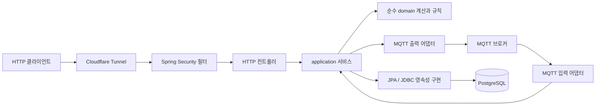

# 현재 백엔드 아키텍처와 설계 근거

이 문서는 현재 구현을 기술적 제약·불변식·대안과 연결한다. 실행 경로는 [코드 흐름](EXECUTION_FLOWS.md), 재현은 [검증 실습](VERIFICATION_WORKBOOK.md)을 따른다. 기준은 이 문서와 함께 있는 작업 트리이며 과거 초안의 목표 구조와 구분한다.

## 1. 시스템 경계와 문제

백엔드는 재배/물 관리 이력을 저장하고 측정 명령을 조율하며, 장치가 보낸 최종 원본 목록을 보존·조회한다. 측정 한 번은 장치의60개 원본을 목표로 하지만 수신 결과가0~59개인 불완전 세션도 명시적으로 보존한다. 수치와 출처를 제공하며 TDS만으로 식물 건강이나 물의 안전성을 판정하지 않는다.

그림은 호출 방향이다. 모든 application 요청이 모든 컴포넌트를 거치는 것은 아니다. MQTT 결과 발행은 저장 트랜잭션이 실제로 끝난 뒤 이뤄진다. HTTP 인증이 MQTT를 인증하는 것도 아니다.

### 배포 단위와 코드 단위

- Java25/Spring Boot4.1.1의 **단일 Gradle 프로젝트·단일 백엔드 프로세스**다. 패키지가 분리됐다는 이유로 마이크로서비스·물리적 다중 모듈이라고 부르지 않는다.
- `measurement`, `session`, `cultivation`, `security`는 기능/책임별 코드 경계다. 컴파일러가 각 경계를 독립 모듈로 강제하지 않는다.
- PostgreSQL18은 공통 영속 저장소다. 정상 원본·진단·재배 연결을 동일한 DB 트랜잭션에서 다룰 수 있다.
- 개인 배포는 기본 PostgreSQL/backend/cloudflared와 선택 MQTT 추가 Compose의 broker로 구성한다. 네트워크·수동 적용은 [배포 안내](../PERSONAL_DEPLOYMENT.md), [MQTT 준비](../PERSONAL_MQTT.md)를 따른다.

**선택의 이유:** 현재 처리량과 단일 사용자 범위에서 분산 서비스로 분리하면 서비스 간 일관성·배포·장애 추적 비용이 먼저 증가한다. 같은 DB 안의 불변식은 로컬 트랜잭션으로 다루는 것이 단순하다. 단, 이것이 수평 확장이나 대규모 처리량을 검증했다는 뜻은 아니다.

## 2. 계층별 책임과 실제 의존성

| 코드 | 책임 | 두지 않는 책임 |
|---|---|---|
| `measurement.domain` | 수치 비교·통계 | Spring 컨텍스트·DB·네트워크 |
| `cultivation.domain` | 재배/관리 값의 유효성·동일성 | HTTP 상태 코드·저장 SQL |
| `security.domain` | 토큰 난수·다이제스트·만료/용량 | Servlet 필터·비밀번호 설정 바인딩 |
| `*.application` | 입력 검증, 도메인 호출, 트랜잭션/업무 조율 | wire 프로토콜의 바이트 파싱 |
| `*.infrastructure.http` | 요청/응답·상태 코드·오류 매핑 | 직접 원본 저장 |
| `session.infrastructure.mqtt` | MQTT 메타데이터·JSON·구독·발행 | 임의 업무 정책/식물별 판단 |
| `*.infrastructure.persistence` | JPA 매핑·SQL·잠금·DB 예외 식별 | MQTT 보존 성공 판정 |

현재 application은 persistence 구현 클래스를 직접 참조한다. 예를 들어 [CultivationService](../../backend/home-water-monitor-backend/src/main/java/com/juca/homewatermonitorbackend/cultivation/application/CultivationService.java)는 `CultivationStore`를 주입받는다. 따라서 **모든 의존성이 인터페이스 포트를 향하는 헥사고날 구조가 아니다.** `ControlRuntime`도 구체 MQTT publisher에 의존한다.

이 구조는 구현 수와 추상화 층을 줄인다. 저장 기술 교체·어댑터 교체의 비용은 application까지 전파될 수 있다. 구현이 하나인데 의미 없는 인터페이스를 모두 추가하는 것과, 교체가 실제로 필요한 경계에 포트를 두는 것은 다른 결정이다. 지금 유지하는 경계는 순수 domain 분리와 서비스 트랜잭션이다. 이를 자동 아키텍처 검사로 강제하는 도구는 현재 없다.

## 3. Java 값 모델·계산과 JPA 엔티티를 분리한 이유

[TdsMeasurement](../../backend/home-water-monitor-backend/src/main/java/com/juca/homewatermonitorbackend/measurement/domain/TdsMeasurement.java)는 Java record 값이고, 저장은 별도의 `TdsMeasurementEntity`가 맡는다. 도메인 비교가 영속성 컨텍스트·프록시·엔티티 생명주기 없이 실행된다. 값 비교 테스트는 Docker 없이 재현할 수 있다.

`BigDecimal.equals()`는 값과 scale을 함께 보므로 `300.0`과 `300.00`을 다르게 본다. `compareWith()`는 같은 `sessionId+seq`인지 먼저 확인하고, 네 필드의 수치 동등성을 `compareTo()`로 비교한다. 이때 반올림이나 허용 오차를 넣지 않는다. 원본 재수신 비교에 오차를 넣으면 실제 데이터 변경을 동일 수신으로 숨길 수 있기 때문이다.

반면 [TdsStatisticsCalculator](../../backend/home-water-monitor-backend/src/main/java/com/juca/homewatermonitorbackend/measurement/domain/TdsStatisticsCalculator.java)의 평균/짝수 중앙값은 표시 정책에 따라 소수2자리 HALF_UP을 사용한다. **원본 동일성 판정과 집계 결과 표현은 다른 문제**다. 중앙값은 복사본을 정렬하므로 입력 순서를 변경하지 않는다. 평균/최소/최대는O(n), 중앙값은O(n log n)이며 최대60개에서는 복잡한 선택 알고리즘보다 검증 가능한 단순성이 유리하다.

수치·scale·반올림의 일반 의미는 [Java25 BigDecimal API](https://docs.oracle.com/en/java/javase/25/docs/api/java.base/java/math/BigDecimal.html)에서 확인하고, 어떤 동등성을 채택했는지는 이 프로젝트의 비교 코드와 테스트로 확인한다.

record는 중첩 객체까지 자동으로 깊은 불변이 되는 장치가 아니다. 현재 각 필드의 타입·검증·컬렉션 생성 방식을 실제로 확인해야 한다. domain 분리도 모든 application 클래스를 프레임워크 독립으로 만든다는 뜻은 아니다.

## 4. 원본과 상태를 나누는 데이터 모델

| 저장 대상 | 핵심 식별/관계 | 보호할 성질 |
|---|---|---|
| `cultivation` | `cultivation_id` | 등록 재시도의 같은 자원 식별 |
| `water_maintenance` | 관리 UUID·재배 FK | 재배별 이력과 사건 발생 시각 |
| `tds_device_command` | 명령 UUID·idempotency key·sessionId·재배 FK | 요청 수락·전달·실행 관측의 구분 |
| `tds_session` | sessionId PK | 최초 보존 결과·통계·출처 메타데이터 |
| `tds_measurement` | `session_id+seq` UNIQUE | 동일 원본의 중복 저장 방지 |
| `tds_session_redelivery`·상세 | 재수신 UUID·세션/원본 참조 | 원본을 덮지 않는 동일/충돌 진단 |
| 누락 진단·장치 관측/slot | 세션/장치 참조 | 불완전 목록과 현재 제어 상태의 분리 |

원본과 ‘최근 명령 상태’를 한 테이블의 가변 값으로 합치면 재시도/재부팅 때 측정 사실까지 바뀔 수 있다. 현재는 이미 보존한 원본을 유지하고 관측/진단을 따로 추가한다. 재수신 진단의 집계 컬럼을 별도 전역 카운터 구현과 혼동하지 않는다. 실제 컬럼은 [마이그레이션](../../backend/home-water-monitor-backend/src/main/resources/db/migration)을 기준으로 확인한다.

START 예약 때 재배 FK를 고정한다. 결과 수신 때 ‘현재 활성 재배’를 검색해 연결하면 측정 도중 재배 종료/변경이 일어났을 때 과거 결과를 다른 재배에 연결할 수 있다. wire에 식물 정책을 추가하지 않고 서버의 명령 예약과 sessionId/deviceId로 연결을 검증한다.

Flyway V1~V8은 적용 이력이다. JPA `ddl-auto: validate`는 매핑 호환성을 점검하지만 스키마 진화나 모든 업무 불변식 검증을 대신하지 않는다. 변경이 필요하면 기존 이력을 고치는 대신 새 마이그레이션과 별도 검증이 필요하다.

## 5. 트랜잭션과 동시성

### 하나의 보존 목록을 하나의 원자적 작업으로

세션 메타데이터·전체 원본·통계 또는 누락/재수신 진단은 함께 확정돼야 한다. 원본 일부만 남거나 진단만 남으면 ‘무엇을 보존했는지’ 신뢰할 수 없다. 측정60초 동안 트랜잭션을 열지는 않는다. 최종 목록이 도착한 뒤 짧은 저장 단위로 처리한다.

[ProcessTdsSessionService](../../backend/home-water-monitor-backend/src/main/java/com/juca/homewatermonitorbackend/session/application/ProcessTdsSessionService.java)는 `NEVER`, [TdsSessionProcessingTransactionService](../../backend/home-water-monitor-backend/src/main/java/com/juca/homewatermonitorbackend/session/application/TdsSessionProcessingTransactionService.java)는 `READ_COMMITTED` 트랜잭션을 쓴다. 저장·재수신 서비스의 기본 REQUIRED는 그 트랜잭션에 참여한다. 매핑 어댑터의 `MANDATORY`는 바깥 트랜잭션 없이 저장하는 오용을 거절한다.

기존 행은 `FOR UPDATE`로 같은 세션의 변경을 직렬화한다. **없는 행을 조회했다고 신규 삽입 경합까지 막히는 것은 아니다.** 두 요청이 모두 신규로 판단하면 PK가 최종 승자를 정한다. 패자는 실패한 트랜잭션을 끝낸 뒤 `tds_session_pkey`/SQLSTATE23505에 한해서 새 트랜잭션으로 기존 결과를 비교한다. 모든 DB 오류를 재시도로 바꾸지 않는다.

READ COMMITTED는 명령마다 커밋된 데이터를 보는 수준이며 자체로 모든 업무 경합을 제거하지 않는다. 잠금·UNIQUE·입력 비교·트랜잭션 종료가 함께 필요하다. 더 강한 격리 수준은 직렬화 실패와 재시도 비용도 검토해야 한다. [PostgreSQL 격리 수준](https://www.postgresql.org/docs/18/transaction-iso.html)

### 프록시 경계가 필요한 이유

Spring 기본 선언적 트랜잭션은 프록시를 통과하는 호출에 적용된다. 현재 라우터와 트랜잭션 서비스가 다른 Bean이므로 트랜잭션 서비스 호출이 실제 커밋/롤백까지 끝난 뒤 라우터에 반환된다. 같은 객체의 메서드 호출에 새 어노테이션만 붙이는 것은 같은 효과를 보장하지 않는다. [Spring 트랜잭션 프록시](https://docs.spring.io/spring-framework/reference/data-access/transaction/declarative/annotations.html)

`persist`, `saveAll`, `flush`, 메서드 본문의 return, 프록시 반환을 구분한다. flush는 SQL을 DB에 반영하되 커밋은 아니다. REQUIRED로 바깥에 참여한 내부 서비스의 반환도 커밋이 아니다. 실제 지연 제약의 커밋 실패는 서비스 본문 이후에 발생할 수 있다. [Spring 전파 규칙](https://docs.spring.io/spring-framework/reference/data-access/transaction/declarative/tx-propagation.html)

## 6. HTTP 멱등성과 원본 재수신은 다른 규칙

등록 API는 키가 같고 정규화된 내용이 같으면 기존 결과를 반환하고, 내용이 달라지면409를 반환한다. 재배 등록은 요청 키가 자원 UUID이며 `INSERT ... ON CONFLICT DO NOTHING` 뒤 저장된 내용을 비교한다. 애플리케이션 메모리의 ‘이미 처리했는가’ 조회만으로 막지 않는다.

측정 원본의 중복 단위는 `sessionId+seq`다. 같은 세션의 다른 내용은 재측정으로 덮지 않고 충돌 진단으로 남긴다. 불완전 최초 목록도 확정 사실로 취급해 나중에 seq를 추가해 정상으로 승격하지 않는다. 추가/삭제를 허용하는 설계라면 최종성·통계 버전·감사 규칙이 별도로 필요하다.

비교할 내용의 범위는 각 기능에 맞는다. 재배/물 관리의 업무 필드 비교와 측정 원본의 네 필드 비교를 하나의 범용 JSON 문자열 비교로 대체하지 않는다. 종료된 재배라도 이미 성공한 물 관리 등록의 동일 재시도는 먼저 기존 결과를 확인해 돌려준다. 새 업무 허용과 과거 성공 확인을 구분한 것이다.

## 7. 비동기 명령과 관측 상태

HTTP 요청을 장치의 측정 종료까지 붙잡으면 연결/스레드/DB 자원을 장치 지연에 묶는다. 현재는 예약을 커밋하고202를 반환한 뒤 `ControlRuntime`의 제한된 worker에서 probe와 START를 처리한다. DB 트랜잭션은 예약·상태 전이별로 짧게 끝나며 네트워크 응답을 기다리는 동안 계속 열려 있지 않다.

같은 프로세스의 Lock/Semaphore는 중복 작업과 자원 폭증을 줄인다. DB의 장치 slot 잠금과 고유 키는 영속 경합을 다룬다. 전자는 서버 여러 대 사이의 분산 잠금이 아니며, 현재 여러 인스턴스 제어기를 검증한 구조도 아니다.

`REQUESTED/PROBING` 중 재시작은 미전달로 복구하지만, 이미 전달 단계인 `DISPATCHING`은 UNKNOWN으로 남긴다. 전송 후 응답 유실은 미실행의 증거가 아니기 때문이다. bootId·windowId·명령 ID·신선한 probe를 맞춰 관측하며 서버가 확신할 수 없는 상태를 성공/실패로 억지 단정하지 않는다.

제한 시간과 probe의 나이는 `System.nanoTime()`의 경과시간으로, DB/화면의 사건 시각은 `Instant`로 다룬다. 시스템 시각 보정으로 대기시간이 바뀌는 문제와 저장 가능한 절대 시각을 분리한 것이다. 단조 시계 값은 다른 프로세스/재시작 사이의 공통 시각이 아니므로 새 epoch와 신선한 관측이 필요하다.

## 8. MQTT 보장과 DB 보장을 분리

QoS1 전송은 중복될 수 있다. 브로커 PUBACK, 백엔드 수신 ACK, DB 커밋, 애플리케이션 보존 확인, 장치 해제 관측은 별개의 사건이다. 현재 코드는 결과 처리 커밋이 완료된 뒤 보존 확인을 발행하며, 발행 실패로 이미 커밋한 데이터를 롤백하지 않는다.

DB와 MQTT를 하나의 분산 트랜잭션으로 원자화하지 않는다. 커밋 뒤 확인이 유실되면 장치의 동일 목록 재전송에 기존 보존 결과를 다시 알려주는 방식으로 복구한다. 결과 확인 발행에 영속 transactional outbox가 구현돼 있다고 설명하지 않는다. outbox는 서버 주도 재발행을 강화할 수 있지만 저장/전송 worker·중복·정리 정책을 추가로 요구한다.

잘못된 입력이나 저장 실패에서도 수신 ACK를 수행하는 경로가 있다. 이는 브로커의 즉시 반복 전달에만 의존하지 않는 정책이다. 따라서 장치의 애플리케이션 확인 대기·동일 목록 재전송이 중요하다. 브로커 persistence가 켜져 있다는 이유로 DB 커밋이나 장치 RAM의 보존까지 보장되지는 않는다. 상세는 [실행 흐름4](EXECUTION_FLOWS.md#4-mqtt-결과-수신부터-보존-확인까지).

## 9. 인증과 신뢰 경계

Spring Security 필터는 Controller 앞에서 Bearer 인증·인가를 처리한다. `POST /api/auth/login`만 익명 허용하며 업무 API는 OWNER 권한을 요구한다. MQTT는 별도 브로커 비밀번호/ACL 경계다. [Spring Security 필터 구조](https://docs.spring.io/spring-security/reference/servlet/architecture.html)

단일 계정은 외부 이름/BCrypt 해시로 설정한다. 토큰은32바이트 난수이고 서버에는SHA256 다이제스트와 만료만 보관한다. 일반 비밀번호는 저엔트로피 입력이므로 비용을 둔 BCrypt 검증을 쓰고, 이미 충분한 난수인 토큰은 빠른 다이제스트로 조회한다. 두 해시의 목적이 다르다.

JWT를 쓰지 않아 폐기/만료/용량 처리가 단순하지만 [TokenRegistry](../../backend/home-water-monitor-backend/src/main/java/com/juca/homewatermonitorbackend/security/domain/TokenRegistry.java)는 프로세스 메모리다. `SessionCreationPolicy.STATELESS`는 HTTP 세션을 쓰지 않는다는 뜻이지 서버 상태가 없다는 뜻이 아니다. 재시작하면 재로그인하며, 여러 인스턴스 간 공유 인증 상태는 구현하지 않았다.

CSRF는 브라우저 쿠키 같은 자동 첨부 인증을 쓰지 않는 명시적 Bearer 전용 경계에서 제외했다. 인증 방식이 쿠키로 바뀌면 이 근거를 재검토해야 한다. 로그인 시도 제한도 프로세스 단위·전역 제한이며 분산 rate limiter나 계정별 정교한 방어가 아니다. TLS/Tunnel은 전송 경계이지 업무 인가 대체물이 아니다.

## 10. 조회 정확성과 현재 한계

- JPA 쓰기와 JDBC 조회가 함께 있다. 제어 SQL/JSONB/행 잠금을 직접 표현하기 쉽지만 스키마 변경의 파급을 양쪽에서 확인해야 한다. 동일 DataSource/트랜잭션 참여가 전제이며 여러 저장소 간 원자성을 구현한 것이 아니다.
- 정상 통계에서 안정화 원본을 제외하되 원본 자체는 보존한다. 실측 추세는 알려진 센서 출처만 조회하고 SIMULATED/UNKNOWN을 섞지 않는다. calibrationVersion 기반 출처 분류는 현재의 단순한 모델이며 교정 정확도 증명이 아니다.
- `CultivationOverviewService`는 목록 각 항목의 관리/측정 정보를 별도로 조회한다. ORM 연관 로딩뿐 아니라 이런 응용 수준의 추가 쿼리도 목록 크기에 따라 늘 수 있다. SQL 수·실행 계획·실제 지연을 측정하기 전에 성능을 최적이라고 말할 수 없다.
- 일부 조회는 offset 페이지다. 큰 이력·동시 삽입에서 비용/페이지 안정성을 검토할 여지가 있다. 현재 keyset 페이지나 대용량 부하 인수를 구현했다고 설명하지 않는다.
- 포괄 RuntimeException→503 또는 NPE→400 매핑은 응답 노출을 줄이지만 내부 버그와 인프라 장애를 뭉뚱그릴 수 있다. 예외 분류·진단 관측 개선은 검토 대상이며 이번 문서는 오류 계약을 바꾸지 않는다.
- Docker healthy는 제한된 준비 상태 검사다. backend는 인증 경계 응답, broker는 TCP listener를 확인한다. 모든 업무·DB·장치 연결·백업 복원을 대신하지 않는다.

## 11. 설계 설명을 검증하는 기준

| 주장 | 필요한 근거 | 현재의 한계 |
|---|---|---|
| 원본·진단의 원자성 | 실제 PostgreSQL 쓰기/커밋 실패 테스트 | 모든 가능한 인프라 장애 증명은 아님 |
| 동시 신규/재수신 안정성 | 두 연결·래치·승자/패자·원본/진단 검사 | 다중 서버 부하 시험과 구분 |
| 인증 만료/폐기 | 실제 필터 HTTP와 주입 Clock 테스트 | 운영 보안 감사·분산 세션 아님 |
| MQTT 복구 | 실제 브로커 재시작·실패·재수신 인수 | 모의 장비와 실물/정확도는 구분 |
| 계층 경계 유지 | 소스 리뷰 | 자동 아키텍처/Lint 검사는 MISSING |

의사결정을 설명할 때는 ‘문제→불변식→선택→대안의 비용→코드→테스트→남은 한계’ 순서로 연결한다. 코드에 있는 것을 모두 최선의 일반 해법으로 포장하지 않는다.
