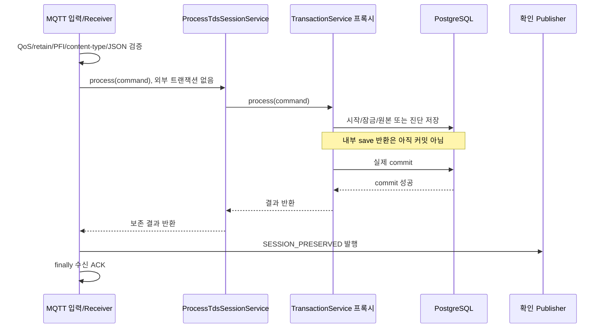

# Java/Spring 기능별 진입점부터 종료점까지

[아키텍처](ARCHITECTURE.md)를 전제로 실제 호출 순서·스레드·트랜잭션·실패의 종료점을 추적한다. 클래스 이름만 찾고 끝내지 말고 각 경계에서 **무엇이 이미 확정됐고 무엇이 아직 미확정인지** 표시한다. 아래 경로는 현재 소스이며 과거 이름의 호환 서비스도 공존하므로 런타임 입력 어댑터에서 참조하는 Bean을 기준으로 읽는다.

## 0. 시작: 프로세스 기동과 Bean 조립

진입점은 [HomeWaterMonitorBackendApplication](../../backend/home-water-monitor-backend/src/main/java/com/juca/homewatermonitorbackend/HomeWaterMonitorBackendApplication.java)의 `main`이다.

1. `SpringApplication.run()`이 설정과 ApplicationContext를 준비한다. `@SpringBootApplication`의 컴포넌트 스캔으로 하위 패키지의 Service/Repository/Configuration 등이 등록된다.
2. 생성자 주입으로 서비스가 요구하는 의존성을 조립한다. 도메인 계산기처럼 외부 자원이 없는 모든 객체가 Spring Bean일 필요는 없다. `SaveNormalTdsSessionService`는 순수 통계 계산기를 직접 생성한다.
3. DataSource/JPA/Flyway의 자동 구성이 DB 연결·마이그레이션·매핑 검증에 참여한다. Spring은 초기화 의존 관계를 관리하므로 단순히 소스 파일 순서대로 실행된다고 읽지 않는다.
4. Servlet 애플리케이션이면 `ApiSecurity`의 필수 계정 설정 바인딩과 필터 체인이 필요하다. 계정 설정 오류를 자동 기본 비밀번호로 우회하지 않는다.
5. MQTT와 제어 설정이 true이면 해당 Configuration/Runtime Bean이 생성된다. `ControlRuntime.start()`는 DB의 미완료 명령을 복구한 뒤 상태 probe 스케줄러를 시작한다.
6. 웹 서버가 준비돼도 장치가 준비됐다는 뜻은 아니다. HTTP readiness·브로커 연결·장치 관측·업무 인수의 종료점은 각각 다르다.

설정 읽기 순서: [application.yaml](../../backend/home-water-monitor-backend/src/main/resources/application.yaml) → 활성 프로필의 [application-personal.yaml](../../backend/home-water-monitor-backend/src/main/resources/application-personal.yaml) → 상위 우선순위 외부 설정. 기본 personal은 장치 기능이 false지만 [MQTT 추가 Compose](../../infra/personal/compose.mqtt.yml)가 명시적인 실행 인수로 두 기능을 true로 덮는다. 파일 하나의 값만 보고 실제 실행 설정을 단정하지 않는다.

**확인:** `AuthenticationIntegrationTest.personalProfileBindsLoopbackAndKeepsPhysicalDeviceControlOff()`는 프로필 기본값의 테스트다. MQTT 추가 Compose를 적용한 프로세스의 기능이 계속 꺼져 있어야 한다는 테스트가 아니다.

## 1. 로그인·인증 요청·로그아웃

### 소스 읽기 순서

| 순서 | 소스/메서드 | 확인할 것 |
|---|---|---|
| 1 | [ApiSecurity.api/introspector](../../backend/home-water-monitor-backend/src/main/java/com/juca/homewatermonitorbackend/security/infrastructure/ApiSecurity.java) | 경로별 허용·Bearer 필터·권한·JSON 오류 |
| 2 | [AuthenticationController.login/session/logout](../../backend/home-water-monitor-backend/src/main/java/com/juca/homewatermonitorbackend/security/infrastructure/AuthenticationController.java) | 요청 DTO와 응답·no-store·토큰 폐기 |
| 3 | [OwnerAuthentication.login/admit](../../backend/home-water-monitor-backend/src/main/java/com/juca/homewatermonitorbackend/security/application/OwnerAuthentication.java) | 입력·시도 제한·BCrypt 검증 |
| 4 | [TokenRegistry.issue/find/revoke](../../backend/home-water-monitor-backend/src/main/java/com/juca/homewatermonitorbackend/security/domain/TokenRegistry.java) | 만료·난수·다이제스트·메모리 동기화 |

### 로그인 경로

```text
POST /api/auth/login
→ SecurityFilterChain의 경로 허용
→ DispatcherServlet / 요청 JSON 바인딩
→ AuthenticationController.login
→ OwnerAuthentication.login
   → UTF-8 비밀번호 길이 등 입력 확인
   → admit: 최근60초 시도 제한
   → PasswordEncoder.matches
   → 계정 이름과 검증 결과 확인
→ TokenRegistry.issue: 만료 정리/용량 제한/난수 발급/다이제스트 보관
→ 200 {accessToken, tokenType, expiresAt}, Cache-Control: no-store
```

이 기능은 HTTP 요청 스레드에서 처리되며 JPA/업무 DB 트랜잭션을 열지 않는다. 설정의 BCrypt 해시를 검증하고 토큰만 메모리에 저장한다. 사용자명이 틀려도 해시 검증을 수행해 계정 존재 여부를 오류 차이로 드러내지 않는다. 입력400·자격 오류401·제한429는 Controller의 예외 핸들러에서 JSON으로 끝난다.

### 인증된 업무 요청의 경로

`Authorization: Bearer ...` → Spring Security Bearer 인증 처리 → `OpaqueTokenIntrospector` → `TokenRegistry.find()` → `ROLE_OWNER` 권한 확인 → 해당 Controller 순서다. 만료되거나 없으면401이 필터에서 끝나므로 업무 Controller의 breakpoint에 도달하지 않는 것이 정상이다. 인증 실패를 모든 Controller에서 직접 반복 검사하지 않는 이유다.

`POST /api/auth/logout`도 유효한 Bearer 인증을 먼저 거친다. 현재 토큰을 `revoke()`하고204로 끝난다. 이후 같은 토큰은401이다. 이미 만료된 토큰을 보내면 Controller 이전에401일 수 있다. 서버 재시작은 메모리 토큰을 모두 없애며 자동 갱신은 없다.

`Clock`을 주입한 이유는 테스트에서 시간을 정확히 이동시켜 만료 경계를 재현하기 위해서다. `synchronized`는 한 JVM 안의 LinkedHashMap/Deque 경합을 보호하며 다중 서버의 인증 상태를 공유하지 않는다. 비밀번호/토큰 record의 `toString()`도 민감 값 대신 고정 표현을 반환한다.

**연결 테스트:** [AuthenticationIntegrationTest](../../backend/home-water-monitor-backend/src/test/java/com/juca/homewatermonitorbackend/security/AuthenticationIntegrationTest.java), [TokenRegistryTest](../../backend/home-water-monitor-backend/src/test/java/com/juca/homewatermonitorbackend/security/TokenRegistryTest.java), [OwnerAuthenticationTest](../../backend/home-water-monitor-backend/src/test/java/com/juca/homewatermonitorbackend/security/OwnerAuthenticationTest.java). 전자는 실제 필터/HTTP, 후자는 순수 인증 계산·경계에 초점이 있다.

## 2. 재배 등록·종료: 가장 짧은 전체 저장 경로

진입점은 [CultivationController.create](../../backend/home-water-monitor-backend/src/main/java/com/juca/homewatermonitorbackend/cultivation/infrastructure/http/CultivationController.java)의 `POST /api/cultivations`다.

```text
Bearer 인증
→ Controller: Idempotency-Key UUID와 Create DTO
→ CultivationService.create [Spring 트랜잭션 프록시 진입]
   → 키 검증
   → Cultivation record 생성/정규화/업무 검증
   → CultivationStore.insert [MANDATORY]
      → INSERT ... ON CONFLICT(cultivation_id) DO NOTHING
   → required / 저장된 snapshot 읽기
   → 기존 값과 정규화된 업무 필드 비교
→ 서비스 프록시의 커밋 완료
→ Controller: 최초201 / 동일 재시도200 + Location
```

핵심 소스는 [CultivationService](../../backend/home-water-monitor-backend/src/main/java/com/juca/homewatermonitorbackend/cultivation/application/CultivationService.java), [Cultivation](../../backend/home-water-monitor-backend/src/main/java/com/juca/homewatermonitorbackend/cultivation/domain/Cultivation.java), [CultivationStore](../../backend/home-water-monitor-backend/src/main/java/com/juca/homewatermonitorbackend/cultivation/infrastructure/persistence/CultivationStore.java)다.

`insert()`가0건이어도 무조건 성공 처리하지 않는다. 같은 키에 다른 이름/식물/시작 시각/메모를 넣으면 저장된 사실과 충돌하므로409다. 단순 ‘존재 조회→없으면 저장’은 동시에 둘 다 없다고 볼 수 있다. DB 고유 키와 충돌 처리 후의 내용 비교가 최종 기준이다. `createdAt`처럼 서버가 새로 만든 처리 시각을 재시도 동일성에 넣으면 정상 재시도까지 충돌하므로 업무 입력을 비교한다.

종료는 `POST /api/cultivations/{id}/end` → `CultivationService.end()` → `required(id,true)`의 PESSIMISTIC_WRITE 잠금 → 엔티티 `end()` 변경 → 트랜잭션 종료 시 dirty checking/flush/commit이다. 모든 엔티티 변경에 명시적 `repository.save()`가 필요한 것은 아니다. 단, 영속 상태와 트랜잭션 안이라는 전제를 확인해야 한다.

### 종료·오류의 실제 경계

- 잘못된 입력은400, 미존재 재배는404, 이미 종료된 재배에 허용되지 않은 새 업무는409 경로를 확인한다.
- 서비스 본문이 반환해도 커밋이 실패하면 Controller의201 성공 응답으로 진행하지 않는다.
- [CultivationErrors](../../backend/home-water-monitor-backend/src/main/java/com/juca/homewatermonitorbackend/cultivation/infrastructure/http/CultivationErrors.java)가 ControllerAdvice로 매핑한다. 필터에서 끝난 인증 오류와 경계가 다르다.
- 클래스 수준 `@Transactional(timeout=5)`와 메서드별 readOnly 적용을 함께 읽는다. timeout은 모든 Java 코드의 실행을5초에 강제 중단하는 타이머와 동일하지 않다.

**연결 테스트:** [CultivationIntegrationTest](../../backend/home-water-monitor-backend/src/test/java/com/juca/homewatermonitorbackend/cultivation/application/CultivationIntegrationTest.java). 최초/동일/충돌·종료·동시성·실제 commit 실패의 assertion을 구분해 찾는다.

## 3. 물 관리 기록: 기존 성공 확인과 새 업무 검증의 순서

진입점은 [WaterMaintenanceController](../../backend/home-water-monitor-backend/src/main/java/com/juca/homewatermonitorbackend/cultivation/infrastructure/http/WaterMaintenanceController.java)의 `POST /api/cultivations/{id}/water-maintenances`다.

1. 인증/바인딩 후 [WaterMaintenanceService.create](../../backend/home-water-monitor-backend/src/main/java/com/juca/homewatermonitorbackend/cultivation/application/WaterMaintenanceService.java)의 트랜잭션에 들어간다.
2. 키를 확인하고 [WaterMaintenance](../../backend/home-water-monitor-backend/src/main/java/com/juca/homewatermonitorbackend/cultivation/domain/WaterMaintenance.java) 후보를 만든다. 발생 시각은 마이크로초로 정규화하고 양수·저장 가능한 용량/행위별 scope를 검증한다.
3. 같은 키가 이미 있으면 `match()`로 내용을 비교해 기존 성공을 반환한다.
4. 신규일 때만 `CultivationService.requireActive()`로 재배를 잠그고 후보가 재배 기간에 속하는지 확인한다.
5. [WaterMaintenanceStore](../../backend/home-water-monitor-backend/src/main/java/com/juca/homewatermonitorbackend/cultivation/infrastructure/persistence/WaterMaintenanceStore.java)에 insert 후 실제 저장된 값과 다시 비교한다. 서비스 프록시의 커밋 뒤 최초201/동일200으로 응답한다.

순서를 바꿔 항상 활성 재배부터 확인하면, 성공한 기록을 재전송하는 사이 재배가 종료됐을 때 과거 성공을 확인할 수 없게 된다. 현재는 **기존 성공의 재확인**과 **새 기록 허용**을 분리한다. 동시 종료/등록은 같은 재배 잠금으로 순서를 정한다.

조회 목록과 최근 전체 교체 시각은 서버 수신 시각이 아니라 `occurredAt`을 기준으로 읽는다. 네트워크 지연으로 늦게 입력한 과거 행위를 ‘가장 최근 교체’로 잘못 해석하지 않기 위해서다. 모든 관리 행위가 전체 교체 시각을 갱신하지는 않는다.

**연결 테스트:** [WaterMaintenanceIntegrationTest](../../backend/home-water-monitor-backend/src/test/java/com/juca/homewatermonitorbackend/cultivation/application/WaterMaintenanceIntegrationTest.java)의 `retriesConflictAndEndedActivityAreDistinct`, `concurrentRegistrationsHaveOneDurableWinner`, `closureSerializesWithRegistration`, `commitFailureLeavesNoMaintenanceOrLastReplacement`.

## 4. MQTT 결과 수신부터 보존 확인까지

### 입력과 저장을 연결하는 현재 진입점

[SessionMqttConfiguration](../../backend/home-water-monitor-backend/src/main/java/com/juca/homewatermonitorbackend/session/infrastructure/mqtt/SessionMqttConfiguration.java)의 `mqttInbound()`가 허용 장비의 events 토픽을 구독한다. Paho 메시지 → Spring Integration 입력 어댑터 → `DirectChannel` → [MqttSessionReceiver.handleMessage](../../backend/home-water-monitor-backend/src/main/java/com/juca/homewatermonitorbackend/session/infrastructure/mqtt/MqttSessionReceiver.java) 순서다. DirectChannel은 이 경로를 자동 작업 큐로 만들지 않는다.



### 메서드별 읽기 순서

| 순서 | 실제 소스 | 책임·트랜잭션 |
|---|---|---|
| 1 | `MqttSessionReceiver.handleMessage` | 현재 트랜잭션이 이미 있으면 거절, 메타데이터 확인 |
| 2 | [MqttSessionCodec.decode](../../backend/home-water-monitor-backend/src/main/java/com/juca/homewatermonitorbackend/session/infrastructure/mqtt/MqttSessionCodec.java) | UTF-8/크기/필드/숫자/토픽·장비 ID를 확인하고 command로 변환 |
| 3 | [ProcessTdsSessionService.process](../../backend/home-water-monitor-backend/src/main/java/com/juca/homewatermonitorbackend/session/application/ProcessTdsSessionService.java) | NEVER, 검증 후 별도 트랜잭션 Bean 호출·정확한 PK 충돌만 복구 |
| 4 | [TdsSessionProcessingTransactionService.process](../../backend/home-water-monitor-backend/src/main/java/com/juca/homewatermonitorbackend/session/application/TdsSessionProcessingTransactionService.java) | READ_COMMITTED, 출처 연결 확인·세션 잠금·신규/재수신 분기 |
| 5 | [SaveNormalTdsSessionService.save](../../backend/home-water-monitor-backend/src/main/java/com/juca/homewatermonitorbackend/session/application/SaveNormalTdsSessionService.java) | 신규60개: 안정화 제외 통계·전체 원본·NORMAL 저장 |
| 6 | [SaveIncompleteTdsSessionService.save](../../backend/home-water-monitor-backend/src/main/java/com/juca/homewatermonitorbackend/session/application/SaveIncompleteTdsSessionService.java) | 신규0~59개: 전체 유효 원본·누락 seq·통계 null/0·INCOMPLETE 저장 |
| 7 | [TdsSessionPersistenceAdapter.insert](../../backend/home-water-monitor-backend/src/main/java/com/juca/homewatermonitorbackend/session/infrastructure/persistence/TdsSessionPersistenceAdapter.java) | MANDATORY + persist로 신규 등록 의도를 유지 |
| 8 | Receiver → codec.encode → [BoundedMqttPublisher.publish](../../backend/home-water-monitor-backend/src/main/java/com/juca/homewatermonitorbackend/session/infrastructure/mqtt/BoundedMqttPublisher.java) | 커밋 성공 뒤 확인 메시지, 연결/발행 대기 제한 |

명령 예약이 있는 sessionId는 그 예약의 deviceId와 일치해야 한다. 예약이 없는 과거/독립 세션까지 전부 거절하는 구현은 아니므로 `DeviceControlStore.matchesSource()`의 `sources.isEmpty()` 분기를 함께 읽는다.

세션 UUID가 이미 할당된 엔티티를 Spring Data `save()`에 넘길 때 신규 판별 방식에 따라 merge가 선택될 수 있다. 현재 세션 어댑터는 `persist()`로 신규 삽입 의도를 명시하고 중복 PK를 충돌로 다룬다. `merge()`는 상태를 관리 객체로 복사하는 의미이므로 단순 INSERT의 별칭이 아니다. 또한 원본의 `saveAll()`이 하나의 bulk INSERT나 JDBC batch를 자동 보장하지는 않는다. 실제 SQL/배치 설정과 바깥 트랜잭션을 따로 확인한다. [Spring Data JPA 신규 판별](https://docs.spring.io/spring-data/jpa/reference/jpa/entity-persistence.html)

통계는 원본 복사본의 `isWarmup=false` 수치만 사용한다. 원본 엔티티는 안정화 구간도 모두 저장한다. `SaveNormalTdsSessionCommand`는 record이며 `List.copyOf()`로 목록을 복사한다. 계산/전달 과정의 목록 변경으로 같은 수신의 의미가 바뀌지 않도록 한다.

`SaveNormalTdsSessionCommand`라는 이름이 남아 있어도 공통 결과 수신은0~60개를 처리한다. 클래스 이름만으로 정상60개 전용 입력이라고 단정하지 말고 codec/공통 validator/라우팅 분기를 확인한다. 비슷한 이름의 `ProcessNormalTdsSessionService` 등 별도 경로와 혼동하지 않도록 현재 Receiver가 주입받는 타입부터 추적한다.

### 실패마다 종료점이 다르다

| 실패 | DB 결과 | 보존 확인 | 수신 ACK |
|---|---|---|---|
| 잘못된 메타데이터/JSON | 저장 서비스 호출 전 중단 | 없음 | finally에서 시도 |
| DB 쓰기/실제 커밋 실패 | 이번 트랜잭션 롤백 | 없음 | finally에서 시도 |
| DB 커밋 후 확인 발행 실패 | 이미 커밋된 데이터 유지 | 전달 실패/불확실 | finally에서 시도 |
| ACK 자체 실패 | 앞서 일어난 DB/발행을 취소하지 않음 | 앞 단계와 별개 | 경고 기록 |

오류를 잡고 로그만 남긴다는 이유로 모든 실패가 안전하게 복구된다고 말할 수 없다. 현재 복구는 장치가 애플리케이션 확인을 받지 못하면 같은 목록을 재전송한다는 계약과 짝을 이룬다. 수신 ACK와 보존 확인을 하나로 부르면 이 차이를 놓친다.

**연결 테스트:** [MqttSessionReceiverTest](../../backend/home-water-monitor-backend/src/test/java/com/juca/homewatermonitorbackend/session/infrastructure/mqtt/MqttSessionReceiverTest.java)는 mock 호출 순서/거절을, [MqttSessionIntegrationTest](../../backend/home-water-monitor-backend/src/test/java/com/juca/homewatermonitorbackend/session/infrastructure/mqtt/MqttSessionIntegrationTest.java)는 실제 브로커/DB의 쓰기·지연 커밋·발행 실패/재수신·재연결을 확인한다.

## 5. 같은 세션의 재수신·동시 신규·충돌

이 경로도4장의 같은 MQTT 진입점을 사용한다. 라우팅 뒤 상태가 NORMAL이면 [ProcessNormalTdsSessionRedeliveryService.process](../../backend/home-water-monitor-backend/src/main/java/com/juca/homewatermonitorbackend/session/application/ProcessNormalTdsSessionRedeliveryService.java), INCOMPLETE이면 [ProcessIncompleteTdsSessionRedeliveryService.process](../../backend/home-water-monitor-backend/src/main/java/com/juca/homewatermonitorbackend/session/application/ProcessIncompleteTdsSessionRedeliveryService.java)로 간다.

### 이미 존재하는 세션

1. [TdsSessionLockAdapter.lock](../../backend/home-water-monitor-backend/src/main/java/com/juca/homewatermonitorbackend/session/infrastructure/persistence/TdsSessionLockAdapter.java)이 현재 트랜잭션에만 lock_timeout을 설정하고 세션 행을 잠근다.
2. 세션 메타데이터와 기존 원본/seq 집합을 확인한다. PostgreSQL timestamptz 저장 정밀도를 맞추는 `matchesStartedAt()`도 읽는다.
3. 각 seq에 대해 [TdsMeasurement.compareWith](../../backend/home-water-monitor-backend/src/main/java/com/juca/homewatermonitorbackend/measurement/domain/TdsMeasurement.java)가 네 필드를 비교한다. `IDENTICAL/CONFLICT`이며 키 자체가 다르면 비교 입력 오류다.
4. 재수신 헤더와 각 원본의 비교 상세를 [TdsRedeliveryPersistenceAdapter.insert](../../backend/home-water-monitor-backend/src/main/java/com/juca/homewatermonitorbackend/session/infrastructure/persistence/TdsRedeliveryPersistenceAdapter.java)에 persist한다. 헤더 flush는 FK 순서를 위한 SQL 반영이지 커밋이 아니다.
5. 트랜잭션이 끝나면 원래 NORMAL/INCOMPLETE 보존 결과와 재수신 진단을 반환한다. 기존 원본과 통계를 수신 값으로 덮지 않는다.

INCOMPLETE 최초 결과의 seq 집합은 고정한다. 같은 개수여도 `{1,2}`에서 `{1,3}`으로 바뀌면 추가/삭제이므로 거절한다. 누락 진단도 실제 원본과 일치해야 한다. 빈 목록도 유효하게 확정한 불완전 결과이며 나중에 원본을 덧붙이는 패치는 아니다.

### 두 요청이 동시에 신규로 들어오는 경우

```text
T1: 기존 행 없음 → persist/원본 저장 → commit 승자
T2: 기존 행 없음 → 같은 PK insert에서 대기 → 23505
T2의 트랜잭션 종료/롤백
→ 바깥 ProcessTdsSessionService가 tds_session_pkey 충돌만 식별
→ processing.processExisting을 새 트랜잭션으로 호출
→ 승자의 원본에 대해 재수신 비교/진단 커밋
```

[TdsSessionInsertConflictClassifier](../../backend/home-water-monitor-backend/src/main/java/com/juca/homewatermonitorbackend/session/infrastructure/persistence/TdsSessionInsertConflictClassifier.java)는 예외 메시지 문자열이 아닌 Hibernate의 SQLSTATE/제약 이름을 검사하고 cause 순환도 방어한다. FK 오류·다른 UNIQUE·timeout까지 같은 중복 요청으로 복구하지 않는다. 실패한 트랜잭션 안에서 계속 SELECT하면 rollback-only/DB 오류 상태 문제를 만들 수 있어 바깥 경계가 필요하다.

T1이 롤백하면 T2가 신규 승자가 될 수도 있다. ‘누가 먼저 HTTP/MQTT를 받았나’보다 실제 커밋과 DB 제약이 기준이다. 다른 sessionId의 독립 작업까지 같은 Java 전역 락으로 직렬화하지 않는다.

**연결 테스트:** [TdsSessionRoutingConcurrencyIntegrationTest](../../backend/home-water-monitor-backend/src/test/java/com/juca/homewatermonitorbackend/session/application/TdsSessionRoutingConcurrencyIntegrationTest.java), [TdsSessionRoutingRollbackIntegrationTest](../../backend/home-water-monitor-backend/src/test/java/com/juca/homewatermonitorbackend/session/application/TdsSessionRoutingRollbackIntegrationTest.java), [ProcessIncompleteTdsSessionRedeliveryIntegrationTest](../../backend/home-water-monitor-backend/src/test/java/com/juca/homewatermonitorbackend/session/application/ProcessIncompleteTdsSessionRedeliveryIntegrationTest.java).

## 6. 측정 START: HTTP 응답과 비동기 완료의 두 종료점

진입점은 재배별 [CultivationMeasurementController.start](../../backend/home-water-monitor-backend/src/main/java/com/juca/homewatermonitorbackend/cultivation/infrastructure/http/CultivationMeasurementController.java)의 `POST /api/cultivations/{id}/measurement-commands`다. 장비별 [MeasurementCommandController](../../backend/home-water-monitor-backend/src/main/java/com/juca/homewatermonitorbackend/session/infrastructure/http/MeasurementCommandController.java) 경로도 같은 Runtime을 쓴다. 전자는 START 재배 연결, 후자는 START/RETRY 요청을 다룬다.

### A. 요청 스레드: 예약하고 반환

1. 인증·UUID·deviceId 형식을 확인한다. Runtime Bean이 없으면503 CONTROL_UNAVAILABLE, 허용 장비 집합에 없으면404 DEVICE_NOT_FOUND다. 전원 OFF와 허용 ID 누락은 다르다.
2. [ControlRuntime.submit/doSubmit](../../backend/home-water-monitor-backend/src/main/java/com/juca/homewatermonitorbackend/session/application/control/ControlRuntime.java)는 같은 키의 동시 요청을 프로세스 내 future로 조율하고, 제한된 admission과 장비별 commanding 상태를 확인한다.
3. [CommandTransactionService.reserve](../../backend/home-water-monitor-backend/src/main/java/com/juca/homewatermonitorbackend/session/application/control/CommandTransactionService.java)가 재배 활성 잠금·장비 slot 잠금·기존 키 비교 뒤 명령과 sessionId/재배 연결을 DB에 예약하고 커밋한다.
4. 예약을 제한된 worker에 넘긴 뒤 Controller는202/기존 요청200과 commandId/sessionId를 반환한다. 실제 측정 원본 세션을 이 시점에 미리 만들지는 않는다.

**HTTP 종료점:** 예약 수락의 응답이다. 장치 실행 수락·측정 성공·DB 원본 보존을 뜻하지 않는다. 예약이 이미 커밋된 뒤 응답을 잃었다면 같은 키 조회/재시도로 기존 요청을 확인해야 한다.

`CommandTransactionService.reserve()`의 오버로드 내부 호출도 읽는다. 외부 호출이 이미 클래스의 트랜잭션 프록시를 거쳐 열어 둔 트랜잭션 안에서는 내부 메서드가 그 실행 문맥을 사용한다. 자기 호출이 별도 어노테이션의 새 경계를 만들지 않는다는 것과, 내부 호출에는 언제나 트랜잭션이 없다는 것은 다른 주장이다.

### B. worker·상태 입력: probe와 실행 확인

```text
ControlRuntime.dispatch
→ transactions.probing [짧은 DB tx]
→ probe / ControlProbeExchange.begin [네트워크 대기, DB tx 밖]
→ ControlMqttPublisher.publish(STATE_REQUEST)
→ DeviceStatusReceiver.handleMessage
→ ControlRuntime.status → 제한된 status worker
→ transactions.observe [짧은 DB tx]
→ 신선한 probe 완료 → dispatch worker 재개
→ ControlPolicy.executable 확인
→ transactions.dispatch [DISPATCHING/전달 payload/boot/window를 커밋]
→ ControlMqttPublisher.publish(START) [DB tx 밖]
→ 장치 상태의 lastExecution/commandResult 관측
→ transactions.observe [ACCEPTED/REJECTED 등 확정]
```

상태 입력은 [DeviceStatusReceiver](../../backend/home-water-monitor-backend/src/main/java/com/juca/homewatermonitorbackend/session/infrastructure/mqtt/DeviceStatusReceiver.java), 상태/신선도 상관관계는 [ControlProbeExchange](../../backend/home-water-monitor-backend/src/main/java/com/juca/homewatermonitorbackend/session/application/control/ControlProbeExchange.java), 실행 조건은 [ControlPolicy](../../backend/home-water-monitor-backend/src/main/java/com/juca/homewatermonitorbackend/session/application/control/ControlPolicy.java), SQL은 [DeviceControlStore](../../backend/home-water-monitor-backend/src/main/java/com/juca/homewatermonitorbackend/session/infrastructure/persistence/DeviceControlStore.java)를 읽는다.

장치가 없으면 probe 응답이 없어 NOT_DISPATCHED/CONTROL_FAILURE로 끝날 수 있다. START 전달 후 응답 제한이 지나면 UNKNOWN일 수 있다. UNKNOWN을 즉시 실패로 바꾸고 새 START를 보내면 실제로 실행한 장치를 중복 실행할 위험이 있다. boot/window/실행 기록과 신선한 probe로 판정 근거를 추가하는 이유다.

### C. 결과 보존과 slot 해제

실제 결과 목록은4장의 별도 수신 경로로 저장된다. 상태의 `lastRelease`가 도착해도 DB 보존 결과·건수와 일치해야 held slot을 해제한다. ‘장치가 IDLE이라고 함’만으로 미확인 버퍼/명령을 지우지 않는다.

앱 조회에서 명령 상태, 서버 보존, 장치 버퍼, 신선도를 나누는 이유는 서로 다른 관측 사실이기 때문이다. 서버 보존 성공과 장치 해제 확인이 시간상 같지 않을 수 있다. 재시작 복구는 `CommandTransactionService.recover()`를 읽는다. REQUESTED/PROBING은 NOT_DISPATCHED, DISPATCHING은 UNKNOWN으로 조정한다.

**비동기 종료점:** 명령의 판정과 보존/버퍼 관측의 조합이다. 네트워크 단절에서는 모든 상태가 반드시 즉시 성공/실패 하나로 수렴한다고 보장하지 않는다.

**연결 테스트:** [ControlRuntimeTest](../../backend/home-water-monitor-backend/src/test/java/com/juca/homewatermonitorbackend/session/application/control/ControlRuntimeTest.java), [CommandTransactionIntegrationTest](../../backend/home-water-monitor-backend/src/test/java/com/juca/homewatermonitorbackend/session/application/control/CommandTransactionIntegrationTest.java), [ControlMqttIntegrationTest](../../backend/home-water-monitor-backend/src/test/java/com/juca/homewatermonitorbackend/session/infrastructure/mqtt/ControlMqttIntegrationTest.java). mock 자원 제한·DB 상태 전이·실제 브로커 종단의 증거를 구분한다.

## 7. 조회: 저장된 사실에서 화면용 값까지

| API | 호출 경로 | 종료 결과 |
|---|---|---|
| GET /api/cultivations | CultivationController → CultivationOverviewService.list → CultivationService.list + 관리/최신 실측 조회 | 재배와 관련 요약 |
| GET /api/cultivations/{id}/measurement-sessions | CultivationMeasurementController → CultivationOverviewService.sessions → MeasurementQueryService.list | 해당 재배 세션 이력 |
| GET /api/cultivations/{id}/tds-trend | 같은 경로의 trend=true | 정상+알려진 실측 출처만 |
| GET /api/measurement-sessions/{id} | MeasurementQueryController → MeasurementQueryService.detail → 조회 store + 원본 repository | 세션 DTO와 seq순 원본 |
| GET /api/measurement-commands/{id} | MeasurementCommandController → DeviceControlQueryService.command | 명령/보존/버퍼/신선도 조합 |

핵심 소스: [CultivationOverviewService](../../backend/home-water-monitor-backend/src/main/java/com/juca/homewatermonitorbackend/cultivation/application/CultivationOverviewService.java), [MeasurementQueryService](../../backend/home-water-monitor-backend/src/main/java/com/juca/homewatermonitorbackend/session/application/MeasurementQueryService.java), [MeasurementQueryStore](../../backend/home-water-monitor-backend/src/main/java/com/juca/homewatermonitorbackend/session/infrastructure/persistence/MeasurementQueryStore.java), [DeviceControlQueryService](../../backend/home-water-monitor-backend/src/main/java/com/juca/homewatermonitorbackend/session/application/control/DeviceControlQueryService.java).

`MeasurementQueryStore.mapper()`는 calibrationVersion에 따라 ADS1115/SIMULATED/UNKNOWN을 만든다. displayAt은 측정 시각→예약 시각→수신 시각 순서이며 timeBasis를 함께 제공한다. 이는 서버 수신 시각을 실제 측정 시각으로 가장하지 않기 위해서다. `startedAt=null`이 모든 시각이 없다는 뜻은 아니다.

`@Transactional(readOnly=true)`는 조회 의도를 나타내고 자원/flush 최적화에 도움을 주지만 모든 쓰기를 보안상 차단하는 장치나 여러 SQL의 단일 스냅샷 보장은 아니다. READ COMMITTED 아래 여러 쿼리는 중간 커밋을 다르게 볼 수 있으므로 전체 화면의 강한 원자적 스냅샷이 필요한지 별도 검토해야 한다.

존재하지 않는 측정은404, 입력 오류400, 일반 조회 장애503 경로를 [MeasurementQueryController](../../backend/home-water-monitor-backend/src/main/java/com/juca/homewatermonitorbackend/session/infrastructure/http/MeasurementQueryController.java)에서 확인한다. 요약 목록은 항목별 추가 쿼리를 호출하므로 응답 모양만 보고 단일 SQL/일정 비용이라고 설명하지 않는다.

**연결 테스트:** [CultivationMeasurementIntegrationTest](../../backend/home-water-monitor-backend/src/test/java/com/juca/homewatermonitorbackend/cultivation/application/CultivationMeasurementIntegrationTest.java), [HydroponicMigrationIntegrationTest](../../backend/home-water-monitor-backend/src/test/java/com/juca/homewatermonitorbackend/cultivation/application/HydroponicMigrationIntegrationTest.java). 과거 데이터·재배 연결·가상/실측·정상/불완전 구분을 읽는다.

## 8. 읽은 경로를 스스로 검증하기

각 기능에서 여섯 항목을 기록한다: **입력/키 → 실행 스레드 → 프록시/트랜잭션 → 변경 데이터 → 성공 종료점 → 실패 종료점**. 이어서 ‘이 줄을 없애면 어떤 불변식이 깨지는가’와 ‘그 사실을 확인하는 테스트는 무엇인가’를 답한다. [실습 문서](VERIFICATION_WORKBOOK.md)의 반복 가능한 절차로 확인한다.

## 9. 수온 보정 v2의 추가 흐름

기존1~8의 경계는 유지한다. 상세 계약은 [v2](../mqtt/v2/README.md), 계산/실물 한계는 [수온 안내](../TEMPERATURE_SETUP.md)를 따른다.

1. 장치는 반올림 전 중앙값 전압과 완료된 온도 변환을 사용해 보정하고 원본을 확정한다. 보정 전 전압·온도·온도시점·공식 버전을 함께 보내 재시도 때 재계산하지 않는다. 온도 보정은 교정이 아니므로 미교정 표식도 유지한다.
2. `SessionMqttConfiguration.mqttInbound`는 허용 장치의 v1/v2 결과 토픽을 모두 구독한다. `MqttSessionCodec.decode`는 schemaVersion과 토픽을 함께 확인하고 버전별 정확한 필드 집합을 검사한다. `TdsSessionInputValidator`→`TemperatureInput.validate`가 v1의 가정 수온과 v2의 실측/모의 출처·공식·시점(원본 이전2000ms 이내) 조합을 구분한다.
3. `ProcessTdsSessionService.process` 이하 기존 트랜잭션 경로가 세션·원본·통계를 함께 저장한다. 새 V9는 기존 열의 값을 변경하지 않고 nullable 확장 열과 조건부 제약을 추가한다. 새 필드도 같은 서비스 트랜잭션에 포함되며 MANDATORY/persist 경로를 유지한다.
4. 재수신은 `TdsSessionMetadataValidator`에서 온도 출처/공식까지 고정하고, `TdsMeasurement.compareWith`가 v1 네 필드 및 v2 온도/온도시점을 비교한다. `TdsMeasurementSnapshot`에는 비교 당시 두 온도 근거도 남기며 원본을 덮어쓰지 않는다. 수치 비교는 compareTo다.
5. 실제 커밋 후 `MqttSessionReceiver`가 입력과 같은 버전의 preservation 토픽으로 확인을 보낸다. 커밋 실패·입력 실패는 보존 확인 없이 종료한다. 장치의 수신 parser도 설정한 버전만 수용한다.
6. `MeasurementQueryStore`는 원본에서 안정화 제외 평균 수온을 조회하고, 모의 온도를 실제 TDS 추세에서 제외한다. `MeasurementQueryService.detail`은 원본 온도/시점도 반환한다. Android는 온도 출처·보정 버전·기존 가정 기록을 구분하고, 추세에 두 온도 기준이 함께 있으면 이를 표시한다.

검증할 질문: TDS값이 같아도 온도가 달라지면 왜 충돌인가? v1과 v2의 같은 sessionId를 왜 합칠 수 없는가? 저장 건수가 같다는 확인만으로 장치 데이터를 지워도 되는 시점은 언제인가? 서버가 수온을 재보정하면 어떤 오류가 생기는가? `TemperatureMqttTest`·`TemperatureMqttIntegrationTest`에서 답을 확인한다. 실제 DS18B20 정확도는 이 서버 시험의 증거 범위 밖이다.

## 10. 매시간 서버 자동 START

1. 설정 enabled=true일 때만 AutomaticMeasurementConfiguration이 명시 장비와 실제 존재하는 재배를 확인하고 Job을 등록한다. 기본 OFF면 자동 타이머는 없다. HourlyMeasurementJob.run의 UTC cron은 매 정각이며 시작 즉시 호출하지 않는다.
2. AutomaticMeasurementService.runAt은 시작 시점과 현재 정각/60초 허용 범위를 HourlyMeasurementSlot으로 검사한다. 지난 회차를 반복하는 루프는 없다. 이전 CLAIMED 정리 후 AutomaticMeasurementRunStore.claim의 REQUIRES_NEW 트랜잭션이 회차 유일 키를 확보한다. 프록시에서 실제 커밋이 끝난 뒤에만 서비스로 돌아온다.
3. 확보에 실패한 경쟁 호출은 종료한다. 성공한 호출은 새 UUID v4 키와 설정한 재배 ID로 ControlRuntime.submit(... START ...)을 호출한다. 기존 CommandTransactionService의 활성 재배 잠금·장비 잠금/버퍼·멱등성·실제 probe/dispatch 경로가 그대로 동작한다. 수동 측정도 같은 장비 잠금을 사용한다.
4. 수락 전 BUSY/종료 재배 등은 SKIPPED, 불확실한 예외는 UNKNOWN으로 기록한다. SUBMITTED는 제어 요청 생성 상태다. 실제 오프라인/센서 준비 실패·ACCEPTED·보존/해제는 기존 명령과 세션을 조인해 확인한다. 최종 회차 기록 갱신도 별도 트랜잭션이다.
5. claim 커밋 이후 중단되면 같은 회차를 다시 보내지 않는다. 다음 정각에 명령이 있으면 SUBMITTED로 연결하고, 없으면 UNKNOWN/PROCESS_INTERRUPTED로 정리한다. DB 기록조차 실패한 callback은 예외 종류만 로그에 남기며 즉시 재시도하지 않는다. 서버가 꺼져 있던 회차는 생성하지 않는다.

검증할 질문: 왜 claim과 MQTT를 하나의 트랜잭션으로 묶지 않는가? claim 직후 중단과 명령 생성 직후 중단을 어떻게 구분하는가? 자동 SUBMITTED가 원본 저장을 입증하지 못하는 이유는 무엇인가? 수동 버튼이 자동 회차와 경합하면 어떤 잠금이 결정하는가?
